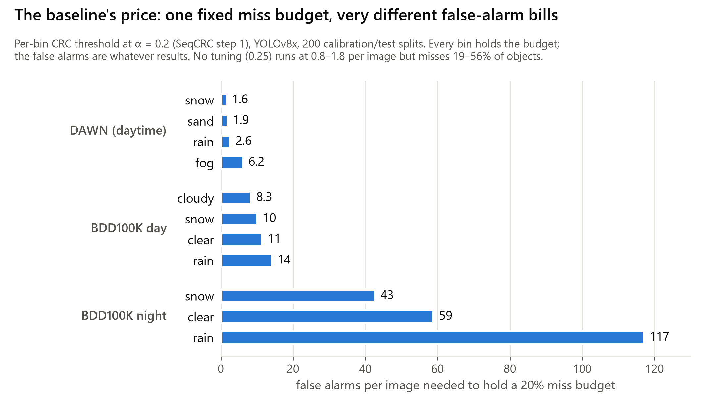
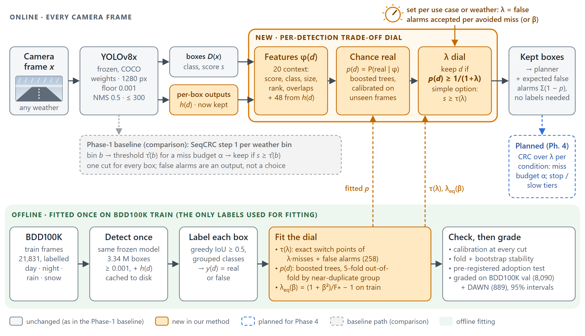

# 00 — Summary: Weather Adaptive Autonomous Driving, as of 2026-10-22

*One page. Every number is traced to a result file in the docs it points to.*

**Project.** A graduate project for CAI 6930 Autonomous Vehicles at FGCU (Nicholas Taylor, Zander Picon). The
question: when a camera's object detector meets bad weather, how should it decide which detections to trust?
The project changes the decision only, without retraining the detector, and states the price of every
choice in false alarms and misses.

## Where it started: the baseline (Phase 1)

SeqCRC's first step calibrates a frozen detector's confidence threshold with conformal risk control (CRC) so the
expected fraction of missed objects stays ≤ α. We reproduced it (the guarantee held 5/5 on COCO) and ran it per
weather bin in our harness (doc 02, doc 05):

- On DAWN with YOLOv8x, α = 0.2 holds in every weather bin (held-out miss 0.188–0.194). One global threshold
  fails in fog (0.251).
- On BDD100K, a threshold calibrated on clear days fails at night (0.28–0.36). Per-bin thresholds restore it.
- **The gap:** the miss budget is fixed and the false alarms are whatever results. They run from 1.6 per image
  (DAWN snow) to **117 per image** (BDD100K rain at night). There is one cut for every box, and the weather must
  be known at run time.

## What we tried first: learning the weather and per-image thresholds (docs 06, 07)

These did not work:
- Weather classifiers and visibility estimators (O3 A/B, v1–v3) did not protect true fog or rain at night.
- Three pre-registered per-image threshold models did not beat one threshold.
- A null simulation explained why. **87–91% of a per-image oracle's advantage is luck**, meaning which boxes
  at a given score happen to be real. The learnable signal is per **detection**.

## The method: a calibrated trade-off dial (doc 08)

Set **λ = false alarms accepted per avoided miss** (or an F-score weight β, mapped to λ). Every setting is the
expected-cost-best rule, fitted once on 21,831 BDD100K **train** frames and graded on BDD100K val and DAWN:
- **Option A, one threshold:** s ≥ τ(λ), exact for every λ.
- **Option B, per detection:** keep a box iff its calibrated chance of being real p(d) ≥ 1/(1+λ). p comes from
  boosted trees on YOLOv8x's own outputs: 20 context features plus 48 per-box features (class probabilities,
  box-edge uncertainty, neck features).

**Results at λ = 10** (recall / precision / false alarms per image; cost ratio vs one threshold, 95% interval):

| condition | one threshold | per detection | cost | no tuning (0.25) | its cost |
|---|---|---|---|---|---|
| BDD100K val, all | 71.3% / 50.1% / 8.59 | 74.4% / 51.4% / 8.49 | ×0.910 (0.906–0.915) | 56.7% / 81.7% / 1.54 | ×1.244 |
| BDD100K night | 62.1% / 42.1% / 8.76 | 67.6% / 41.5% / 9.76 | ×0.903 (0.897–0.909) | 43.4% / 76.6% / 1.36 | ×1.249 |
| BDD100K rain at night | 58.4% / 38.7% / 8.96 | 63.4% / 38.6% / 9.78 | ×0.918 (0.897–0.941) | 41.3% / 74.6% / 1.36 | ×1.183 |
| DAWN fog | 78.6% / 65.3% / 2.80 | 78.6% / 71.6% / 2.09 | ×0.956 (0.921–0.989) | 68.1% / 85.9% / 0.75 | ×1.290 |

Across all conditions and presets, per detection costs 0.87–0.96× one threshold on BDD100K and 0.90–0.97× on
DAWN. F1 on all of BDD100K val is 0.701 per detection, against 0.672 for one threshold and 0.670 for no tuning.

**Statistical backing:**
- **Calibration error:** 0.11 points on BDD100K val. Near each cut the share actually real matches the cut
  (52.1 / 25.1 / 9.6 / 3.4 / 1.1% at 50 / 25 / 9.1 / 3.2 / 1.0%).
- **Fold stability:** 5-fold out-of-fold estimates grouped by near-duplicate group.
- **Uncertainty:** 95% image-bootstrap intervals.
- **Pre-registration:** model 2 was adopted under pre-registered criteria, all three met.
- **Caveat:** DAWN fog under-states the chance a box is real (17% real at the 9.1% cut).

## Next (Phase 4, due Nov 5; doc 10 §8)

- **CRC over λ:** the baseline's guarantee applied to the dial, to certify a miss budget per condition at a
  lower false-alarm price.
- **Four ablations:** (a) feature groups, (b) per-condition recalibration, (c) training size, (d) detector
  transfer (NRP A100).
- **Write-up.**

## Where to look

| need | go to |
|---|---|
| Phase 3 slides and Overleaf section | doc 10, `slides/outline.md`, `latex/methodology.tex`, `figures/phase3/` |
| the method in full | doc 08 (+ the interactive page, doc 09) |
| the baseline and the literature | doc 02 |
| every CRC number | doc 05; data and protocol: doc 03 |
| what was tried and why it failed | docs 06, 07 |
| how to reproduce anything | doc 04 |
| decisions, open items, terms | docs 11, 12, 13 |
