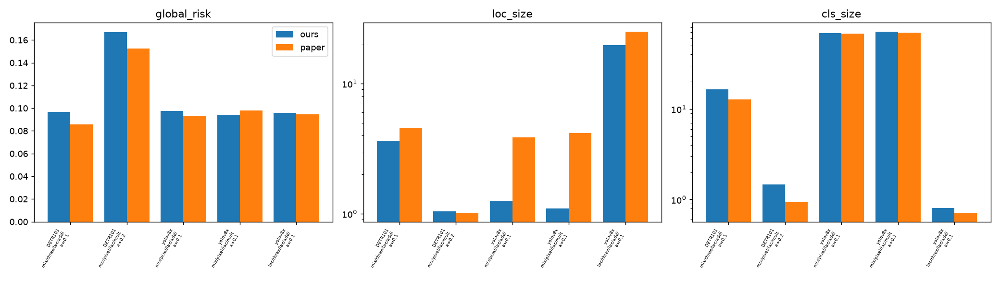
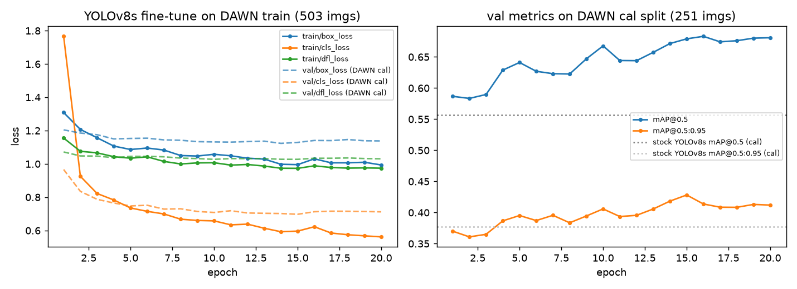
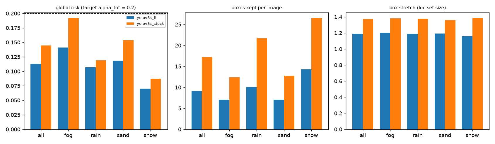
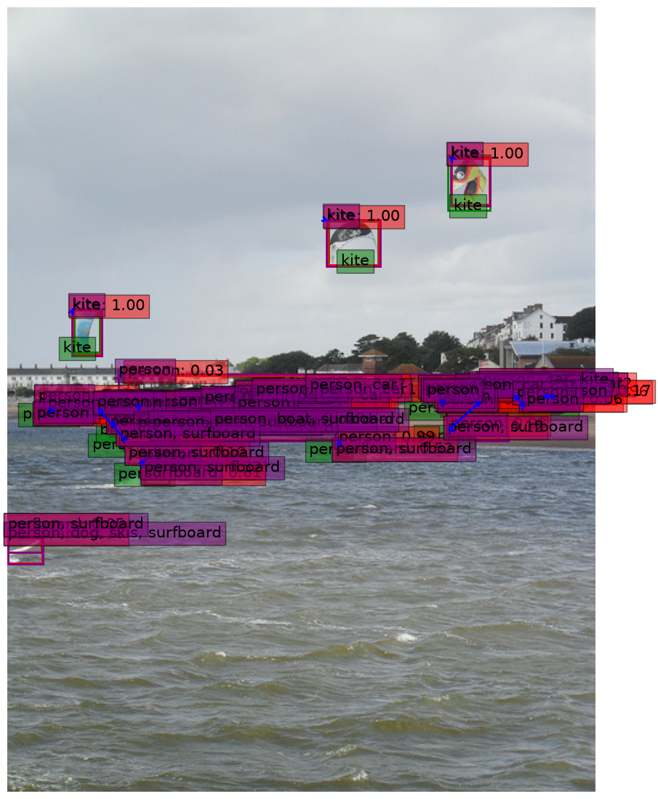
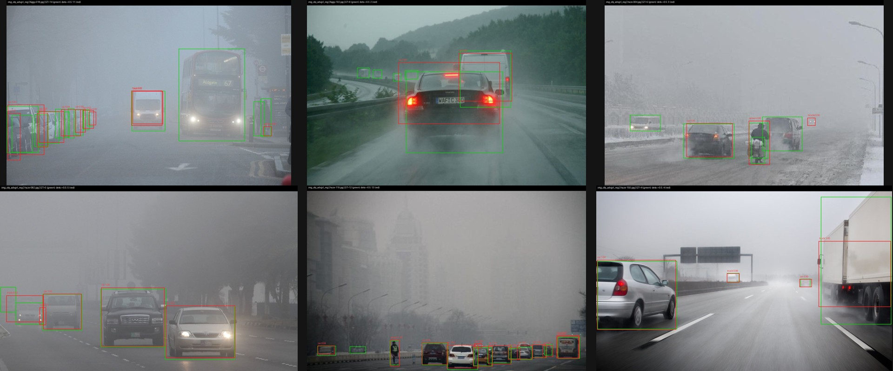
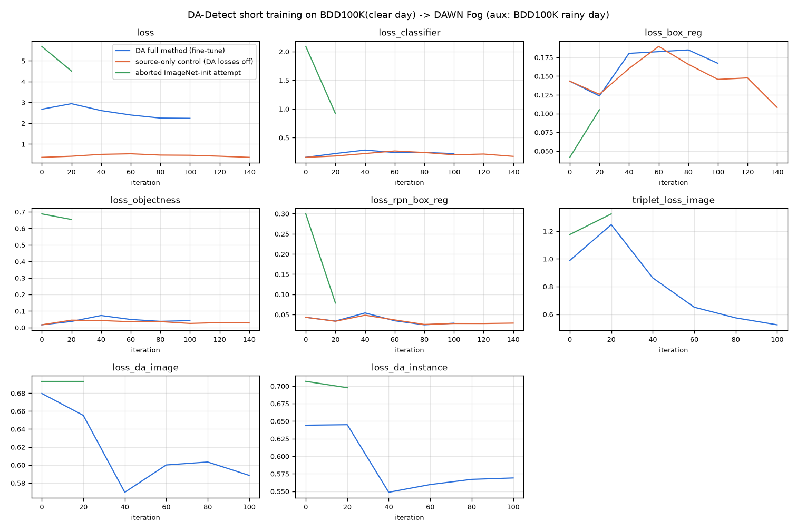

# 02 — Literature review and the Phase 1 baseline

*Sources, all in `Downloads\weather adaptive lit review\`:*
- *the literature review (LR), `deliverables\Literature_Review_Overleaf\main.tex`, byte-identical to the submitted PDF;*
- *the reproducibility write-up (RW), `part2\writeup_final\repro_writeup.tex`, with its evidence reports `part2\_repro\{cods,DA-Detect}\results.md`;*
- *the two papers in `papers\`, and the SeqCRC and proposal decks.*

*Paper equation numbers are the papers' own. The LR cites SeqCRC arXiv v2. Phase 1 figures are copied to
`figures/phase1_reproduction/`, the LR's TikZ diagrams to `latex/phase1_tikz/`, and its bibliography to
`latex/refs_litreview.bib` (33 keys).*

> **In short.**
> - Two papers, one at each layer the project joins. **DA-Detect** (WACV 2023) adapts a Faster R-CNN to synthetic fog: perception. **SeqCRC** (arXiv 2025) calibrates a frozen detector's thresholds with a finite-sample guarantee: decision.
> - Phase 1 reproduced both. SeqCRC's guarantee held in 5/5 COCO runs. DA-Detect builds and runs, but on DAWN's real fog its full model is not better than its own baseline: 20.41 vs 21.44 AP@50, difference −1.03 (−4.46 to +1.68).
> - **The gap:** DA-Detect leaves the operating point open. SeqCRC leaves the weather out (i.i.d.) and prices no false positives.
> - **The Phase 3 baseline** is SeqCRC's first step (a CRC confidence threshold with an image-level miss loss), calibrated per weather bin on frozen YOLOv8. Its key limitation: the trade-off is fixed by α and the false-alarm cost is only reported afterwards. It is never chosen, and every box in a bin gets the same cut.

---

## 1. The two papers at a glance

| | DA-Detect (Paper A) | SeqCRC (Paper B) |
|---|---|---|
| citation | Li, Xu, Ma, Zou, Ma, Yu. *Domain Adaptive Object Detection for Autonomous Driving under Foggy Weather.* WACV 2023, pp. 612–622. arXiv:2210.15176 | Andéol, Mossina, Mazoyer, Gerchinovitz. *Conformal Object Detection by Sequential Risk Control.* arXiv:2505.24038 (v2, 31 Oct 2025; preprint) |
| BibTeX key | `li2023dadetect` | `andeol2025seqcrc` |
| code | github.com/jinlong17/DA-Detect @ `3f1f0ff` (MIT; maskrcnn-benchmark) | github.com/leoandeol/cods @ `269ff11` |
| layer | perceive: make the detector better in fog | decide: calibrate a frozen detector's output |
| changes | trains the detector (adversarial alignment + triplet regulariser) | trains nothing; calibrates 3 scalars |
| guarantee | none | finite-sample, E[loss] ≤ α, marginal over i.i.d. data |
| evaluated on | Foggy Cityscapes (one synthetic density), KITTI | MS-COCO val2017 (2,500 / 2,500) |
| headline | 42.34 vs 38.43 mAP@0.5 over its own GRL baseline | global risk at or under α^tot in 370 of 376 runs (largest exceedance 0.1061 vs 0.1) |
| what it leaves open | the operating point; what it misses and how many false positives it admits at any threshold | weather and shift; false positives; per-condition validity |

LR synthesis: "DA-Detect trains a 33.1 M-parameter detector to raise mAP under one synthetic shift and calibrates
nothing; SeqCRC trains nothing and calibrates three scalars to bound an expected loss under the assumption that there
is no shift. Neither supplies what a car in changing weather needs: an operating point chosen per condition, with its
miss rate and its false-positive cost both stated."

## 2. Paper A — DA-Detect

**What it does.** Unsupervised domain adaptation of a camera-only 2-D Faster R-CNN, from labelled clear Cityscapes
to unlabelled Foggy Cityscapes. It adds two pieces:
1. **Image-level and object-level domain classifiers**, trained adversarially through **AdvGRL**. AdvGRL is a
   gradient-reversal layer that pushes harder on "hard" examples.
2. A **domain-level metric regulariser**: triplet losses that use a synthetic rainy auxiliary domain.

All adaptation modules are removed at test time. The claimed gap is that earlier adaptation ignored per-sample
difficulty and the feature distance to a third, related domain.

**Architecture** (redrawn in `latex/phase1_tikz/fig_dadetect.tex`):
- Backbone: ImageNet ResNet-50 (C4) up to res4, with the stem and res2 frozen. It outputs F, 1,024 channels at stride 16.
- RPN: 15 anchors per location; 2,000 proposals per image in training, 1,000 at test.
- RoI head: 14×14 RoI pooling, then res5, giving f of 2,048 dimensions per RoI. 8 classes plus background.
- Domain classifiers: 2 conv layers at image level (per location) and 3 FC layers at object level (per RoI). They see source and target only; the auxiliary domain enters only the triplet loss.
- Code evaluation settings: score floor 0.05, NMS IoU 0.3, at most 100 boxes, test size 600/1200.

**Key equations** (paper numbering):

| eq. | content |
|---|---|
| 1 | L_img = −Σᵢ [Gᵢ log Pᵢ + (1−Gᵢ) log(1−Pᵢ)], with G = 1 for source and 0 for target |
| 2 | L_obj = −Σᵢ Σⱼ [Gᵢⱼ log Pᵢⱼ + (1−Gᵢⱼ) log(1−Pᵢⱼ)] |
| 3–4 | GRL: forward R(v) = v; backward dR/dv = −λI |
| 5 | **AdvGRL:** λ_adv = min(λ₀/L_c, β) if L_c < α, else λ₀ (λ₀ = 1, α = 0.63, β = 30) |
| 6 | d(F^S, F^T) < d(F^S, F^A): anchor = source, positive = fog, negative = rain |
| 7 | L^R_img = max(d(F^S,F^T) − d(F^S,F^A) + δ, 0), δ = 1.0, Euclidean distance, no GRL |
| 8 | the same on per-RoI features (dropped for unaligned pairs such as KITTI) |
| 9 | **L = L_cls + L_reg + w(L_img + L_obj + L^R_img + L^R_obj), w = 0.1**; there is no consistency term |

The LR notes that α = 0.63 equals binary cross-entropy on *logits* 0.7/0.3, not on probabilities. L_c is computed
once per iteration, and λ jumps from 1 to about 1.59 at L_c = α.

**Training.**
- Paper: SGD (momentum 0.9, weight decay 5×10⁻⁴); one image per domain per iteration; learning rate 0.01 for 50k iterations, then 0.001 for 20k; one RTX 3090 (24 GB).
- The released config differs:
  - it targets Cityscapes→BDD100K;
  - learning rate 0.001, cosine schedule, 33,200 warm-up iterations, 170k iterations;
  - ALIGNMENT off; L^R_obj weight 0;
  - timm is required but not listed;
  - checkpoints exist for only 4 rows of Table 2, and there is no source-only checkpoint.

**Datasets:**

| dataset | size | conditions | role |
|---|---|---|---|
| Cityscapes | 2,975 train / 500 val; 2048×1024; 8 classes | clear daytime, 27 cities | labelled source |
| Foggy Cityscapes | the same images, re-rendered | homogeneous synthetic fog at the densest level (β = 0.02 in code; visibility about 150 m) | unlabelled target **and** test set (val); clear-weather boxes kept even where fog hides the object |
| Rainy Cityscapes | one RainMix copy per source image | Garg & Nayar rain streaks | triplet negative only; never evaluated |
| KITTI | 7,481 images, car only | clear weather, different camera | adaptation target and test set at once (transductive) |

**Reported numbers.**

Table 2, ablation on Cityscapes→Foggy val (mAP@0.5):

| configuration | mAP@0.5 |
|---|---|
| source only | 23.41 |
| img + GRL | 38.10 |
| obj + GRL | 38.02 |
| img + obj + GRL ("baseline") | 38.43 |
| img + obj + AdvGRL | 40.23 |
| img + obj + GRL + Reg | 41.97 |
| full model | 42.34 |

- Over the baseline, the regulariser alone adds +3.54, AdvGRL alone +1.80, and both +3.91.
- Table 3, Cityscapes→KITTI car AP: 74.38, against comparators at 65.36–73.70.
- Sensitivity: w = 0.1 / 0.01 / 0.001 gives 42.34 / 41.30 / 41.19. AdvGRL (β, α) settings give 38.83–42.34.
- Not reported: parameter counts, FLOPs, FPS, training time, seeds, variance, and recall or false positives at any threshold.

**Cost** (LR, counted from the released checkpoints):
- The deployed detector has 33,062,200 parameters; the domain classifiers add 3.67 M in training only.
- About 806 G multiply-adds per image at 600×1200 with 1,000 proposals, 732 G of them in the res5 head.
- Model-zoo speed is 5.8–9.8 FPS on a V100. The LR estimates about 10 FPS on a Jetson AGX Orin and calls that optimistic.

**The LR's verdict:**
- "Our judgement is that DA-Detect is a sound, modest improvement to adversarial alignment whose evidence is weaker than its headline."
- "Nothing in the method controls either error."
- "Adaptation improves the input to the decision layer; it does not replace it."

## 3. Paper B — SeqCRC

**Versions.**
- v1 (29 May 2025, DETR-50) is the version the SeqCRC deck quotes.
- v2 (31 Oct 2025, DETR-101) is the version the LR cites.
- Affiliations: Institut de Mathématiques de Toulouse, SNCF, IRT Saint Exupéry.

**What it does.** Post-hoc, model-agnostic calibration of three detector parameters, with finite-sample
guarantees from one calibration split:
- λ^cnf: keep a box if its score ≥ 1 − λ^cnf;
- λ^loc: a box margin, in pixels (additive) or relative (multiplicative);
- λ^cls: a class-set parameter (LAC or APS).

Plain CRC handles one scalar. SeqCRC handles one parameter followed by two that depend on it.

**Assumptions.**
1. Calibration and test data are i.i.d. The detector f is deterministic and has not seen them.
2. Each loss Lᵢ lies in [0, B], is non-increasing and right-continuous, and Lᵢ(λ̄) = 0 almost surely.

**The CRC rule** (Angelopoulos et al., ICLR 2024; paper Eq. 1). Note the **inf over λ**:

  λ̂ = inf{ λ ∈ Λ : n/(n+1) · R̂ₙ(λ) + B/(n+1) ≤ α },  with R̂ₙ(λ) = (1/n) Σᵢ Lᵢ(λ)

**Theorem 1.** α − 2B/(n+1) ≤ E[L_test(λ̂)] ≤ α, for α ≥ B/(n+1). The lower bound needs an extra continuity assumption.

**The sequential steps:**

| step | content |
|---|---|
| Eq. 3 | the confidence step controls R̃^cnf = max{R^cnf(λ^cnf), R^loc(λ^cnf, λ̄^loc), R^cls(λ^cnf, λ̄^cls)} |
| Eqs. 4–5 | λ^cnf₊ uses the reserve B̃^cnf (conservative; deployed). λ^cnf₋ uses reserve 0 ("optimistic"; used inside step 2) |
| Eq. 6 | λ^•₊ = inf{λ^• : n/(n+1) R^•(λ^cnf₋, λ^•) + B^•/(n+1) ≤ α^•}, for • ∈ {loc, cls}, in parallel |
| Thm 2 | if α^• ≥ α^cnf + B^•/(n+1), then E[L^•] ≤ α^• (Eq. 7); E[L^cnf] ≤ α^cnf (Eq. 8) only if L^cnf(λ̄^cnf) ≤ α^cnf almost surely |
| Cor. 1 | E[max(L^loc, L^cls)] ≤ α^tot = α^loc + α^cls (Eq. 9) |

**Monotonisation.** Matching makes the step-2 losses non-monotone in λ^cnf, so each is replaced by its sup over
λ′ ≥ λ^cnf. This keeps validity but grows the sets.

**Losses.**
- Confidence:
  - box-count-threshold: 1 if fewer boxes are kept than there are objects;
  - box-count-recall: (|y| − |Γ|)₊ / |y|.
- Localisation: thresholded, box-wise recall, pixel-wise. Sets are additive or multiplicative.
- Classification: LAC and APS sets.
- An image with no ground truth has loss 0; an image with no surviving box has loss B.
- Matchings: Hausdorff, LAC, Mix, GIoU.
- **The guarantee is per image, not per object.**

**Algorithms.**
- Alg. 1 (calibration), in order:
  1. Define the prediction sets and losses.
  2. Run the detector on the calibration images.
  3. Calibrate confidence with Eqs. 4–5, via Alg. 3 (a sweep over sorted scores).
  4. Match ground truth to predictions.
  5. Calibrate λ^loc and λ^cls, via Alg. 4 (binary search).
- Alg. 2 (inference): threshold the boxes, then build the localisation and classification sets in parallel.

**Experiments.**
- Data: COCO val2017, 5,000 images split n = 2,500 calibration / 2,500 test; one split.
- Detectors: YOLOv8x (68 M parameters) and DETR-101 (60 M).
- Preprocessing: NMS 0.5; scores below 10⁻³ dropped.
- Budgets: α^tot = 0.1 with (α^cnf, α^loc, α^cls) = (0.02, 0.05, 0.05); α^tot = 0.2 with (0.03, 0.1, 0.1).
- 376 runs. Metrics are risks and set sizes; **precision and false positives per image are not reported.**

**Results (v2).**

Table I, DETR-101, α^tot = 0.1:

| loss or set | size | task risk | global risk |
|---|---|---|---|
| box_count_threshold | 25.588 | 0.022 | 0.086 |
| box_count_recall | 17.778 | 0.019 | 0.085 |
| thresholded | 1.552 | 0.046 | 0.097 |
| boxwise | 1.504 | 0.049 | 0.097 |
| pixelwise | 1.043 | 0.047 | 0.096 |
| additive | 1.047 | 0.052 | 0.100 |
| multiplicative | 1.043 | 0.047 | 0.096 |
| APS | 1.007 | 0.050 | 0.082 |
| LAC | 0.994 | 0.051 | 0.087 |

Table III, α^tot = 0.1, risk / size:

| loss or set | DETR-101 | YOLOv8x |
|---|---|---|
| box_count_threshold | 0.022 / 25.588 | 0.012 / 18.855 |
| box_count_recall | 0.019 / 17.778 | 0.019 / 11.710 |
| pixelwise | 0.047 / 1.043 | 0.049 / 3.867 |
| multiplicative | 0.047 / 1.043 | 0.052 / 4.181 |
| LAC | 0.051 / 0.994 | 0.049 / 0.717 |

- 6 of the 376 global risks exceed α^tot; the largest is 0.1061 against 0.1.
- The calibrated box-count-recall threshold at α^cnf = 0.02 is 0.074.
- Calibration takes about 20 min per experiment on an RTX 4090, mostly in monotonisation.

**Authors' own limitations:**
- false positives and precision are not controlled;
- monotonisation inflates the sets;
- COCO label noise forces large corrections;
- the global bound is conservative;
- set sizes are heavy-tailed;
- the guarantee is marginal only.

The only nod to shift is that calibrating on COCO val is "potentially breaking Assumption 1".

**The LR's verdict:**
- "It bounds a count, not a miss rate."
- "The theorem transfers to any domain under its assumption; the numbers do not."
- "A car in changing weather violates this twice: consecutive frames are strongly dependent, and the current weather is not a random draw from the calibration mixture but a condition that persists for minutes and may be rare in the calibration set."
- "A marginal guarantee can hold on the pool and fail in the condition that matters."
- Three structural weaknesses: design choices dominate the outcome, set size inherits detector quality, and only one error type is controlled.

## 4. Phase 1 reproduction (Assignment 1, Part 2)

**Repositories:**
- Repo 1: `cods` @ `269ff11a…`. The write-up calls it "our project's base paper".
- Repo 2: DA-Detect @ `3f1f0ff0…`, the planned second detector (O5).

**Compute:** one laptop with Windows 11, a Ryzen 7 4800H, 16 GB RAM and an RTX 3050 Ti (4 GB). Both repos shared it,
so all timings are contended. Cityscapes and Foggy Cityscapes need an account, so DAWN and BDD100K stood in for them.

### 4.1 cods (SeqCRC)

**Setup.**
- `uv pip install -e .` took 191 s. Tests: 25 passed, 0 failed (217 s).
- Problems found and fixed:
  1. A HEAD bug: `build_predictions` wraps each list in a 1-tuple and breaks the cached reload (8-line patch).
  2. YOLO letterbox mis-scaling: at IoU ≥ 0.75, 0.506 of ground truth matched vs 0.567 with padding undone. Fixed by running batch 1.
  3. A Windows `__main__` guard was needed.
  4. DETR-R101 at batch 4 overflowed the 4 GB GPU; batch 1 was used.
  5. Calibration is CPU-bound. A YOLOv8x run at n_cal = 2,500 had not finished its first sweep after 52 min, so calibration used **500** images, and testing used the full 2,500.

**COCO, ours (n_cal = 500) vs paper (n_cal = 2,500).** Config = matching / confidence loss / localisation loss / margin.

| detector, α^tot | config | run | conf. size | loc. size | cls. size | global risk |
|---|---|---|---|---|---|---|
| DETR-101, 0.1 | mix / bct / thresholded / add. | ours | 27.87 | 3.630 | 16.44 | 0.097 |
| | | paper | 25.59 | 4.565 | 12.77 | 0.086 |
| DETR-101, 0.2 | mix / bct / pixelwise / mult. | ours | 24.22 | 1.042 | 1.47 | 0.167 |
| | | paper | 22.66 | 1.018 | 0.93 | 0.152 |
| YOLOv8x, 0.1 | mix / bcr / pixelwise / add. | ours | 11.02 | 1.251 | 68.78 | 0.098 |
| | | paper | 11.71 | 3.867 | 67.58 | 0.093 |
| YOLOv8x, 0.1 | mix / bct / pixelwise / mult. | ours | 17.35 | 1.092 | 71.14 | 0.094 |
| | | paper | 18.86 | 4.181 | 69.88 | 0.098 |
| YOLOv8x, 0.1 | lac / bct / thresholded / add. | ours | 17.35 | 19.68 | 0.81 | 0.096 |
| | | paper | 18.86 | 25.04 | 0.72 | 0.095 |

*Global risk, localisation set size (log) and class set size (log) for the five configurations: ours (blue, n_cal =
500) against the paper (orange, n_cal = 2,500).*

**The write-up's reading:**
- **The guarantee reproduces**: global risk is under α^tot in all 5 runs.
- Localisation risks sit at or just above their own budget: 0.057–0.064 vs 0.05, and 0.110 vs 0.1.
- DETR's class sets are 29–58% larger than the paper's.
- YOLOv8x's localisation stretch is 3–4× smaller (1.25 vs 3.87). The suspected cause, not verified, is the letterbox bug.
- Calibration is the method's "training": 17–20 min per DETR configuration and 62–76 min per YOLOv8x configuration at n = 500.

**YOLOv8s fine-tuned on DAWN** (the "training" part of the assignment):
- Split: 50/25/25, group-aware, stratified, seed 0. Train 503, calibration 251, test 251.
- Training: 20 epochs at 640, batch 16, AdamW with lr 0.000119 (auto), wall time 934 s.

| YOLOv8s | P | R | mAP@0.5 | global risk (α^tot = 0.2) | boxes/img | classes/obj |
|---|---|---|---|---|---|---|
| stock (COCO) | 0.569 | 0.427 | 0.461 | 0.145 | 17.18 | 2.39 |
| fine-tuned on DAWN | 0.547 | 0.553 | **0.533** | **0.113** | 9.11 | 1.19 |

*Training and validation losses over 20 epochs (503 images); validation mAP on the 251 calibration images, with the
stock model dotted.*

**SeqCRC on DAWN per weather.**
- Config: mix / box_count_recall / pixelwise / LAC / additive, α^tot = 0.2 with (0.03, 0.1, 0.1).
- Calibrated on 251 images, tested on 251.

| detector | weather | n | boxes/img | loc risk | cls risk | global risk | stretch | cls size |
|---|---|---|---|---|---|---|---|---|
| fine-tuned | all | 251 | 9.108 | 0.082 | 0.063 | 0.113 | 1.189 | 1.188 |
| fine-tuned | fog | 73 | 7.055 | 0.083 | 0.094 | 0.141 | 1.203 | 1.154 |
| fine-tuned | rain | 48 | 10.083 | 0.100 | 0.036 | 0.107 | 1.191 | 1.165 |
| fine-tuned | sand | 79 | 7.089 | 0.085 | 0.071 | 0.118 | 1.194 | 1.240 |
| fine-tuned | snow | 51 | 14.255 | 0.058 | 0.029 | 0.070 | 1.159 | 1.176 |
| stock | all | 251 | 17.183 | 0.093 | 0.093 | 0.145 | 1.375 | 2.387 |
| stock | fog | 73 | 12.438 | 0.139 | 0.121 | 0.192 | 1.382 | 2.336 |
| stock | rain | 48 | 21.708 | 0.097 | 0.071 | 0.119 | 1.379 | 2.471 |
| stock | sand | 79 | 12.785 | 0.082 | 0.100 | 0.153 | 1.360 | 2.440 |
| stock | snow | 51 | 26.529 | 0.040 | 0.064 | 0.087 | 1.386 | 2.299 |

*Global risk (budget 0.2 dashed), boxes kept per image and box stretch, per weather: fine-tuned (blue) vs stock
(orange) YOLOv8s. Fog sits closest to the budget, and fine-tuning halves the sets.*

- Calibrated confidence threshold: 0.0135 (stock) → 0.1098 (fine-tuned).
- Box margin: 10.13 → 7.20 px.

*DETR-101 at α^tot = 0.2 on a COCO image. Green: ground truth. Red: kept boxes. Purple: conformal boxes with their
class sets (e.g. "person, surfboard").*

### 4.2 DA-Detect

**Setup.**
- A native Windows build is not viable, so the Linux image `pytorch/pytorch:1.10.0-cuda11.3-cudnn8-devel` was used (21.6 GB pull, 12 min); the build took 292 s.
- Fixes needed:
  - a `FORCE_CUDA` patch, because the CUDA ops are skipped when no GPU is visible during the build;
  - **AdvGRL crashes** on `adv_threshold.numpy()` for a CUDA tensor, as soon as the hard-example branch fires (fixed with `float(...)`);
  - apex is not needed, despite the README;
  - timm is needed but not listed.
- All 4 released checkpoints load, with zero missing keys.
- Training needs a GPU: the domain-adaptation losses hard-code CUDA tensors.

**Testing on DAWN Fog** (283 images, mapped to the 8-class space; DAWN has no rider or train, so means are over 6 classes):

| checkpoint | paper (Foggy CS) | DAWN Fog AP@50 | person | car | truck | bus | mcycle | bicycle |
|---|---|---|---|---|---|---|---|---|
| Img+Obj+AdvGRL+Reg (full) | 42.34 | **20.41** | 29.7 | 44.6 | 8.9 | 16.1 | 7.4 | 15.7 |
| Img+Obj+AdvGRL | 40.23 | 22.78 | 35.3 | 49.7 | 9.1 | 14.6 | 11.0 | 17.0 |
| Img+Obj+GRL (baseline) | 38.43 | **21.44** | 30.2 | 44.8 | 7.6 | 15.4 | 11.9 | 18.8 |

- Paired image bootstrap (200 resamples): full minus baseline = **−1.03 (95% CI −4.46 to +1.68)**, P(full > baseline) = 0.235.
- Speed here was 3.15–4.43 s/image, against the authors' 0.218 s/image on an RTX 3090.

*Six DAWN fog images, full DA-Detect model, detections ≥ 0.5. Distant objects are missed.*

**Training (short run).**
- An ImageNet-initialised run took 14.4 s/iteration and was aborted.
- Instead the released GRL weights were fine-tuned:
  - 400/667 px input, one image per domain;
  - source: BDD100K clear day (3,250 images); auxiliary: BDD100K rainy day; target: DAWN fog, unlabelled;
  - stopped at 101 iterations.
- A **matched source-only control** used the same seed, data order and schedule, with every DA weight set to 0.

| model | AP | AP@50 | person | car |
|---|---|---|---|---|
| initial (released Img+Obj+GRL) | 12.02 | 21.44 | 30.2 | 44.8 |
| + 101 iterations, source-only | 13.56 | **28.60** | 35.5 | 50.2 |
| + 101 iterations, DA full method | 5.92 | **12.49** | 11.9 | 35.6 |

- DA minus source-only: −16.11 (95% CI −20.58 to −11.12).
- The evaluation is transductive: training and testing use the same unlabelled fog images. The run is far too short to judge the method.

*Loss panels for the DA run, the source-only control and the aborted ImageNet run.*

### 4.3 Comparison and conclusion

| | cods (SeqCRC) | DA-Detect |
|---|---|---|
| stack | modern: Python 3.10+, torch 2.x, pip-installable | 2019 maskrcnn-benchmark fork: torch 1.x, custom C++/CUDA ops |
| setup | 191 s install; tests pass | 12 min image pull + 5 min compile, in Docker (Linux only) |
| fixes | 1 code bug; Windows `__main__` guard | FORCE_CUDA patch; AdvGRL crash; wrong apex instruction; timm unlisted |
| testing | reproduced on the paper's data; guarantee holds in 5/5 runs | paper's data unavailable; on real fog the gain disappears (20.41 vs 21.44) |
| training | no weights to train; calibration CPU-heavy (17–76 min per config at n = 500); YOLOv8s fine-tune +7.2 mAP points, sets halved | loop runs after one fix; DA losses hurt early (12.49 vs 28.60 source-only) |
| match to paper | good for validity, partial for set sizes | not testable on its benchmark; does not transfer to real fog |
| use in our project | reference implementation of the CRC rule; our faster harness does per-bin calibration | builds and runs, so O5 is feasible; its fog weights are no better than baseline on DAWN |

**Verbatim conclusion** (RW): "For our project this means: keep SeqCRC's first step as the calibration rule,
calibrate per weather bin, and treat DA-Detect as an optional detector swap whose value must be measured on real
weather at an operating point, not taken from its Foggy Cityscapes mAP."

**Threats to validity** (RW):
- timings are contended (shared GPU);
- cods used n_cal = 500 and a single split;
- DA-Detect ran on a different domain and label space;
- the DA-Detect training run is far too short.

Phase 1 terminal and log screenshots are also in `figures/phase1_reproduction/`:
`terminal_pytest.png`, `terminal_seqcrc_results.png`, `terminal_train_yolov8s_dawn.png`, `term_01_build_success.png`,
`term_02_test_full_model_dawn_fog.png`, `term_03_training_iterations.png`, and `qual_dawn_yolov8s_ft_a02_2.png` (not
used in the write-up).

## 5. The gap, in the project's own words

**LR abstract:**
> "DA-Detect is a sound but modest gain over its own adversarial baseline (38.43 to 42.34 mAP at IoU 0.5), shown on
> one synthetic fog density and by mAP alone, with no operating point and no guarantee. SeqCRC gives the right kind
> of guarantee, finite-sample and model-agnostic, but shows it on generic COCO images under an i.i.d. assumption
> that changing weather breaks, and it bounds a recall-side loss (a box count at the threshold step, coverage of
> matched objects afterwards) while leaving false positives unpriced."

**LR synthesis, "What each paper leaves open":**
> "DA-Detect leaves the operating point to the user. AP integrates over thresholds, so the paper never states what
> the adapted detector misses, or how many false positives it admits, at the threshold a car would run. [...]
> SeqCRC leaves the weather out. It calibrates once on i.i.d. COCO images, prices no false positives and assumes
> exchangeability, which persistent weather and dependent frames both break. Our run 1 shows the consequence: one
> threshold calibrated on the pooled DAWN mix meets the budget on the pool while fog exceeds it in all 10 splits."

**LR introduction, why recall first:**
> "The design is recall-first because the two errors are not symmetric in bad weather." "A miss also leaves no trace
> at run time, so the only defence is an open-loop margin in speed and gap, set from an estimate of how much the
> detector misses in this weather."

**Proposal, research gap (slide 4):**
> "Adverse-weather detectors are trained and scored by mAP, then deployed at one fixed confidence threshold with no
> bound on what they miss; conformal methods bound the misses but ignore the weather and never price the false
> positives they add."

**SeqCRC deck:**
- Slide 12, "Missing for us": recall only; one distribution; fragile in practice.
- Slide 13: "Not covered: False positives, weather, per-class budgets — The point of the project".

**LR, "How our design answers"** (the four answers, Oct 10):
1. a weather-conditional threshold, SeqCRC's step 1 per hazard bin;
2. a price (FPPI) for every budget;
3. a tiered output (confirmed / possible, with m(b));
4. an optional detector swap (DA-Detect).

Open questions listed there:
- Do adaptation and thresholding stack?
- Does an estimator that separates visibility, or a strictest-bin rule, extend validity to true fog?
- Is an upper bound on m(b) tight enough to set a useful speed?
- Does video need non-exchangeable CRC?

## 6. The Phase 3 baseline, stated precisely

**What "the Phase 1 reproduced model" is.** SeqCRC's **first step** is conformal risk control of the confidence
threshold, reproduced with `cods` in Phase 1. Following the Phase 1 conclusion, it is **run once per weather bin**
on a frozen COCO YOLOv8, with the image-level IoU-matched miss fraction as the loss. In the harness's notation, with
λ = 1 − τ:

  **τ̂(b) = max{ τ on the 200-point grid : n_b/(n_b+1) · R̂(τ; b) + 1/(n_b+1) ≤ α }**

Here R̂(τ; b) is the mean per-image fraction of ground-truth objects in bin b with no match at score ≥ τ. If no τ
qualifies, the fit is *infeasible* and τ̂ falls to the 0.001 floor. The detector, matching and splits are as in doc 03.

**Its numbers** (doc 05 has every table):

| setting | result |
|---|---|
| run 1: YOLOv8s @640, class-aware loss, DAWN 1,005 images, 10 splits | α = 0.1 infeasible in every bin (floor miss 0.12–0.22). At α = 0.2, the feasible oracle bins (rain, sand, snow) miss 0.191–0.215 at 9.5–30.1 FPPI; fog is infeasible (0.214 at 37.7 FPPI). Global threshold: fog 0.242, above α in 10/10 splits. |
| **run 2 primary: YOLOv8x @1280, grouped loss, clean labels (889 images), 200 splits** | **α = 0.2 per-bin holds in every DAWN bin:** fog 0.191, rain 0.188, sand 0.194, snow 0.192, at **1.6–6.2 FPPI**. Mean τ̂: fog 0.025 vs snow 0.252, a tenfold spread. **The global threshold fails in fog** (0.251, above α in 98% of splits). Default 0.25 misses 0.19–0.30 at 0.75–1.61 FPPI. Smallest certifiable α: fog 0.148, rain 0.114, sand 0.094, snow 0.078. |
| BDD100K val control, YOLOv8x @1280 grouped | A threshold calibrated on clear daytime **fails every night bin** (0.321 / 0.357 / 0.279, 100% of splits). Per-bin CRC restores α = 0.2 at **59 / 117 / 43 FPPI** (clear / rain / snow night). |

**Its key limitation, which is the gap the method addresses:**
1. **The false-alarm cost is an output, not a choice.** The baseline fixes α and *reports* FPPI afterwards. That
   price ranges from 1.6 FPPI in DAWN snow to 117 in BDD100K rain at night. Nothing lets a user say how many false
   alarms one avoided miss is worth for their vehicle, camera set-up or redundancy. This is SeqCRC's "false positives
   unpriced", still unsolved.
2. **Every box in a bin gets the same cut.** One threshold per bin treats two boxes with the same score
   identically, even when one sits on the road ahead and the other is a reflection. The luck-vs-structure analysis
   (doc 07 #5) shows that the learnable pattern is per **detection**, not per image or per weather.
3. **The weather bin must be known.** Per-bin validity needs the bin at run time. Predicted bins (O3, visibility
   v1–v3) do not protect true fog or rain at night (doc 06).
4. **Marginal, i.i.d. guarantee.** Validity is in expectation over exchangeable frames within a bin. It is not per
   frame and not for dependent video, and α = 0.1 is often infeasible.

**What the method changes.** Doc 08 and doc 10 give the detail.
- The trade-off becomes the input: λ, the false alarms accepted per avoided miss, or β in Fβ units.
- Every λ maps to an expected-cost-optimal rule fitted once on BDD100K train. It is either one threshold, or a
  per-detection cut p(d) ≥ 1/(1+λ) on a calibrated chance that each box is real, built from YOLOv8x's own per-box
  outputs.
- The CRC baseline stays available on top: because both options are nested in λ, CRC can calibrate λ itself per
  condition to certify a miss budget ("CRC over λ", planned for Phase 4).
