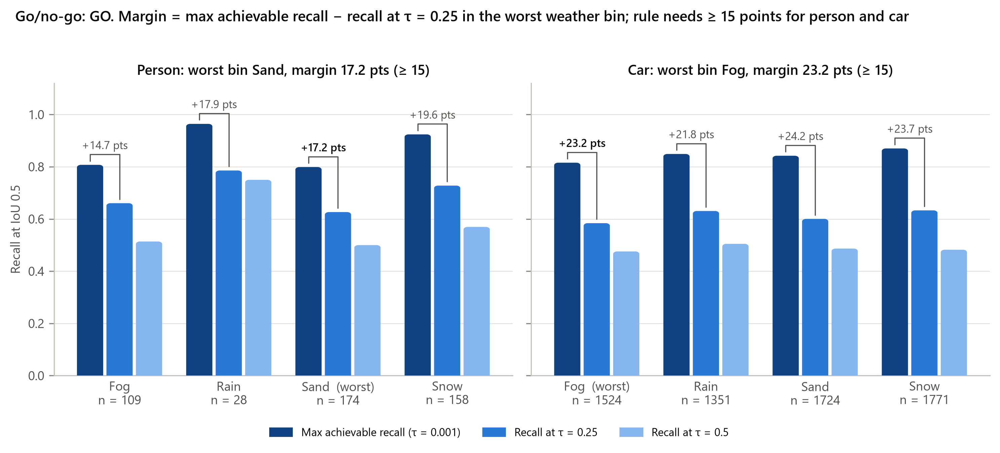
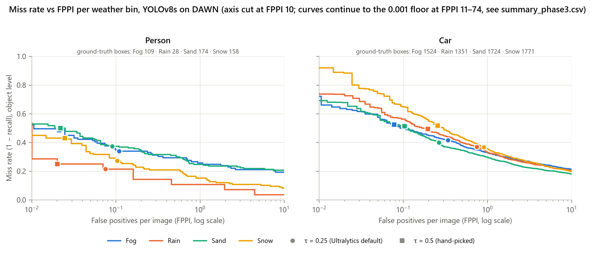
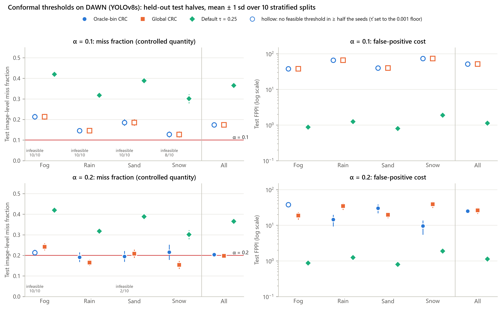
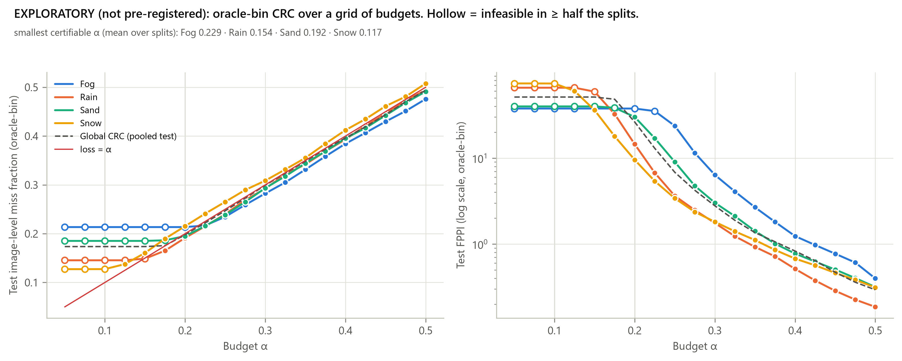
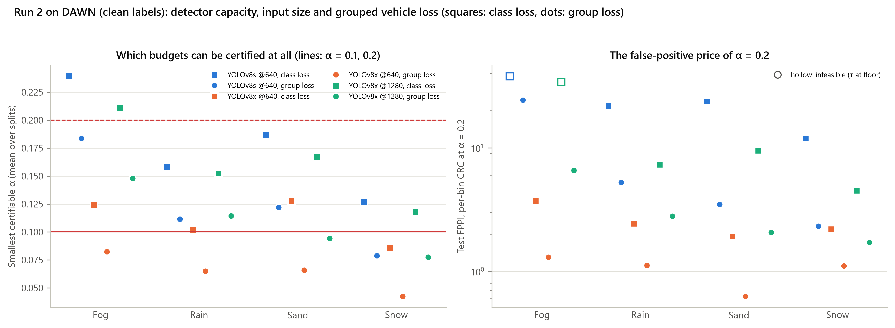
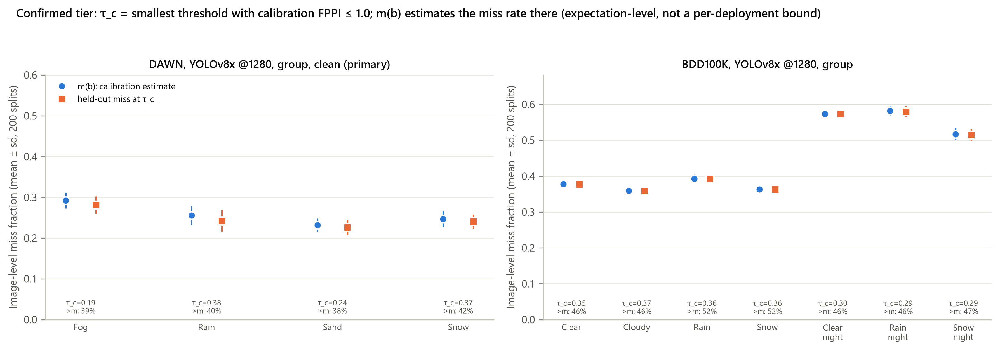
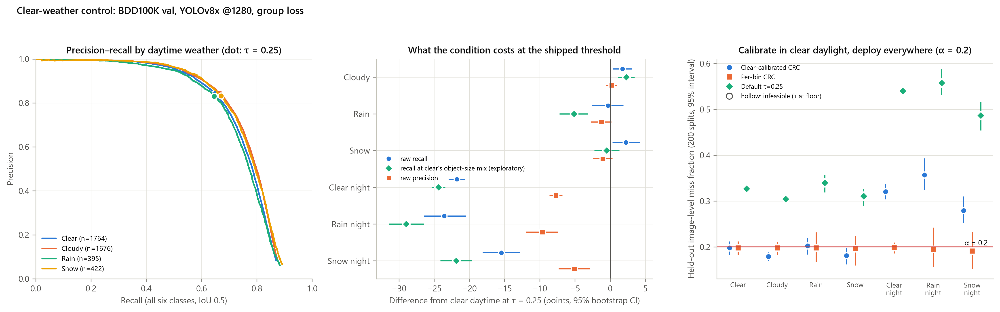
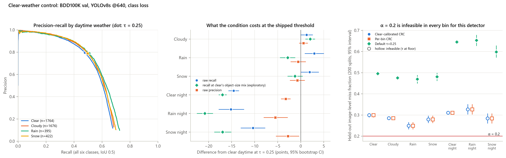
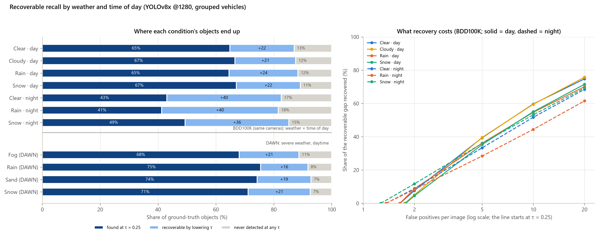
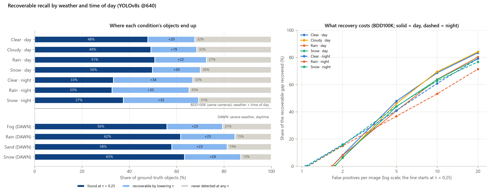

# 05 — Results: weather-conditional CRC (run 1, run 2, the BDD100K clear-weather control)

*Sources: `results/results.md` (run 1, generated by `python -m wad.report`), `results/run2/run2.md` (run 2 and
the control, generated by `python -m wad.run2 report`), `results/run2/dawn_variants.csv`, the per-variant
`go_no_go*.json` and `seeds200/*.csv`, `results/run2/recoverable_by_condition.csv`, `PREREG_run2.md`,
`NOTES.md`. Protocol and definitions: `03_data_and_evaluation.md`. This is objectives O1 (harness and
go/no-go) and O2 (oracle-bin CRC policy).*

> **In short**
> - **Go/no-go: GO.** Lowering the threshold below 0.25 recovers 15–24 recall points in DAWN's worst bins.
>   The person verdict is fragile (bootstrap P(GO) 0.64 in run 1, 0.28 for the run 2 primary).
> - **Run 1 (YOLOv8s @640).** α = 0.1 cannot be certified anywhere. At α = 0.2, per-bin CRC holds in rain,
>   sand and snow at 9.5–30 false positives per image (FPPI), against 0.8–1.9 at τ = 0.25.
> - **Run 2 primary (YOLOv8x @1280, grouped loss, clean labels; pre-registered).** At α = 0.2, per-bin CRC
>   **holds in every DAWN bin at 1.6–6.2 FPPI**. One global threshold **fails in fog** (0.251, above α in
>   98% of splits).
> - **BDD100K control.** A threshold calibrated in clear daylight **fails every night bin** (0.28–0.36 miss
>   in 100% of splits). Per-bin calibration restores night only at **43–117 FPPI**.
> - **What follows.** A miss budget is always paid for in false positives, at a price set by the condition.
>   Where to sit on that trade-off is a choice, which is why the method became a dial (`08`).

---

## 1. Run 1 — DAWN, YOLOv8s @640, CPU (2026-10-01)

**Setup.**
- Weights: `yolov8s.pt` (COCO).
- Settings: imgsz 640, confidence floor 0.001, NMS IoU 0.5, max_det 300, one image per pass.
- Detection: 1,005 images in 128 s (0.128 s/image), 57,570 cached boxes.
- Labels and loss: class-aware loss (L-class), all labels.
- Sanity: 3 images with no detection at the floor; median 44 detections per image; 4 images hit max_det.

### 1.1 Go/no-go (phase 3)

**Verdict: GO.**
- Person: worst bin sand (174 objects), max recall 79.9% vs 62.6% at τ = 0.25, a margin of **17.2 points**.
- Car: worst bin fog (1,524 objects), 81.6% vs 58.4%, a margin of **23.2 points**.
- The pre-registered threshold was 15 points.

**Bootstrap** (2,000 resamples of near-duplicate groups within bin): the verdict is GO in **64%** of
resamples (person 64%, car 100%). Sand and fog are a near-tie for person's worst bin (P(worst) 0.56 vs 0.44;
margins 17.2 and 14.7). The person verdict is therefore fragile. Worst-bin margin 95% intervals: person
9.4–24.1, car 20.4–26.0.

*fig2: for each bin and class, the gap between max recall (threshold → 0.001) and recall at 0.25 is what a
lower threshold can recover. It is 15–24 points in every worst bin.*

Per bin, all six classes:

| bin | images | GT | max recall | recall @0.25 | recall @0.5 | margin vs 0.25 (pts) | never matched (pts) | LAMR | MR @1 FPPI | mAP50 |
|---|---:|---:|---:|---:|---:|---:|---:|---:|---:|---:|
| Fog | 283 | 1,894 | 79.4% | 55.9% | 44.9% | 23.5 | 20.6 | 0.644 | 0.429 | 0.499 |
| Rain | 199 | 1,584 | 84.6% | 61.7% | 48.9% | 22.9 | 15.4 | 0.655 | 0.408 | 0.577 |
| Sand | 320 | 2,210 | 81.4% | 58.0% | 46.6% | 23.4 | 18.6 | 0.661 | 0.391 | 0.547 |
| Snow | 203 | 2,061 | 87.1% | 63.3% | 48.4% | 23.8 | 12.9 | 0.730 | 0.447 | 0.612 |
| **All** | 1,005 | 7,749 | **83.1%** | **59.6%** | 47.1% | 23.4 | 16.9 | 0.676 | 0.417 | 0.520 |
| All, person | 1,005 | 469 | 85.3% | 67.8% | 54.2% | 17.5 | 14.7 | 0.345 | 0.207 | 0.717 |
| All, car | 1,005 | 6,370 | 84.5% | 61.2% | 48.7% | 23.3 | 15.5 | 0.550 | 0.327 | 0.740 |

*fig1: miss rate vs false positives per image (log scale) for person and car in each DAWN bin (dots τ = 0.25,
squares τ = 0.5). For cars the four weathers nearly coincide beyond 1 FPPI. The defaults sit at 0.02–1 FPPI,
far from the low-miss end, which is reached only at 10+ FPPI (the axis is cut at 10).*

### 1.2 Calibration (phase 4): 10 splits, mean ± sd

| α | policy | Fog | Rain | Sand | Snow | All |
|---|---|---|---|---|---|---|
| 0.1 | oracle-bin | 0.214 / 37.7 (**inf 100%**) | 0.145 / 65.8 (inf 100%) | 0.185 / 39.9 (inf 100%) | 0.127 / 73.6 (inf 80%) | 0.174 / 51.2 |
| 0.1 | global | 0.214 / 37.7 | 0.145 / 65.8 | 0.185 / 39.9 | 0.127 / 73.7 | 0.174 / 51.2 (inf 100%) |
| 0.2 | oracle-bin | 0.214 / 37.7 (**inf 100%**) | **0.191 / 14.5** | **0.195 / 30.1** (inf 20%) | **0.215 / 9.5** | 0.204 / 25.0 |
| 0.2 | global (τ̂ 0.0037) | **0.242 / 18.8 (above α 10/10)** | 0.165 / 34.6 | 0.208 / 19.7 | 0.153 / 38.8 | 0.198 / 26.3 |
| — | τ = 0.25 | 0.419 / 0.87 | 0.318 / 1.25 | 0.388 / 0.80 | 0.301 / 1.88 | 0.365 / 1.13 |
| — | τ = 0.5 | 0.501 / 0.28 | 0.420 / 0.37 | 0.486 / 0.32 | 0.410 / 0.64 | 0.462 / 0.38 |

Cells are held-out image miss fraction / FPPI. *inf* is the share of splits with no feasible threshold; there
τ̂ falls to the 0.001 floor and no guarantee holds.

*fig3 (the run 1 main figure): left, the controlled miss fraction against α; right, its price in FPPI (log
scale). Hollow markers are infeasible bins. Per-bin CRC sits on the α line where it is feasible. The
default 0.25 misses α by 0.10–0.22 in every bin.*

**Reading** (`results.md`):
- **α = 0.1 cannot be certified.** Even at the floor, the mean per-image miss is 0.118–0.218 across bins.
- **Smallest certifiable α:** fog 0.229, rain 0.154, sand 0.192, snow 0.117 (pooled 0.175).
- In the 2 snow splits where α = 0.1 was certified, the held-out loss was 0.145 and 0.146. A marginal
  guarantee does not promise any single split.
- **One threshold over-delivers in the easy bins and under-delivers in the hard ones.** Global α = 0.2:
  fog 0.242 (above α in 100% of splits), snow 0.153.
- **The price of the budget is FPPI:** 9.5–30.1 false positives per image in the feasible bins at
  α = 0.2, against 0.80–1.88 at τ = 0.25.
- **The 200-split rerun agrees.** Oracle-bin rain 0.190 (above α in 38% of splits), sand 0.199 (42%), snow
  0.192 (37%); global fog 0.246 (98%).
- **Dropping near-duplicates** leaves the pattern unchanged.

**Per-class budgets (O4 preview, one table).** With α = 0.05 for person and 0.10 for the rest, *"24 of 24
bin × class fits are infeasible in at least half the splits"*. Rain has about 10 calibration images with a
person, so 1/(n+1) ≈ 0.09 > 0.05: *"A tighter budget for people is not certifiable on DAWN with this
detector."*

### 1.3 What the irrecoverable miss is made of

Ground-truth boxes that no detection matches even at the 0.001 floor, as a share of all ground truth:

| reason | Fog | Rain | Sand | Snow | All |
|---|---:|---:|---:|---:|---:|
| no proposal (nothing of the right class within IoU 0.3) | 9.7% | 5.4% | 7.3% | 3.9% | 6.6% |
| wrong class (another class's box at IoU ≥ 0.5) | 5.1% | 5.1% | 5.8% | 3.9% | 5.0% |
| loose box (best same-class box IoU 0.3–0.5) | 5.7% | 5.0% | 5.5% | 4.7% | 5.2% |
| taken (its box matched another object) | 0.2% | 0.0% | 0.0% | 0.3% | 0.1% |

- Top confusions: car → truck 170, truck → car 44, car → person 34.
- Boxes under 32 px in the detector's input are 37% of the data but 61% of the never-matched boxes.
- Only 39% of never-matched boxes are true non-detections: 29% are found with the wrong class and 31% with a
  box too loose for IoU 0.5. This motivated run 2's **grouped loss**.

### 1.4 Resolution sensitivity: YOLOv8s at imgsz 1280

> **Bug: `results.md` §6.3 is invalid.** A later from-cache recheck scored the 640 detections twice; see
> `04_harness_and_reproducibility.md` §7. The numbers below are the valid 2026-10-01 ones from `NOTES.md`.

- Pooled max recall falls from 83.1% to 81.0%: 504 boxes gained (small) and 662 lost (larger).
- Person improves (85.3% → 87.2%) and car worsens (84.5% → 82.5%).
- The smallest certifiable α gets worse in every bin: fog 0.229 → 0.309, pooled 0.175 → 0.239. α = 0.2 costs
  50–71 FPPI instead of 10–38.
- Still GO, but person's worst bin flips to fog (margin 17.4).
- **Resolution alone is not the fix.**

### 1.5 EXPLORATORY (not pre-registered): the price of each budget

Oracle-bin CRC over a grid of budgets. Cells are test miss / FPPI; *(inf.)* means infeasible in at least half
the splits. This shows what a budget would cost; it must not be used to pick α after the fact.

| α | Fog | Rain | Sand | Snow |
|---|---|---|---|---|
| 0.15 | 0.214 / 37.7 (inf.) | 0.149 / 59.2 (inf.) | 0.185 / 39.9 (inf.) | 0.160 / 36.0 |
| 0.20 | 0.214 / 37.7 (inf.) | 0.191 / 14.5 | 0.195 / 30.1 | 0.215 / 9.5 |
| 0.25 | 0.235 / 23.7 | 0.240 / 3.6 | 0.238 / 9.0 | 0.265 / 3.4 |
| 0.30 | 0.282 / 6.4 | 0.292 / 1.8 | 0.293 / 3.0 | 0.309 / 1.8 |

*fig5 (exploratory): each extra 0.05 of miss budget cuts false positives by about 2–4×. The price curve is
steep near the floor.*

**Run 1 caveats** (`results.md` §8):
- infeasible bins;
- the fragile person GO;
- duplicates (22 exact copies excluded; 133 near-duplicate pairs never split);
- 3 zero-detection images;
- small per-class samples;
- the guarantee is marginal and per bin;
- the 640 input halves DAWN's objects.

---

## 2. Run 2 — DAWN with stronger detectors, grouped loss, clean labels (pre-registered 2026-10-08)

**Pre-registration** (`PREREG_run2.md`). Written *"after run 1 ... and **before** any of the detections,
splits or numbers below were produced"*.
- Honest limitation: run 2's choices (grouped loss, larger detector, clean labels) were informed by run 1.
- No numeric pass/fail thresholds were registered.
- The registration fixed the detectors, losses, labels, budgets, splits, policies, tiers, the BDD100K
  questions Q1–Q4, and the 200-split rerun.
- Verdict words are computed from these choices (holds / at the budget / fails).

**Detectors** (all fixed COCO weights, conf floor 0.001, NMS 0.5, max_det 300, EXIF applied):

| id | weights / input | device | s/image | role |
|---|---|---|---:|---|
| v8s_640 | YOLOv8s @640 | CPU (run 1 cache) | 0.128 | run 1 detector |
| v8x_640 | YOLOv8x @640 | RTX 3050 Ti | 0.075 | separates capacity from resolution |
| **v8x_1280** | YOLOv8x @1280 | RTX 3050 Ti | 0.165 | **run 2 primary** |

CPU detections are bit-identical to the run 1 cache on 12 of 12 images checked.

### 2.1 Every variant on DAWN, clean labels (10 splits)

**Smallest certifiable α**, the tightest budget the CRC rule can certify:

| detector | loss | Fog | Rain | Sand | Snow | All |
|---|---|---:|---:|---:|---:|---:|
| YOLOv8s @640 | class | 0.239 | 0.158 | 0.187 | 0.127 | 0.177 |
| YOLOv8s @640 | group | 0.184 | 0.111 | 0.122 | 0.079 | 0.122 |
| YOLOv8x @640 | class | 0.125 | 0.102 | 0.128 | 0.086 | 0.106 |
| **YOLOv8x @640** | **group** | **0.083** | **0.065** | **0.066** | **0.042** | **0.059** |
| YOLOv8x @1280 | class | 0.211 | 0.152 | 0.167 | 0.118 | 0.160 |
| **YOLOv8x @1280 (primary)** | **group** | **0.148** | **0.114** | **0.094** | **0.078** | **0.104** |

**Per-bin CRC at α = 0.2**: held-out miss / FPPI.

| detector, loss | max recall (all) | Fog | Rain | Sand | Snow |
|---|---:|---|---|---|---|
| YOLOv8s @640, class | 83.1% | 0.205 / 38.0 (inf 1.0) | 0.188 / 21.8 | 0.204 / 23.8 | 0.192 / 11.9 |
| YOLOv8x @640, group | 92.6% | 0.193 / 1.3 | 0.188 / 1.1 | 0.199 / 0.6 | 0.192 / 1.1 |
| **YOLOv8x @1280, group (primary)** | 91.5% | **0.187 / 6.6** | **0.190 / 2.8** | **0.183 / 2.1** | **0.189 / 1.7** |

*fig7: left, the smallest certifiable α per detector × loss (dashed line α = 0.2, solid α = 0.1); right, the
FPPI price of α = 0.2. The grouped loss (dots) and the larger detector move every bin down. YOLOv8x @640
with the grouped loss is the only variant below α = 0.1 everywhere.*

### 2.2 The primary, 200 splits: the pre-registered verdicts

| α | policy | bin | mean τ̂ | held-out miss [2.5–97.5%] | FPPI | above α | infeasible |
|---|---|---|---:|---|---:|---:|---:|
| 0.2 | per-bin | Fog | 0.0251 | **0.191** [0.131, 0.258] | 6.16 | 42% | 0 |
| 0.2 | per-bin | Rain | 0.1515 | **0.188** [0.120, 0.276] | 2.63 | 36% | 0 |
| 0.2 | per-bin | Sand | 0.1297 | **0.194** [0.138, 0.255] | 1.88 | 40% | 0 |
| 0.2 | per-bin | Snow | 0.2524 | **0.192** [0.139, 0.249] | 1.63 | 40% | 0 |
| 0.2 | per-bin | All | per bin | 0.192 [0.159, 0.228] | 3.21 | 33% | 0 |
| 0.2 | global | Fog | 0.1118 | **0.251** [0.202, 0.304] | 1.66 | **98%** | 0 |
| 0.2 | global | Rain / Sand / Snow / All | (same) | 0.180 / 0.190 / 0.147 / 0.195 | 2.93 / 1.96 / 3.30 / 2.38 | 20% / 29% / 0% / 37% | 0 |
| 0.1 | per-bin | Fog / Rain / Sand / Snow | 0.001 / 0.0017 / 0.0036 / 0.0114 | 0.137 / 0.103 / 0.095 / 0.092 | 36.6 / 51.4 / 25.3 / 19.9 | 100% / 52% / 42% / 38% | **100%** / 72% / 22% / 1% |
| — | τ = 0.25 | Fog / Rain / Sand / Snow / All | 0.25 | 0.304 / 0.209 / 0.227 / 0.188 / 0.236 | 0.75 / 1.57 / 0.94 / 1.61 / 1.17 | at α = 0.2: 100% / 66% / 96% / 21% / 100% | — |

The generated verdict sentences (`run2.md` summary, item 1):
- *"At α = 0.2 per-bin CRC Fog holds (0.191, above α in 42% of splits); Rain holds (0.188 ...); Sand holds
  (0.194 ...); Snow holds (0.192 ...), at 1.6–6.2 FPPI (run 1, YOLOv8s: 12.2–28.6 in its feasible bins, fog
  infeasible at 38)."*
- *"The global threshold: Fog fails (0.251, above α in 98% of splits)"*. Rain, sand and snow hold.
- *"α = 0.1 is out of reach for the primary in Fog (smallest certifiable α 0.148, infeasible in 100% of
  splits), Rain (0.114, infeasible in 72%)"*. It is feasible in most splits of sand and snow.

**The post hoc secondary: YOLOv8x @640, group, clean.** It was pre-registered as a secondary detector and
singled out *after* the results.
- Smallest α: fog 0.083, rain 0.065, sand 0.066, snow 0.042.
- At α = 0.1 per-bin CRC holds everywhere (0.091–0.094) at 4.2–11.9 FPPI. α = 0.2 costs 0.6–1.3 FPPI.
- `NOTES.md`: *"the proposal should switch the primary for the final report only with that history stated."*

**640 vs 1280 for YOLOv8x.** At 1280, recall at τ = 0.25 rises by up to 3.8 points (snow), but max recall falls
in fog (−2.7) and the smallest α rises by 0.03–0.07 in every bin. *"Higher resolution helps at the shipped
threshold but loses objects in the low-confidence tail, which is what a miss budget needs."*

**Operating points differ between DAWN bins.** For the primary, the τ that gives 1 FPPI is fog 0.192, rain
0.389, sand 0.246 and snow 0.373 (95% bootstrap). On BDD100K's daytime bins the same τ is nearly constant
(0.358–0.373).

### 2.3 Go/no-go per variant

> `run2.md`'s own "Go/no-go per variant" table is **mis-rendered**: it repeats the operating points. The
> table below is rebuilt from `dawn_variants.csv` and each variant's `go_no_go.json` /
> `go_no_go_bootstrap.json`.

| variant | verdict | person: worst bin (n), max recall vs @0.25, margin | car: worst bin, margin | bootstrap P(GO) |
|---|---|---|---|---|
| v8s_640 class all | GO | sand (174) 79.9 vs 62.6, 17.2 | fog (1,524) 81.6 vs 58.4, 23.2 | 0.64 |
| v8s_640 class clean | GO | sand (147) 77.6 vs 60.5, 17.0 | fog (1,373) 81.1 vs 57.9, 23.2 | 0.64 |
| v8s_640 group all / clean | GO | sand, 17.2 / 17.0 | fog, 22.8 / 22.7 | 0.64 |
| v8x_640 class all / clean | **NO-GO** | rain (28) 89.3 vs 89.3, **0.0** | fog, 21.3 / 22.4 | 0.17 / 0.21 |
| v8x_640 group all / clean | **NO-GO** | rain (28), 0.0 | fog, 21.9 / 22.7 | 0.17 / 0.21 |
| v8x_1280 class all | NO-GO | sand (174) 89.1 vs 79.3, 9.8 | fog, 18.4 | 0.18 |
| v8x_1280 class clean | GO | fog (104) 90.4 vs 75.0, 15.4 | fog (1,373), 19.2 | 0.29 |
| v8x_1280 group all | NO-GO | sand (174), 9.8 | fog, 19.6 | 0.18 |
| **v8x_1280 group clean (primary)** | **GO** | fog (104) 90.4 vs 75.0, **15.4** | fog (1,373) 90.2 vs 69.8, 20.4 | **0.28** (person 0.30, car 0.95) |

*A stronger detector leaves less recall below τ = 0.25, so the gate can turn NO-GO because the detector is
better.* Clean labels flip the primary from NO-GO to GO. That GO holds in only 28% of bootstrap resamples,
so it is fragile.

### 2.4 Confirmed tier (FPPI ≤ 1): the planner's speed-prior input

τ_c is the smallest threshold whose calibration FPPI is ≤ 1. m(b) is a **calibration estimate** of the miss
rate there; it is expectation-level, not a bound.

| | Fog | Rain | Sand | Snow |
|---|---:|---:|---:|---:|
| τ_c (primary) | 0.191 | 0.377 | 0.244 | 0.370 |
| m(b) estimate | 0.292 | 0.255 | 0.232 | 0.246 |
| held-out miss at τ_c | 0.281 | 0.242 | 0.226 | 0.240 |
| held-out FPPI | 1.01 | 1.05 | 1.00 | 0.98 |
| splits above m(b) | 39% | 40% | 39% | 42% |
| m(b), YOLOv8x @640 group (post hoc best) | 0.214 | 0.200 | 0.167 | 0.207 |

At an FPPI cap of 0.1, m(b) is 0.41–0.55 for the primary.

*fig8: m(b) (dots) against the held-out miss at τ_c (squares). They agree on average, but the held-out miss
is above m(b) in 38–53% of splits, so a planner needs an upper confidence bound on top. Right: on BDD100K,
night's m(b) is about 0.57 against about 0.37 by day at the same false-positive cap.*

---

## 3. The BDD100K clear-weather control (YOLOv8x @1280, grouped loss)

The control asks a simple question: on the same cameras and the same labelling, what do rain, snow and
night cost, and does a threshold calibrated in clear daylight carry over?

**Precision and recall per bin** (all classes):

| bin | max recall | R @0.25 | P @0.25 | FPPI @0.25 | R @0.5 | P @0.5 | F1-optimal τ | R / P at F1-opt |
|---|---:|---:|---:|---:|---:|---:|---:|---|
| Clear | 87.0% | 64.8% | 84.3% | 1.65 | 51.5% | 94.8% | 0.200 | 67.5% / 80.5% |
| Cloudy | 87.6% | 66.6% | 84.5% | 1.75 | 53.2% | 95.0% | 0.217 | 68.3% / 82.0% |
| Rain | 88.4% | 64.5% | 83.0% | 1.64 | 51.2% | 94.4% | 0.208 | 67.0% / 80.3% |
| Snow | 89.2% | 67.1% | 83.2% | 1.78 | 53.3% | 95.2% | 0.236 | 67.8% / 82.2% |
| Clear night | 82.6% | **43.1%** | 76.6% | 1.36 | 28.8% | 92.7% | 0.162 | 49.4% / 66.1% |
| Rain night | 81.6% | **41.3%** | 74.6% | 1.36 | 28.2% | 92.7% | 0.200 | 44.5% / 68.6% |
| Snow night | 85.2% | 49.4% | 79.2% | 1.27 | 34.0% | 92.9% | 0.184 | 53.5% / 72.4% |
| All | 85.6% | 56.7% | 81.7% | 1.54 | 43.0% | 94.3% | 0.208 | 59.1% / 78.0% |

The shipped τ = 0.25 is close to F1-optimal in every bin; the F1-optimal τ is 0.16–0.24.

**Difference from clear daytime at τ = 0.25** (95% image bootstrap):

| bin | Δ recall (pts) | Δ precision (pts) | Δ FPPI | Δ recall at clear's object-size mix (exploratory) |
|---|---|---|---|---|
| Cloudy | +1.8 [+0.4, +3.1] | +0.2 | +0.11 | +2.3 [+1.1, +3.5] |
| Rain | −0.3 [−2.5, +1.9] | −1.3 | −0.01 | **−5.1 [−7.2, −3.2]** |
| Snow | +2.2 [+0.3, +4.3] | −1.1 | +0.13 | −0.5 [−2.2, +1.3] |
| Clear night | **−21.8** [−22.9, −20.6] | −7.7 | −0.28 | −24.4 |
| Rain night | **−23.6** [−26.4, −20.5] | −9.7 | −0.29 | −29.0 |
| Snow night | **−15.5** [−18.1, −12.8] | −5.1 | −0.38 | −21.9 |

- **Night costs 22–29 recall points per object.**
- **Daytime rain costs about 5 points per object**, once object size is matched. The raw bin hides this,
  because its objects are larger (19% under 20 px tall vs 27% in clear).
- The first report's "precipitation does not matter" was confounded by object size and is corrected.
- Rain-night *person* recall drops 29.9 points [−37.4, −21.9], with precision down 21.3.

*fig6 (YOLOv8x @1280): left, the daytime PR curves nearly coincide. Middle, night costs 15–29 recall points.
Right (α = 0.2), the clear-calibrated threshold (blue) holds by day but sits at 0.28–0.36 at night. Per-bin
CRC (orange) holds everywhere.*

*fig6 (YOLOv8s @640): the same control with run 1's detector. α = 0.2 is infeasible in every BDD100K bin
(smallest α 0.25–0.34), because BDD's many tiny distant cars are beyond it.*

**Policies on held-out halves at α = 0.2** (200 splits): miss / FPPI (share of splits above α).

| bin | clear-calibrated CRC | per-bin CRC | global CRC | τ = 0.25 |
|---|---|---|---|---|
| Clear | 0.198 / 11.4 (37%) | same | 0.161 / 25.7 (0%) | 0.327 / 1.6 (100%) |
| Cloudy | 0.179 / 11.8 (0%) | 0.198 / 8.3 (47%) | 0.148 / 26.3 | 0.304 / 1.8 |
| Rain | 0.202 / 12.9 (60%) | 0.198 / 14.2 (48%) | 0.159 / 31.4 | 0.340 / 1.6 |
| Snow | 0.181 / 13.1 (1%) | 0.196 / 10.1 (45%) | 0.144 / 30.4 | 0.311 / 1.8 |
| Clear night | **0.321 / 12.7 (100%)** | 0.198 / **58.9** (42%) | 0.249 / 28.7 (100%) | 0.540 / 1.4 |
| Rain night | **0.357 / 13.7 (100%)** | 0.195 / **117.1** (38%) | 0.276 / 34.5 (100%) | 0.558 / 1.4 |
| Snow night | **0.279 / 12.1 (100%)** | 0.192 / **42.7** (34%) | 0.217 / 29.3 (90%) | 0.487 / 1.3 |

- Per-bin τ̂ at α = 0.2: by day 0.033–0.056, at night 0.0021–0.0077. The global τ̂ is 0.0122.
- Smallest certifiable α: clear 0.118, cloudy 0.108, rain 0.107, snow 0.101; clear night 0.159, rain night
  0.181, snow night 0.143.
- At α = 0.1 almost every bin is infeasible.

**What tuning buys and costs** (from τ = 0.25 to the per-bin threshold, α = 0.2):

| bin | Δ recall (pts) | Δ precision (pts) | FP added per recovered object | at the shared clear-calibrated τ |
|---|---:|---:|---:|---:|
| Clear | +13.9 | −35.7 | 5.2 | 5.2 |
| Cloudy | +11.4 | −27.0 | 4.0 | 5.2 |
| Rain | +14.7 | −41.7 | 6.8 | 6.3 |
| Snow | +12.1 | −32.2 | 5.2 | 6.3 |
| Clear night | +35.5 | −64.5 | **15.7** | 4.8 |
| Rain night | +37.6 | −68.3 | **31.8** | 6.1 |
| Snow night | +30.1 | −63.5 | **14.1** | 5.3 |

*"The exchange rate is similar day and night at the same τ; what night changes is how far τ must drop to meet
the budget, and the rate rises steeply as it does."* The τ that gives 1 FPPI is stable by day (0.358–0.373)
and drops at night (0.291–0.303).

## 4. Cross-dataset: a BDD100K clear-daytime threshold applied to DAWN (descriptive only)

Primary detector and loss, α = 0.2, median τ̂ 0.0347:

| DAWN bin | miss | 95% CI | P(miss > α) | recall | precision | FPPI |
|---|---:|---|---:|---:|---:|---:|
| Fog | 0.204 | 0.169–0.238 | 0.56 | 80.5% | 58.9% | 3.77 |
| Rain | 0.149 | 0.114–0.189 | 0.01 | 85.1% | 54.3% | 5.70 |
| Sand | 0.150 | 0.123–0.181 | 0.00 | 85.7% | 57.6% | 4.39 |
| Snow | 0.120 | 0.093–0.149 | 0.00 | 84.5% | 54.6% | 7.14 |
| All | 0.158 | 0.143–0.175 | 0.00 | 83.9% | 56.2% | 5.11 |

The verdict is *"Fog at the budget (0.204)"*, and rain, sand and snow hold. At α = 0.1 the BDD fit is
infeasible for every detector. With the class loss, fog misses 0.236 (P 0.98). DAWN and BDD100K differ in
more than weather, so this is descriptive only.

## 5. Where objects end up, per condition (exploratory, `wad/recoverable.py`)

YOLOv8x @1280, grouped. *found* = matched at τ = 0.25; *recoverable* = matched only below 0.25; *never* =
matched at no threshold. The last column is the extra FPPI needed to recover half of the recoverable gap.

| dataset | condition | images | objects | found | recoverable | never | extra FPPI for half the gap |
|---|---|---:|---:|---:|---:|---:|---:|
| BDD100K | clear day | 1,764 | 23,977 | 64.8% | 22.2% | 13.0% | 5.6 |
| BDD100K | cloudy day | 1,676 | 24,004 | 66.6% | 21.0% | 12.4% | 5.4 |
| BDD100K | rain day | 395 | 4,904 | 64.5% | 23.8% | 11.6% | 6.6 |
| BDD100K | snow day | 422 | 5,550 | 67.1% | 22.1% | 10.8% | 6.7 |
| BDD100K | clear night | 3,274 | 33,878 | 43.1% | **39.5%** | 17.4% | 8.0 |
| BDD100K | rain night | 286 | 2,770 | 41.3% | **40.3%** | 18.4% | **11.1** |
| BDD100K | snow night | 273 | 2,662 | 49.4% | 35.9% | 14.8% | 7.6 |
| DAWN | rain | 187 | 1,486 | 75.4% | 16.4% | 8.2% | 2.6 |
| DAWN | snow | 203 | 2,061 | 71.1% | 21.5% | 7.4% | 3.0 |
| DAWN | fog | 256 | 1,716 | 68.1% | 20.6% | 11.3% | 2.0 |
| DAWN | sand | 243 | 1,689 | 74.2% | 18.6% | 7.2% | 2.0 |

*fig9 (YOLOv8x @1280): night has about twice the recoverable recall of day (+36–40 vs +21–24 points), but
every recovered object costs more false positives. 7–18% of objects are never detected at any threshold
(most at night); that is the detector's ceiling.*

*fig9 (YOLOv8s @640): the same with run 1's detector. Much more is never detected; for example, DAWN fog has
55.9% found, 23.5% recoverable and 20.6% never.*

## 6. Deviations, erratum and review

- **Unbinned images.** 23 overcast/partly-cloudy night images fell in no BDD100K bin.
- **Dropped data.** 37 zero-area boxes and one cross-weather exact duplicate were removed.
- **Per-class AP fix.** Under the grouped loss, per-class AP could exceed 1; it is fixed.
- **200-split rerun.** It had been missing from the first report and was added.
- **Intervals.** Q3/Q4 intervals are percentiles over splits, not an image bootstrap.
- **Exploratory, labelled as such:** size-standardised recall, the α sweep and O3 argmax bins.
- **"Best" is post hoc.** The "best" label for YOLOv8x @640 is a post hoc selection; the primary is reported
  first everywhere.
- **Review.** An adversarial review (3 reviewers, independent recomputation, a skeptic per finding) confirmed
  25 findings, all fixed. The fixes include the object-size confound, "certified" → "calibration estimate"
  for m(b), and one computed rule for verdict words.

## 7. What this means for the method

1. **Per-condition calibration works, at a price.** CRC per weather bin holds α = 0.2 in every DAWN bin with
   the pre-registered primary (1.6–6.2 FPPI). On BDD100K it holds in every bin, including night, but at
   43–117 FPPI. A single global threshold fails exactly where it matters: DAWN fog, and every night bin.
2. **Night is the hard case, not rain or snow.** On the same cameras, night costs 22–29 recall points per
   object, against about 5 for daytime rain. The visibility work (`06`) therefore had to separate night first.
3. **The price of a miss budget is false positives, and it is steep and condition-dependent.** At the same
   threshold the exchange rate is about 5–6 false positives per recovered object, day or night. Meeting the
   same α at night pushes the threshold so low that the marginal rate rises to 14–32.
4. **α = 0.1 is mostly out of reach** for the pre-registered primary. The detector's ceiling (7–18% of
   objects never detected, depending on condition) bounds what any threshold policy can do.
5. **The default 0.25 is near F1-optimal but far from any miss budget.** It misses α = 0.2 in almost every
   bin. Which operating point is "right" depends on the use case, not on the detector.
6. **So the trade-off itself became the method.** Instead of fixing α and paying whatever FPPI it costs per
   bin, the λ dial (`08_method_lambda_dial.md`) makes the exchange rate explicit: λ is the number of false
   alarms accepted per avoided miss. Every setting is fitted on BDD100K train and graded here, and CRC can
   still certify a miss budget on top of it ("CRC over λ", `10_phase3_methodology_kit.md`).
