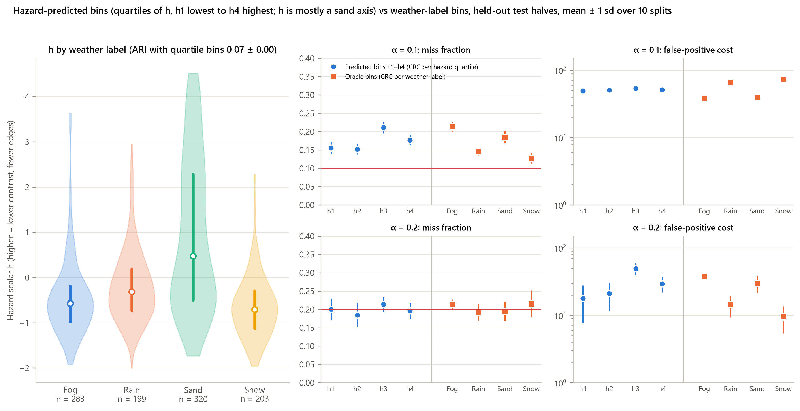
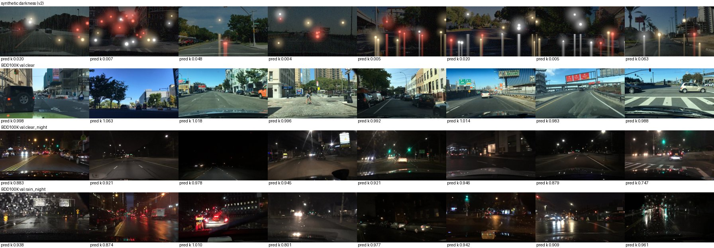
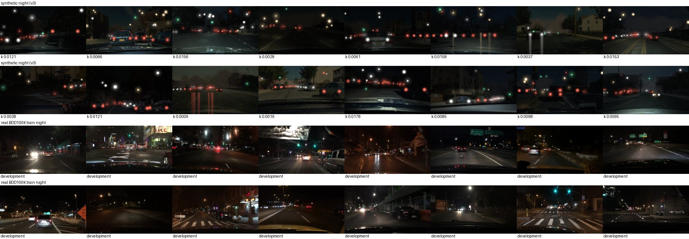
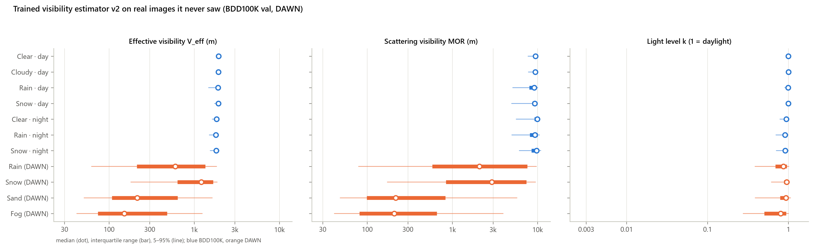
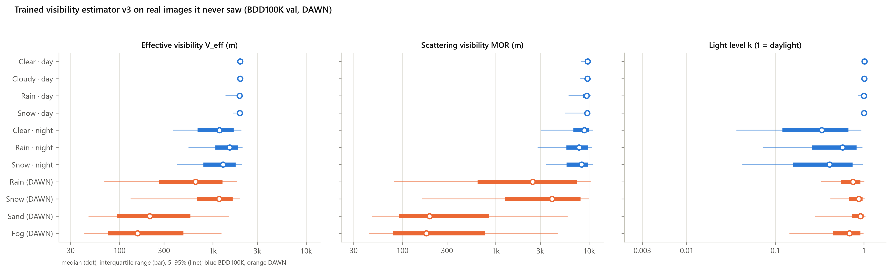
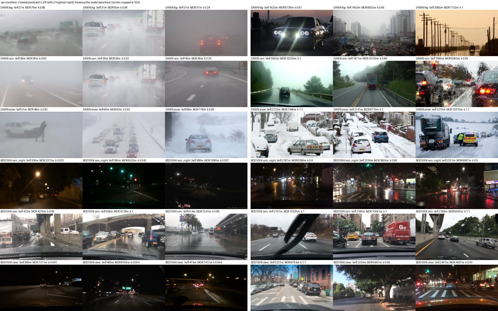
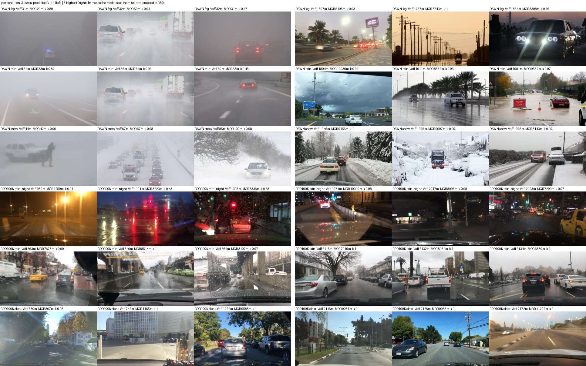

# 06 — Results: hazard estimation (O3) and visibility estimators v1–v3

*Sources: `results/results.md` §7 (O3 version A), `results/o3/o3.md` (generated by `python -m wad.o3_eval`),
`PREREG_o3.md`, `PREREG_visibility.md` (v2, amendments 1–3, Version 3, v3 erratum), `results/vis2/vis2.md`
and `results/vis3/vis3.md` (generated by `python -m wad.vis_eval [--version 3]`), `results/run2/stats_*.csv`,
and the narrative and verdicts in `NOTES.md`. Objective O3: a camera-only hazard estimate, so that calibration
can run on predicted bins when the true weather is unknown.*

> **In short**
> - **Version A** is a pixel-statistics scalar. It is mostly a sand-versus-rest axis (agreement with weather
>   labels ARI 0.07).
> - **Version B** is a ResNet-18 weather classifier trained on BDD100K train. It reaches balanced accuracy
>   0.755, but its fog class rests on 43 images.
> - The guarantee holds *within the bins the estimator predicts*. It **does not carry over to real fog**:
>   true-fog miss is 0.234 at α = 0.2 against 0.193 for the oracle bin. Pre-registered S1 is not met in any
>   setting.
> - **Visibility v2/v3** are physics-labelled ResNet-18s trained on synthetic fog, rain, spray and darkness.
>   They measure scattering well (DAWN fog ~200 m, clear day ~9.5 km). v2 reads night as daylight; v3
>   relights the night frames and separates night from day.
> - Neither v2 nor v3 beats the simple contrast + detail score v1 at predicting detector misses (S1 not
>   met), and **no visibility score holds the budget for rain at night** (S2 not met). Per-weather labels do,
>   at about 117 FPPI.
> - **Consequence.** Adaptivity moved from "which weather bin is this image in" to "which detection is real"
>   (`07`, `08`).

---

## 1. O3 version A: hazard scalar from pixels (run 1, YOLOv8s)

**Design** (`wad/hazard.py`, which imports no detection code; a test checks this):
- Four image statistics, computed after resizing to a 640-px long side: dark channel (15×15 patch), RMS
  contrast, edge energy (Laplacian variance) and saturation.
- h is the first principal component (44% of variance), with loadings dark_channel −0.680, rms_contrast
  −0.124, edge_energy −0.124 and saturation +0.712.
- Bins are quartiles h1–h4, cut on each calibration half.

**What h measures.** Agreement with the weather labels is low: adjusted Rand index **0.074 ± 0.001**.
*"The first component is mostly a sand-versus-rest axis (saturation against dark channel), not a monotone
degradation score."* Sand fills h4 (163.9 of the 320 sand images, mean over splits); fog and snow sit low.

**CRC on predicted bins** (run 1 detector, α = 0.2):

| predicted bin | held-out miss | FPPI | above α |
|---|---:|---:|---:|
| h1 | 0.200 | 17.7 | 60% |
| h2 | 0.185 | 21.0 | 20% |
| h3 | 0.214 | 49.6 | 70% (infeasible in 70% of splits) |
| h4 | 0.196 | 29.5 | 40% |

FPPI gap to the oracle-bin policy over all test images: +0.03 ± 0.09 at α = 0.1 and **+4.37 ± 3.08** at
α = 0.2. *"Validity does not depend on how well h tracks the weather (only approximately here, because the
quartile cut points are estimated on the calibration half), but they spend more false positives than the
oracle bins."*

*fig4: left, h by weather label; sand spreads high while fog and snow overlap low (ARI 0.07). Right, CRC on
predicted bins h1–h4 (blue) vs the oracle weather bins (orange). The budget holds about as well, at a higher
FPPI at α = 0.2.*

## 2. O3 version B: a learned weather classifier (`PREREG_o3.md`, written 2026-10-08)

**Design** (fixed *"before the training subset was downloaded or any model was trained"*):
- **Data.** BDD100K **train**, daytime only, five classes from the weather tag: clear; cloudy (overcast +
  partly cloudy); rain; snow; fog. Up to 1,500 per class, seed 0, with a 10% stratified hold-out.
  - Result: 5,443 training and 605 hold-out images (clear 1,500, cloudy 1,500, **fog 48**, rain 1,500,
    snow 1,500).
- **Model.** ResNet-18 (ImageNet) with a 5-way head, input 224×400, flip + random-resized-crop 0.6–1.0, no
  colour jitter. AdamW (lr 1e-4, weight decay 1e-4), batch 32, label smoothing 0.1, class-balanced sampling,
  8 epochs. The best hold-out balanced accuracy is kept.
- **Hazard score and bins.** h_B = p(rain) + p(snow) + p(fog); quartile bins on each calibration half.
- **Criteria.**
  - **S1**: *"predicted-bin policy meets α in every weather bin where the global threshold fails"*.
  - **S2**: *"FPPI gap to oracle bins ≤ 5"*.

**Training result.**
- Best hold-out balanced accuracy **0.755**, at epoch 6 of 8. Fog hold-out recall was 0.4 in most epochs.
- On BDD100K val daytime, argmax accuracy is 0.784.
- Mean h per BDD100K bin: clear 0.209, cloudy 0.235, rain 0.863, snow 0.876, clear night 0.390, rain night
  0.754, snow night 0.695.
- Mean h per DAWN bin: fog 0.827, rain 0.844, sand 0.672, snow 0.927.

**Where DAWN images land** (argmax class by true weather, all 1,005 images):

| DAWN weather | → clear | → cloudy | → fog | → rain | → snow |
|---|---:|---:|---:|---:|---:|
| fog (283) | 22 | 5 | **165** | 79 | 12 |
| rain (199) | 4 | 6 | 37 | **140** | 12 |
| sand (320) | 55 | 41 | **139** | 60 | 25 |
| snow (203) | 0 | 1 | 6 | 31 | **165** |

The fog class absorbs sand: 139 of 320 sand images are labelled fog.

**Results** (`o3.md`; pre-registered rows first, then the exploratory argmax rows):

| setting | source | α | ARI | global fails in | predicted-bin miss in failing bins | oracle | S1 | FPPI gap | S2 |
|---|---|---|---:|---|---|---|---|---|---|
| run 1, v8s_640 class all | A | 0.2 | 0.074 | fog, sand | fog 0.243, sand 0.205 | fog 0.214, sand 0.195 | not met | +4.37 ± 3.08 | met |
| run 1 | B | 0.2 | 0.102 | fog, sand | fog 0.239, sand 0.201 | fog 0.214, sand 0.195 | not met | +5.84 ± 3.36 | **not met** |
| run 2 primary (v8x_1280 group clean) | A | 0.1 | 0.064 | fog | 0.144 | 0.135 | not met | +8.40 ± 5.68 | not met |
| run 2 primary | A | 0.2 | 0.064 | fog | 0.240 | 0.187 | not met | −0.22 ± 0.81 | met |
| run 2 primary | B | 0.1 | 0.097 | fog | 0.140 | 0.135 | not met | +9.49 ± 4.60 | not met |
| run 2 primary | **B** | **0.2** | 0.097 | fog | **0.233** | **0.187** | **not met** | −0.21 ± 0.48 | met |
| run 2, v8x_640 group clean | B | 0.1 | 0.097 | fog | 0.118 | 0.085 | not met | −0.44 ± 1.70 | met |
| run 2, v8x_640 group clean | B | 0.2 | 0.097 | fog | 0.234 | 0.193 | not met | +0.09 ± 0.09 | met |
| v8x_640, B-argmax (*exploratory*) | | 0.1 / 0.2 | 0.244 | fog | 0.112 / 0.234 | 0.085 / 0.193 | not met | +1.98 / +0.13 | met |

At α = 0.1 every run 1 fit falls to the 0.001 floor under both sources. S1 is not met, and S2 is met only
because oracle and predicted bins then coincide (FPPI gap +0.03).

**Verdict: S1 is not met in any setting; S2 is met in most.** The reading (`o3.md`):
- *"Within the bins the estimator predicts, the guarantee holds as the theory says"*. The held-out miss per
  predicted bin is 0.082–0.092 at α = 0.1 and 0.182–0.198 at α = 0.2.
- *"But it does not carry over to the true weather condition: on images that really are foggy the
  predicted-bin policy misses 0.112 at α = 0.1 (exceeds α in 70% of splits), 0.234 at α = 0.2 (... 80%),
  against 0.085, 0.193 for the oracle fog bin."*
- *"The classifier puts 149 of 256 fog test-and-calibration images ... in its fog bin, alongside 100 sand
  images; the fog bin's threshold is set for that mixture and is too high for real fog."*
- *"A wrong bin costs false positives, not safety"* holds only for the predicted bin's average, not for the
  hazardous condition inside it.
- The suggested remedies: an estimator that isolates fog (more fog data, e.g. WEDGE or Foggy Cityscapes, or
  a visibility regressor), or a conservative rule that sends uncertain images to the strictest bin.

## 3. Per-condition statistics (exploratory, on the run 2 caches)

- **Where objects end up.** Found at 0.25, recoverable below 0.25, never detected: see
  `05_results_crc_runs.md` §5. Night gains most from a lower threshold (+36–40 points vs +21–24 by day).
  DAWN fog has 11.3% of objects never detected at any score.
- **The shipped τ = 0.25 is close to F1-optimal** (`wad/stats_tables.py`):
  - DAWN F1 at 0.25 vs the best constant: fog 0.760 vs 0.763 (best τ 0.208); rain 0.774 vs 0.777 (0.303).
  - BDD100K rain at night: 0.531 vs 0.540.
- **Meeting a recall budget costs precision and F1.** Per-weather CRC (α = 0.2) on BDD100K rain at night has
  precision 0.063 and F1 0.116 at 117.1 FPPI.

## 4. Visibility v1: a simple pixel score (exploratory)

h_v1 = −(z(log edge energy) + z(RMS contrast)) / 2. It is standardised on the O3 BDD100K train frames, and
higher means less visible (`wad/visibility.py`).

- **Spearman with the per-image miss at τ = 0.25:** BDD100K **0.46** (with never-detected 0.13; n = 8,018);
  DAWN **0.245** (0.196; n = 888).
- It protects the images it ranks least visible. In DAWN's lowest-visibility quarter, v1 bins give 0.196
  against 0.275 for per-weather bins, at higher FPPI.
- **Blind spot: rain at night** (0.238 at α = 0.2).

v1 became the comparator that the trained estimators had to beat.

## 5. Visibility v2: a trained, physics-labelled estimator (`PREREG_visibility.md`, 2026-10-11)

The goal was *"an **objective** hazard score: the visibility of the scene measured from the camera frame,
not a weather label"*. It never reads detector output.

**Synthetic training data from clear-day BDD100K train frames** (1,500 O3 frames plus 3,000 more; 3,989
train / 462 validation after excluding 49 dark, mis-tagged frames):
- **Metric depth.** From Depth Anything V2 Metric Outdoor Small. The model saturates near 80 m, so depth
  beyond 40 m is extended smoothly (amendments 1–2).
- **Scattering veil, p = 0.75.** MOR ~ log-uniform[30, 5000] m, β = 3.912/MOR, t = exp(−βd),
  I = J·t + A·(1 − t). Yellow-orange (dust/sand) tint with p = 0.15.
- **Rain, p = 0.35.** Streaks; windshield drops (p = 0.5); **wheel spray** (p = 0.6): a local plume with MOR
  ~ log-uniform[15, 150] m over *every* labelled car/truck/bus box (54,017 boxes).
- **Darkness, p = 0.35.** k ~ log-uniform[0.003, 0.3], sensor noise, partial auto-gain, light blooms and
  wet-road streaks.
- **Camera nuisances.** JPEG 40–95, blur, flip.

**Targets** (log10):
- MOR;
- light level k;
- a 7×13 visibility map;
- **V_eff = min(MOR_road, V_light)**, with V_light = 2000 m·k^0.5. This is a convention (k = 0.01 → 200 m),
  not a measured quantity.

**Model and bins.**
- ResNet-18, 224×400, L1 on all targets, AdamW 3e-4 with a cosine schedule, batch 32, 20 epochs.
- Score h_v2 = −log10 V_eff.
- Bins: quartiles (primary) and fixed bands ≥ 1000 / 300–1000 / 100–300 / < 100 m.

**Criteria.**
- **S1**: Spearman with misses ≥ v1's on both datasets.
- **S2**: holds α = 0.2 in BDD100K rain-night, clear-night and DAWN fog.
- **S3**: overall FPPI ≤ v1's.
- **S4**: synthetic MAE of log10 V_eff ≤ 0.15.

**Process.** A first training run was stopped after an independent code review upheld 13 findings,
grouped as the 7 items of amendment 3. All were fixed and the model was retrained from scratch before any
real-image prediction.

**Training result.** Best epoch 19. Synthetic validation MAE (log10): MOR 0.069, k 0.039, V_eff 0.069, map
0.104.

## 6. Visibility v3: night relighting (designed after v2; **not blind**)

**Why.** v2 read real night as near-daylight. The diagnosis viewed 24 BDD100K **val** images with v2's light
predictions and no detection results: *"v2's synthetic darkness is dimmed daylight (median sky luma 62
above road 40, daylight shadows, floating lights), while real clear night has a dark sky (21 vs road 32),
light pooled by headlights and street lamps, and lower overall luma (8–47)."* It was a sim-to-real gap in
the darkness model, not in the scattering model.

*v2 diagnosis: v2's synthetic darkness (top row, predicted k 0.004–0.06) against real BDD100K val clear day,
clear night and rain night. Real night frames are read as k ≈ 0.75–1.0, i.e. as daylight.*

**What changed.**
- **Darkness, p = 0.40:** night relighting with p = 0.75, otherwise dusk.
- **Night relighting:**
  - ambient light a ~ log-uniform[0.0005, 0.01];
  - ego headlights (p = 0.9) with inverse-square fall-off on metric depth;
  - street-light pools (p = 0.6);
  - a dark sky;
  - head and tail lights on labelled vehicles;
  - dashcam auto-exposure.
- **k** is now the mean illumination of driving-zone pixels 10–60 m away.

**Tuning and checks.**
- **Tuning** used 200 of 400 BDD100K *train* night frames. Final median luma, synthetic vs real: mean 22.7
  vs 28.1, sky 15.2 vs 16.6, road 28.7 vs 22.2.
- **Training:** MAE MOR 0.084, k 0.049, V_eff 0.071, map 0.121.
- **Development check:** AUC 0.991 for night vs day (v2: 0.868); median k on real night 0.32 (v2: 0.94).
  It used the same frames as tuning, so it is *not* an independent check.

*v3 rendering check: synthetic night renders against real BDD100K train development night frames.*

**v3 erratum** (documentation only, nothing retrained):
- the diagnosis used 24 *val* images, and "k ≈ 0.92" is the mean (the median is 0.94);
- tuning used the first 200 development frames, so the development check is not independent;
- dusk uses 0–5 lights (v2: 3–19);
- light reaching the image can be up to ~22% below k (median gap ~7%);
- exposure sets mean *linear* luminance, with gain clamped to [1, 200].

## 7. v2 and v3 results on real images (never seen in training or model selection)

Detector: YOLOv8x @1280, grouped vehicles, DAWN clean labels. α = 0.2, 200 calibration/test splits.

| pre-registered criterion | v2 | v3 | met (v2 / v3) |
|---|---|---|---|
| S1 BDD100K (Spearman vs v1) | 0.277 vs **0.460** | 0.373 vs **0.460** | no / no |
| S1 DAWN | 0.177 vs **0.245** | 0.179 vs **0.245** | no / no |
| S2 BDD100K rain night (held-out miss, share above α) | 0.248 (100%) | 0.260 (100%) | no / no |
| S2 BDD100K clear night | 0.236 (100%) | 0.220 (≥ 99%) | no / no |
| S2 DAWN fog | 0.220 (75%) | 0.216 (70%) | no / no |
| S3 BDD100K overall FPPI vs v1 | 29.57 vs 31.91 | 30.20 vs 31.91 | yes / yes |
| S3 DAWN overall FPPI vs v1 | 4.05 vs 6.37 | 4.05 vs 6.37 | yes / yes |
| S4 synthetic MAE log10 V_eff | 0.069 | 0.071 | yes / yes |
| sanity: night vs day ROC AUC (BDD100K val) | 0.852 | **0.987** | — |
| sanity: median MOR (m): DAWN fog / sand / rain / snow / BDD clear day | 208 / 216 / 2,078 / 2,901 / 9,461 | 180 / 196 / 2,477 / 4,007 / 9,651 | ordering holds |

*fig10 (v2): V_eff, MOR and k per condition on BDD100K val and DAWN. Scattering is well ordered (DAWN fog
and sand around 200 m), but BDD100K night sits at daylight k.*

*fig10 (v3): night is now separated (median k 0.33 at clear night, 0.57 at rain night). Rain at night still
reads brighter than clear night, and night V_eff stays above 1 km for most frames.*

**Spearman with the per-image miss at τ = 0.25** (never-detected in brackets):

| score | BDD100K (n = 8,018) | DAWN (n = 888) |
|---|---|---|
| v1 (contrast + detail) | **0.460** (0.13) | **0.245** (0.196) |
| v2 | 0.277 (0.059) | 0.177 (0.171) |
| v2 light only / scattering only (exploratory) | 0.294 / −0.154 | 0.146 / 0.201 |
| v3 | 0.373 (0.094) | 0.179 (0.175) |
| v3 light only / scattering only (exploratory) | 0.437 / 0.137 | 0.140 / 0.213 |
| stretched-image sensitivity (v2 / v3) | — | 0.185 / 0.187 |

**Fixed visibility bands.**
- v2 puts 8,073 of 8,090 BDD100K images in ≥ 1000 m (bands 1 / 16 / 8,073), so its bands are useless on
  BDD100K.
- v3 BDD100K bands: 34 / 1,538 / 6,518.
- DAWN v2 bands: < 100 m 179, 100–300 m 214, 300–1000 m 250, ≥ 1000 m 246. v3: 179 / 214 / 262 / 234.

**Key policy rows** (quartile bins; held-out miss (share of splits above α), FPPI):

| condition | global | per-weather (oracle) | v1 | v2 | v3 |
|---|---|---|---|---|---|
| DAWN fog | 0.251 (98%), 1.7 | **0.191 (42%), 6.2** | 0.213 (64%), 7.5 | 0.220 (75%), 5.3 | 0.216 (69%), 5.2 |
| BDD100K rain night | 0.276 (100%), 34.5 | **0.195 (38%), 117.1** | 0.238 (100%), 57.8 | 0.248 (100%), 52.8 | 0.260 (100%), 45.4 |
| BDD100K clear night | 0.249 (100%), 28.7 | **0.198 (42%), 58.9** | 0.204 (70%), 53.1 | 0.236 (100%), 36.0 | 0.220 (99%), 44.5 |
| DAWN lowest quarter by v1 | 0.304 (99%), 1.0 | 0.275 (99%), 2.0 | **0.196 (41%), 19.8** | 0.256 (96%), 5.4 | 0.252 (94%), 5.3 |
| DAWN lowest quarter by v2 | 0.268 (99%), 1.3 | 0.239 (90%), 3.1 | 0.206 (56%), 12.2 | **0.195 (41%), 9.9** | 0.201 (48%), 8.9 |
| DAWN, all images | 0.195 (37%), 2.4 | 0.192 (33%), 3.2 | 0.192 (34%), 6.4 | 0.191 (29%), 4.0 | 0.191 (31%), 4.1 |

Each score protects the images *it* ranks least visible and leaves the others' lowest quarter unprotected.

*fig11 (v3): for each condition, the 3 lowest-V_eff frames (left) and the 3 highest (right), with V_eff, MOR
and k. The lowest DAWN frames are white-outs and downpours with spray (MOR 31–118 m). The lowest BDD100K
'clear' frames are now night scenes (k 0.04–0.06).*

*fig11 (v2): the same layout for v2. Even its least-visible BDD100K rain-night frames get V_eff ≈ 1–1.3 km
(k up to 0.91), and its least-visible 'clear' frames are sunlit glare scenes, not night: v2 reads night as
daylight.*

**Why rain at night still fails in v3.** *"v3 reads rain-night as brighter than clear night (median k 0.57
vs 0.33) ... The model has plausibly learned that visible lights and bright road reflections mean more
light, so real wet-road reflections read as brighter. For the detector, glare and reflections are a hazard.
A next version would need glare/contrast loss in the target (e.g. veiling luminance from light sources)."*

**Exploratory combination** (`wad/vis_combo.py`):
- v3's light level alone reaches 0.437 on BDD100K, but that is mostly "is it night".
- Within daytime images: v1 0.091, v3 0.028. Within night images: v1 0.175, v3 0.132.
- An equal-weight rank mean of v1 and v3 does not beat v1 (0.438 vs 0.460 on BDD100K; 0.226 vs 0.245 on
  DAWN).

## 8. The visibility verdict in one paragraph (from `NOTES.md`)

*"A trained, physics-labelled estimator measures the scattering it is built to measure ... Night needed a
second, not-blind version (v3) and is now separated from day, but its darkness is underestimated. On DAWN
the v2/v3 thresholds reach the same overall miss as v1's at lower FPPI (4.05 vs 6.37), though each score
protects a different set of images. As a predictor of detector difficulty, the simple contrast + detail
score v1 remains better on both datasets and within day and within night, and no visibility score, simple
or trained, holds the budget for rain at night, where per-weather (oracle) thresholds do it at ~117 FPPI."*

Recorded limitations:
- the depth model saturates near 80 m, so long-MOR veils render weaker;
- V_eff ≤ 2,000 m in daylight by construction;
- v3 is not blind, and its development check is not independent.

## 9. What this means for the method

1. **Predicted bins keep the guarantee *for the bins*, not for the hazard.** A weather or visibility
   estimator sorts images into bins that hold α on average. Real fog and rain at night sit inside a mixture,
   and that mixture's threshold is too high for them. Every pre-registered S1/S2 test that checks the true
   hazardous condition failed (O3-B, v2, v3).
2. **Per-weather labels are the ceiling, and they are expensive at night.** The oracle per-weather threshold
   holds rain-night α = 0.2 only at about 117 FPPI. In practice the label is also not available at run time
   without an estimator.
3. **Image-level difficulty is only weakly predictable from pixels.** The best Spearman with misses is 0.46,
   from the simplest score. Later threshold work showed why: 87–91% of a per-image oracle's apparent edge is
   luck about *which* detections at a given score are real (`07_threshold_exploration.md`, idea #5).
4. **The detector's confidence means about the same thing in every condition.** The share real at score
   0.1–0.25 is 0.24–0.33 across day, night, rain at night and DAWN fog. The dial's per-weather thresholds
   add nothing (0.98–1.03× one threshold; `08` §3). Conditions differ in *how much is recoverable*, not in
   what a score is worth.
5. **So the adaptivity moved from "which weather bin" to "which detection".** The per-detection option of
   the λ dial (`08` §4) judges each box from the detector's own outputs: score, class probabilities,
   box-edge uncertainty, neck features, overlaps and crowding. It costs 0.87–0.96× one threshold across
   BDD100K conditions and dial settings (0.91× at λ = 10). A weather or visibility signal can still enter later, as a
   per-condition recalibration or as "CRC over λ" per condition (`10_phase3_methodology_kit.md`).
