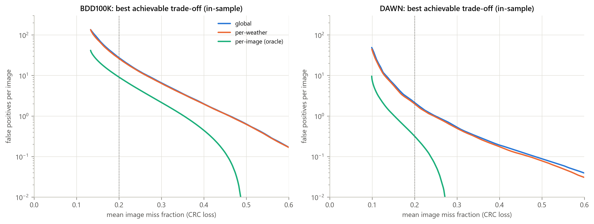
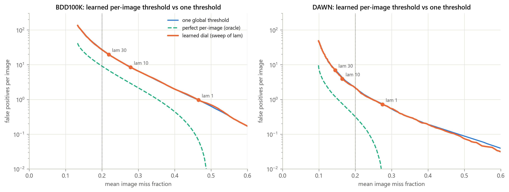
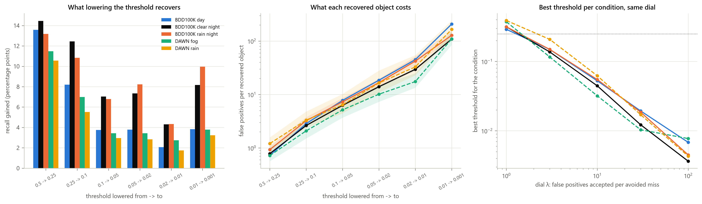
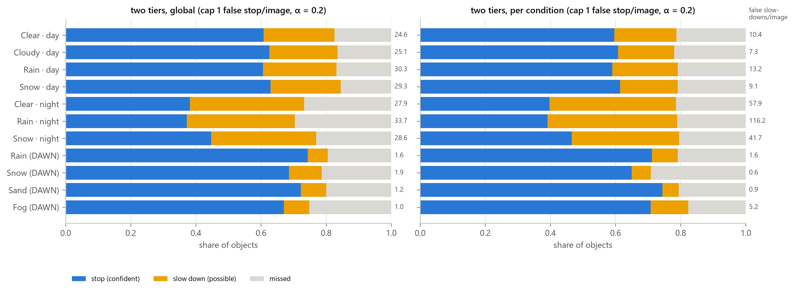
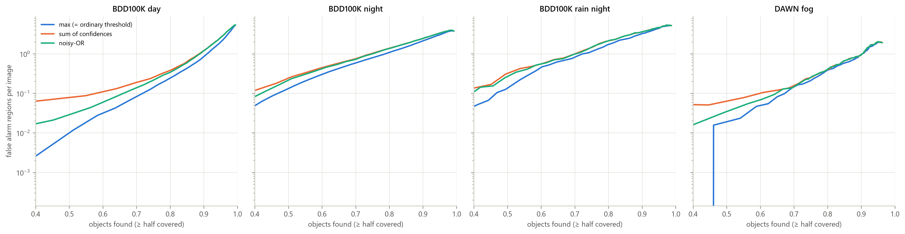
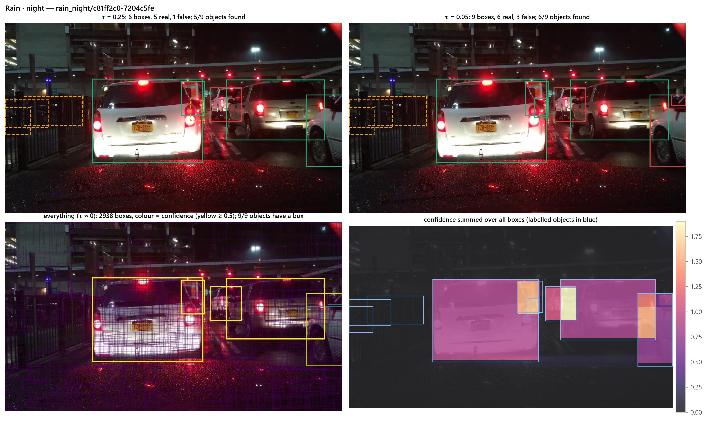

# 07 — Threshold exploration (2026-10-12 → 10-15): what was tried before the dial, and why

*All of this is reproducible from the harness (`python -m wad.<module>`); the narrative with every number is in
`NOTES.md` from "Threshold work at a glance" onward, the pre-registrations in `PREREG_threshold.md`. Only
the dial (`08_method_lambda_dial.md`) is the method; everything here is evidence that shaped it.*

## The question that started it

Weather-conditional CRC (O2) holds a miss budget per weather bin, but it fixes the trade-off (α) and the
threshold is chosen per bin. The user's idea (2026-10-12): **there is no single ideal threshold — the right
recall/precision trade-off depends on the use case** (camera set-up, redundancy, weather, how cautiously to
drive). So: make the trade-off a dial λ ("false alarms accepted to avoid one miss") and ask whether the
best threshold can be *predicted per image*.

## Summary table

| # | idea | data / model | verdict | why |
|---|---|---|---|---|
| 0 | headroom (oracle per-image threshold, in-sample) | YOLOv8x @1280, BDD100K val + DAWN | big *apparent* headroom: at mean image miss 0.2, 9.2 vs 28.0 FPPI on BDD100K (night 19.9 vs 66.1), 0.33 vs 2.24 on DAWN | oracle knows the labels — see #5 |
| 1 | per-image threshold from **pixels** (PREREG v1) | ResNet-18, 21,831 BDD100K train frames, predicts misses/FP at 40 thresholds | P1 not met (27.82 vs 28.00 FPPI), P2 not met (2.34 vs 2.38), P3 met (per-condition calibrated dial, rain-night 108 vs 117 FPPI) | predicts *how many* objects are missed (Spearman 0.57) but not *where* scores sit; uses 10 distinct thresholds |
| 2 | threshold budget per condition | in-sample on val | night recovers ~2× more recall per threshold step at the same or lower FP per recovered object | detector far less confident at night (median matched score 0.28 vs 0.62) |
| 3 | per-image threshold from the **confidence profile** (PREREG v2, decision-focused) | MLP on detections-per-threshold profile + λ, trained on cost | no better than one threshold even in-sample (1.001–1.009×); val 1.005–1.017×, DAWN 0.97–1.09× | YOLOv8x confidence means about the same in every condition |
| 4 | per-image threshold from **YOLOv8x's own image features** (PREREG v3) | frozen backbone/neck pooled to 10,880 dims; pilot 1,000 images, then full 21,831 | pilot 1.01–1.06×; full run E1 1.005, E2 0.990 (0.976–1.009), E3 0.217 — none met | overfits misses (0.85 fit vs 0.48 held out); acts like one threshold set 1–3 steps too high |
| 5 | **luck vs structure** (null simulation) | redraw which detections are real from the dataset-wide chance at their score/class | 87–91% of the oracle's 15–19% edge on BDD100K is luck; ≤ 1–2% of cost learnable per image (DAWN 70–89% luck) | luck = *which* detections at a score are real → the learnable pattern is **per detection** |
| 6 | **per-detection rescoring** | gradient boosting on detector outputs (score, class, geometry, rank, overlaps, crowding) | 0.92–0.94× one threshold (BDD100K), 0.93–0.96× (DAWN); AUC in the 0.05–0.5 band 0.75→0.82 | became the dial's per-detection option (model 1, then model 2 with YOLOv8x per-box features) |
| 7 | box combinations: softmax share (competitive), noisy-OR (cooperative), learned sigmoid on top | per box, one threshold | competitive 1.02–1.12×, cooperative 1.03–1.32×, learned sigmoid 0.99–1.00×; as extra inputs to #6: no change | per-box matching counts extra boxes on real objects as false |
| 8 | **summed-confidence map** (user's Monte-Carlo-over-thresholds idea), region level | 4-px maps: max (= thresholding), sum, noisy-OR | at 80% objects found, false-alarm regions/image: day 0.24 / 0.38 / 0.34; night 1.18 / 1.43 / 1.42; rain night 1.87 / 2.26 / 2.22; DAWN fog 0.41 / 0.43 / 0.42 | weak boxes pile up on clutter (lamps, reflections, the hood); summing ≈ score weighting, no new information |
| 9 | **graded response** (stop / slow tiers from confidence) | stop: false stops ≤ 1/image; slow: CRC α = 0.2 | per condition: every condition holds α (0.192–0.198) at ~0.95 false stops/image; night's extra caution goes to cheap slow-downs (61 false slow-downs/image at night vs 9.3 by day) | foundation for a decision layer (stop vs slow) |
| 10 | no-label false-alarm estimate | Σ(1 − chance real) over kept boxes | within ~2% on BDD100K; DAWN rain 13–38% under | a deployed dial can report its own expected false-alarm rate |

## Key figures

| figure | shows |
|---|---|
|  | **fig12** headroom: per-image oracle vs one threshold (in-sample) |
|  | **fig13** the pixel CNN's trade-off curve lies on the single-threshold curve |
|  | **fig14** what lowering the threshold recovers per condition and what each recovered object costs |
|  | **fig15** graded response: stop/slow tiers per condition |
|  | **fig18** summed-confidence map vs thresholding at region level |

Example images (all boxes down to confidence ~0; boxes at 0.25 / 0.01 / 0.005 / 0.001; the summed map):
`figures/threshold_exploration/fig16_all_boxes_*.png`, `fig17_low_thresholds_*.png`, `fig19_summed_map_*.png`
for clear day, clear night, rain night and DAWN fog.

*fig16 (rain at night): at essentially zero threshold YOLOv8x puts 2,300–2,900 boxes on an image; every object
has a box; confidence summed over all boxes concentrates on the objects — but so does clutter.*

## Engineering facts learned along the way

- **One detector run gives every threshold exactly.** Greedy NMS lets only higher-scoring boxes suppress
  lower ones and greedy matching is score-ordered, so filtering the 0.001-floor run at τ equals re-running
  at τ (checked on 50 BDD100K images at τ = 0.05 / 0.25 / 0.5: identical boxes; `tests/test_threshold_equivalence.py`).
  All 200 thresholds × 8,090 images take 0.2 s instead of ~67 GPU-hours. Caveat: the 300-box cap.
- **The threshold never changes a box**, only which boxes are kept; lower thresholds add smaller, less
  precisely placed boxes (median IoU with the object 0.86 at score ≥ 0.5 vs 0.62 at 0.001–0.01).
- **Conditions differ in how much is recoverable, not in what a score is worth** (share real at 0.1–0.25:
  day 0.264, night 0.277, rain-night 0.239, DAWN fog 0.327, DAWN rain 0.223). Equalising the miss rate across
  conditions therefore means accepting more false alarms per recovered object in hazardous conditions —
  by choice (that is the dial, or per-condition CRC).
- **12–18% of objects never get a correct box** at any score (day 12%, night 17%, rain at night 18%, DAWN fog
  11%): no threshold policy can find them; that is the detector's ceiling.

## What carried forward

1. The dial λ as the user-facing parameter (from #1, kept when the per-image model failed).
2. One threshold per λ as the simple, exact option (#3–#5 show per-image thresholds cannot beat it).
3. Per-detection scoring as the learnable option (#5 → #6), later with YOLOv8x's own per-box features.
4. Stop/slow tiers as the starting point for a decision layer (#9).
5. The no-label health check (#10).
