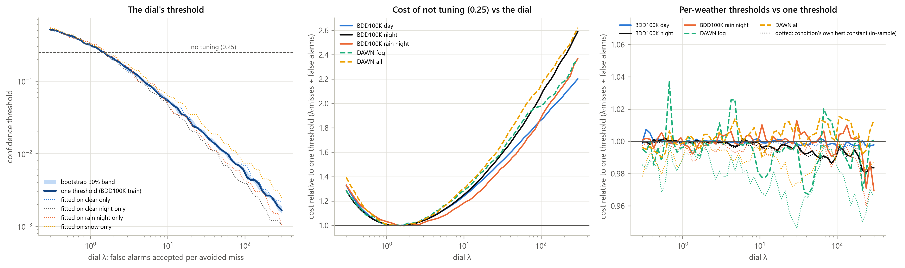
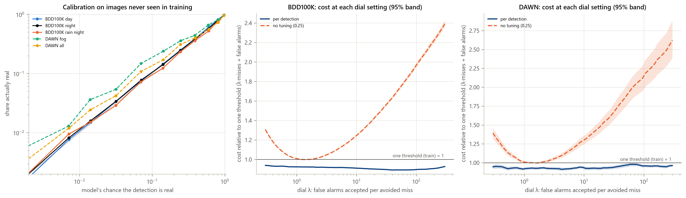
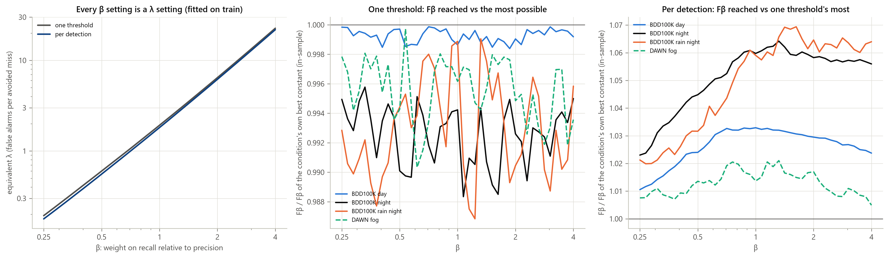

# 08 — The method: the λ dial (one threshold or per detection, also settable by Fβ)

*Status: decided 2026-10-13 (one threshold), 2026-10-14 (per-detection option, Fβ dial), 2026-10-15 (λ is the
method; Fβ goes through λ; per-detection model 2 with YOLOv8x's own per-box features adopted under a
pre-registered test). Code: `wad/dial.py`, `wad/one_threshold.py`, `wad/per_detection.py`,
`wad/yolo_box_features.py`, `wad/fbeta_dial.py`. Every number below is generated from the CSVs in
`results/threshold/` (copies in `Docs/tables/`).*

---

## 1. The idea in one paragraph

A detector's confidence cut-off is normally a fixed, arbitrary number (Ultralytics' default 0.25),
changed — if at all — by guessing. We replace it with a **dial in meaningful units: λ, the number of false
alarms you accept to avoid one missed object.** Every dial setting is the expected-cost-best choice for the
cost **λ·misses + false alarms**, fitted on BDD100K *train* only and graded on BDD100K *val* and DAWN (never
used to choose anything). The dial can be applied two ways: **one confidence threshold** per λ, or **per
detection**, keeping a box iff a calibrated model's chance that it is real is at least **1/(1+λ)**. The
same dial can be set in **Fβ units** (β = how many times more recall counts than precision): β is turned
into its equivalent λ, fitted on train. The goal is *not* to beat 0.25 on F1; it is a tunable,
statistically backed trade-off for the use case (camera set-up, redundancy, weather, how conservatively the
vehicle should drive).


*fig20 — left: the threshold for each λ (bootstrap band; dotted: fitted on single weathers); middle: cost
of not tuning (fixed 0.25) relative to the dial; right: per-weather thresholds vs one threshold (no gain).*

## 2. Set-up and notation

- Detector: YOLOv8x (COCO-pretrained, **frozen**), input 1280 px, confidence floor 0.001, NMS IoU 0.5, at
  most 300 boxes, six classes (car, truck, bus, bicycle, motorcycle, person), EXIF orientation applied.
- For image x the detector returns candidates dᵢ = (boxᵢ, classᵢ, sᵢ) with score sᵢ ≥ 0.001.
- Labels (training/evaluation only): greedy score-ordered matching at IoU ≥ 0.5 with **grouped classes**
  (vehicle = car/truck/bus, two-wheeler = bicycle/motorcycle, person) gives yᵢ ∈ {0,1} (real / false).
  An object counts as found iff its matched box is kept; objects with no box above the floor are missed
  by every setting (12% by day, 17% at night, 18% rain at night, 11% DAWN fog).
- A keep rule k(d) ∈ {0,1}. Misses M = objects not found; false alarms F = kept boxes with y = 0.

**Cost of a setting:**  C_λ = λ · M + F   (summed over images; λ = false alarms accepted per avoided miss)

## 3. Option A — one threshold per λ

k(d) = 1[s ≥ τ(λ)],  τ(λ) = argmin_τ Σ_{x ∈ train} [ λ·M_τ(x) + F_τ(x) ].

- Exact on 3.34M train detections (21,831 images): sort scores once, cumulative real/false counts, argmin.
  Because greedy NMS and greedy matching are score-ordered, filtering the floor run at τ equals running
  the detector at τ (checked on the GPU), so one detector run gives every threshold.
- Ties: 'score ≥ t' cannot split detections with equal scores, so only ends of equal-score blocks are
  candidate rules (fix of 2026-10-15).
- The dial's thresholds are stored as the **exact switch points** of the fit (lower convex hull of
  (real kept, false kept); 258 switch points; `weights/one_threshold_table.csv`), so any λ > 0 gives the
  fitted threshold.
- Equivalent statement: τ(λ) is where a box's chance of being real (score calibration on train) equals
  1/(1+λ) (verified: 0.306/0.054/0.019 for λ = 1/10/30 from both routes).

<!-- T1 -->
| λ | threshold τ(λ) | bootstrap 90% band | 1/(1+λ) |
|---|---|---|---|
| 1 | 0.3063 | 0.3006–0.3112 | 0.500 |
| 3 | 0.1508 | 0.1392–0.1581 | 0.250 |
| 10 | 0.0541 | 0.0509–0.0563 | 0.091 |
| 30 | 0.0186 | 0.0176–0.0208 | 0.032 |
| 100 | 0.0057 | 0.0050–0.0062 | 0.010 |

5-fold check inside train: the threshold fitted on four folds costs at most 0.2% more on the fifth than
that fold's own best. **Per-weather thresholds add nothing** (0.98–1.03× one threshold), and even each
condition's own in-sample best constant is only 0–5% cheaper (DAWN fog at λ 30 the most):

<!-- T10: cost relative to the dial's one threshold -->
| condition | λ1 no tuning | λ1 per-weather | λ1 own best | λ10 no tuning | λ10 per-weather | λ10 own best | λ30 no tuning | λ30 per-weather | λ30 own best |
|---|---|---|---|---|---|---|---|---|---|
| BDD100K val, all | 1.009 | 0.999 | 0.999 | 1.245 | 0.997 | 0.998 | 1.548 | 0.998 | 1.000 |
| BDD100K day | 1.007 | 0.999 | 0.998 | 1.240 | 0.999 | 1.000 | 1.517 | 0.998 | 0.998 |
| BDD100K night | 1.010 | 0.999 | 0.999 | 1.249 | 0.996 | 0.994 | 1.576 | 0.998 | 0.997 |
| BDD100K rain at night | 1.032 | 0.999 | 0.998 | 1.183 | 1.012 | 0.998 | 1.465 | 1.013 | 0.999 |
| DAWN, all | 1.011 | 1.001 | 0.991 | 1.306 | 0.996 | 0.996 | 1.651 | 1.010 | 0.974 |
| DAWN fog | 1.014 | 1.005 | 0.997 | 1.290 | 0.982 | 0.973 | 1.589 | 0.999 | 0.946 |

*Why per-weather thresholds don't help:* YOLOv8x's confidence means nearly the same thing in every
condition (share real at score 0.1–0.25: day 0.264, night 0.277, rain-night 0.239, DAWN fog 0.327), so
the expected-cost-best cut is about the same everywhere; conditions differ in *how much is recoverable*
(night ~2× more), not in what a score is worth.

## 4. Option B — per detection (calibrated chance, cut 1/(1+λ))

**Decision rule (Bayes-optimal for the dial's cost).** If p = P(y = 1 | features) is calibrated, keeping a
box costs its expected false alarm (1 − p); dropping it costs its expected miss λ·p. So

  keep d  ⟺  1 − p(d) ≤ λ·p(d)  ⟺  **p(d) ≥ 1/(1+λ)**.

The rule is nested in λ (a larger λ keeps a superset), so misses fall monotonically as λ rises.

**Model.** Gradient-boosted trees (`HistGradientBoostingClassifier`: max_iter 400, learning rate 0.1, 63
leaves, early stopping on 10%, random_state 0), trained on the 3.34M BDD100K train detections. Inputs come
from the detector only (no labels, no pixels of our own):

| group | features |
|---|---|
| context (model 1, 20) | logit of score, class, log height/width, aspect, x-centre, top/bottom edge, rank and rank within class group, overlap with stronger boxes (max IoU same group / any, count > 0.5), confidence-weighted support from overlapping boxes, image crowding (boxes above 0.25/0.05/0.01, max score, group count) |
| YOLOv8x per-box (model 2, +48) | at the anchor the kept box came from: probabilities of the six classes, strongest other COCO class, top-1 − top-2 margin, sum and entropy of the 80 class probabilities; entropy of each box side's DFL distribution (4) and their mean (how sure the box edges are); pyramid level; neck feature vector (320-d) reduced to 32 principal components (PCA on 200k train detections) |

**Model 2 is the adopted model** (pre-registered test, `PREREG_threshold.md`, written before training):

<!-- T4 -->
| pre-registered criterion | value | verdict |
|---|---|---|
| BDD100K val all, lam 10: cost model 2 / model 1, 95% interval below 1 | 0.9719 (0.9686-0.9753) | met |
| DAWN all, lam 10: model 2 not worse (point estimate <= 1) | 0.9952 (0.9805-1.0101) | met |
| BDD100K val all: share real near each preset cut within x1.25 of the cut | 1.041, 1.005, 1.061, 1.066, 1.131 | met |

Model 2 vs model 1 (cost ratio, 95% image bootstrap):

<!-- T3 -->
| condition | λ = 1 | λ = 3 | λ = 10 | λ = 30 | λ = 100 |
|---|---|---|---|---|---|
| BDD100K val, all | 0.982 (0.979–0.985) | 0.980 (0.977–0.983) | 0.972 (0.969–0.975) | 0.965 (0.962–0.969) | 0.976 (0.973–0.980) |
| BDD100K day | 0.982 (0.978–0.986) | 0.985 (0.980–0.989) | 0.982 (0.978–0.986) | 0.972 (0.967–0.977) | 0.977 (0.973–0.982) |
| BDD100K night | 0.982 (0.978–0.986) | 0.975 (0.971–0.979) | 0.963 (0.958–0.968) | 0.959 (0.953–0.964) | 0.975 (0.971–0.980) |
| BDD100K rain at night | 0.993 (0.978–1.009) | 0.978 (0.964–0.993) | 0.965 (0.948–0.982) | 0.970 (0.950–0.989) | 0.982 (0.962–1.002) |
| DAWN, all | 0.984 (0.969–1.000) | 0.998 (0.984–1.012) | 0.995 (0.981–1.010) | 0.998 (0.978–1.016) | 1.008 (0.989–1.027) |
| DAWN fog | 0.974 (0.945–1.006) | 0.998 (0.964–1.032) | 0.999 (0.972–1.026) | 1.005 (0.975–1.039) | 0.994 (0.962–1.028) |

What the new inputs add (log-loss increase on BDD100K val boxes scored 0.05–0.5 when a whole group is
shuffled): YOLOv8's class-probability vector (e.g. car vs truck confusion) carries most of the gain.

<!-- T6 -->
| feature group | features | log-loss increase when shuffled |
|---|---|---|
| context (20 features of model 1) | 20 | 0.1817 |
| class probabilities | 10 | 0.0913 |
| neck feature components | 32 | 0.0223 |
| box-side uncertainty (DFL) | 5 | 0.0036 |
| pyramid level | 1 | 0.0009 |


*fig23 — left: calibration on images never seen in training (diagonal = perfect); middle/right: cost
relative to one threshold at every dial setting with 95% bands, and no tuning (0.25).*

## 5. Results at the dial's settings (both options vs no tuning)

Recall / precision / false alarms per image; cost ratio = (λ·misses + false alarms) relative to the one
threshold at the same λ (95% image bootstrap). λ = 10 ("balanced"):

<!-- T2_10 -->
| condition | one threshold: recall / precision / FA per image | per detection (model 2) | per detection cost vs one threshold (95%) | no tuning (0.25) | no tuning cost |
|---|---|---|---|---|---|
| BDD100K val, all | 71.3% / 50.1% / 8.59 | 74.4% / 51.4% / 8.49 | ×0.910 (0.906–0.915) | 56.7% / 81.7% / 1.54 | ×1.244 |
| BDD100K day | 77.5% / 55.7% / 8.45 | 79.1% / 59.6% / 7.35 | ×0.918 (0.912–0.923) | 65.7% / 84.1% / 1.70 | ×1.240 |
| BDD100K night | 62.1% / 42.1% / 8.76 | 67.6% / 41.5% / 9.76 | ×0.903 (0.897–0.909) | 43.4% / 76.6% / 1.36 | ×1.249 |
| BDD100K rain at night | 58.4% / 38.7% / 8.96 | 63.4% / 38.6% / 9.78 | ×0.918 (0.897–0.941) | 41.3% / 74.6% / 1.36 | ×1.183 |
| DAWN, all | 82.3% / 62.9% / 3.80 | 83.1% / 66.6% / 3.27 | ×0.933 (0.912–0.954) | 72.1% / 82.9% / 1.16 | ×1.306 |
| DAWN fog | 78.6% / 65.3% / 2.80 | 78.6% / 71.6% / 2.09 | ×0.956 (0.921–0.989) | 68.1% / 85.9% / 0.75 | ×1.290 |

λ = 1 ("precision first"):

<!-- T2_1 -->
| condition | one threshold: recall / precision / FA per image | per detection (model 2) | per detection cost vs one threshold (95%) | no tuning (0.25) | no tuning cost |
|---|---|---|---|---|---|
| BDD100K val, all | 53.7% / 85.4% / 1.11 | 57.7% / 86.5% / 1.09 | ×0.924 (0.920–0.928) | 56.7% / 81.7% / 1.54 | ×1.009 |
| BDD100K day | 62.9% / 87.2% / 1.27 | 66.2% / 89.0% / 1.12 | ×0.907 (0.901–0.913) | 65.7% / 84.1% / 1.70 | ×1.007 |
| BDD100K night | 39.9% / 81.5% / 0.93 | 45.1% / 81.5% / 1.05 | ×0.941 (0.936–0.946) | 43.4% / 76.6% / 1.36 | ×1.010 |
| BDD100K rain at night | 38.5% / 81.0% / 0.87 | 42.6% / 80.2% / 1.02 | ×0.964 (0.947–0.982) | 41.3% / 74.6% / 1.36 | ×1.032 |
| DAWN, all | 69.7% / 85.2% / 0.95 | 71.7% / 87.0% / 0.84 | ×0.920 (0.902–0.938) | 72.1% / 82.9% / 1.16 | ×1.011 |
| DAWN fog | 66.3% / 88.3% / 0.59 | 67.3% / 90.9% / 0.45 | ×0.929 (0.889–0.960) | 68.1% / 85.9% / 0.75 | ×1.014 |

λ = 30 ("recall first"):

<!-- T2_30 -->
| condition | one threshold: recall / precision / FA per image | per detection (model 2) | per detection cost vs one threshold (95%) | no tuning (0.25) | no tuning cost |
|---|---|---|---|---|---|
| BDD100K val, all | 77.4% / 31.3% / 20.54 | 80.1% / 33.1% / 19.52 | ×0.897 (0.893–0.902) | 56.7% / 81.7% / 1.54 | ×1.548 |
| BDD100K day | 81.9% / 36.3% / 19.72 | 83.2% / 40.4% / 16.83 | ×0.912 (0.906–0.918) | 65.7% / 84.1% / 1.70 | ×1.517 |
| BDD100K night | 70.8% / 25.3% / 21.45 | 75.3% / 25.6% / 22.51 | ×0.883 (0.877–0.890) | 43.4% / 76.6% / 1.36 | ×1.576 |
| BDD100K rain at night | 68.0% / 21.2% / 24.41 | 72.1% / 22.2% / 24.51 | ×0.900 (0.876–0.922) | 41.3% / 74.6% / 1.36 | ×1.465 |
| DAWN, all | 86.0% / 46.8% / 7.65 | 86.7% / 50.7% / 6.59 | ×0.938 (0.914–0.960) | 72.1% / 82.9% / 1.16 | ×1.651 |
| DAWN fog | 82.5% / 49.6% / 5.61 | 82.7% / 55.7% / 4.41 | ×0.959 (0.922–1.002) | 68.1% / 85.9% / 0.75 | ×1.589 |

Across every condition and graded setting (λ = 1, 3, 10, 30, 100): per detection (model 2) costs
**0.870–0.964× one threshold on BDD100K** (largest upper 95% bound 0.982) and **0.895–0.966× on DAWN**.
**No tuning (0.25) costs 1.005–2.081× on BDD100K and 0.994–2.346× on DAWN**; 0.25 is only right near
λ ≈ 1.4–1.5, which is roughly the F1 point.

## 6. Statistical backing

**Calibration on images never used in training** (model 2). Expected calibration error (percentage
points): BDD100K all 0.11, day 0.10, night 0.16, rain at night 0.29; DAWN all 0.98, fog 1.49. Because half
the boxes have a chance < 0.5% (which dilutes averages), the check that matters is right at the cuts:

<!-- T5 -->
| share actually real near the cut | λ=1 (cut 50%) | λ=3 (25%) | λ=10 (9.1%) | λ=30 (3.2%) | λ=100 (1.0%) |
|---|---|---|---|---|---|
| BDD100K val, all | 52.1% (n=28,933) | 25.1% (n=31,582) | 9.6% (n=55,808) | 3.4% (n=95,418) | 1.1% (n=148,052) |
| BDD100K day | 53.9% (n=14,868) | 25.5% (n=14,276) | 9.6% (n=24,490) | 3.4% (n=43,883) | 1.1% (n=70,426) |
| BDD100K night | 50.1% (n=14,065) | 24.9% (n=17,306) | 9.7% (n=31,318) | 3.5% (n=51,535) | 1.2% (n=77,626) |
| BDD100K rain at night | 46.3% (n=918) | 22.7% (n=1,205) | 8.6% (n=2,505) | 2.8% (n=4,584) | 1.2% (n=7,304) |
| DAWN, all | 50.6% (n=1,574) | 31.5% (n=1,326) | 12.6% (n=1,803) | 4.4% (n=3,239) | 1.7% (n=6,448) |
| DAWN fog | 58.4% (n=317) | 38.1% (n=281) | 17.1% (n=375) | 5.5% (n=650) | 2.5% (n=1,402) |

On BDD100K a dial setting means what it says. **DAWN fog under-states the chance** (17% real at the 9.1%
cut), so in fog the option errs toward precision (drops some boxes it should keep). A per-condition
recalibration (or CRC per condition, §9) is the natural fix.

**Stability** (5-fold by near-duplicate group inside train; out-of-fold calibration and cost):

<!-- T9 -->
| λ | held-out ECE (points) | held-out cost vs one threshold | fold models on BDD100K val | fold models on DAWN |
|---|---|---|---|---|
| 1 | 0.05–0.11 | 0.928–0.933 | 0.923–0.928 | 0.916–0.934 |
| 3 | 0.05–0.11 | 0.922–0.926 | 0.922–0.923 | 0.921–0.931 |
| 10 | 0.05–0.11 | 0.912–0.919 | 0.912–0.913 | 0.929–0.939 |
| 30 | 0.05–0.11 | 0.892–0.901 | 0.897–0.899 | 0.932–0.944 |
| 100 | 0.05–0.11 | 0.886–0.897 | 0.896–0.897 | 0.946–0.958 |

**No-label check:** the expected false alarms on an unlabelled frame, Σ (1 − chance) over kept boxes,
match the actual count within ~1–5% on BDD100K (e.g. day 7.42 estimated vs 7.35 actual at λ 10); DAWN
rain is under-estimated (glare/spray).

**Evaluation caveat:** each detection keeps its real/false label from matching all boxes ≥ 0.001; if the
model drops a matched box but keeps a weaker duplicate, the duplicate still counts as false, so per-detection
numbers are slightly pessimistic (re-matching moves the ratio by at most 0.001).

**Model-choice caveat:** model 2's own choices (feature list, PCA, one run, adoption) used train only; the
20 context features and the boosting settings it inherits were picked in exploratory runs scored on
val/DAWN (alternatives within ~0.005).

## 7. The same dial in Fβ units

Fβ = (1+β²)·P·R / (β²·P + R) counts recall β times as much as precision. With calibrated chances the
Fβ-best rule is a cut at F*/(1+β²), F* the best Fβ reachable (Zhao et al. 2013; Lipton et al. 2014),
which is exactly the λ dial at

  **λ_eq(β) = (1 + β²) / F* − 1**   (F* measured on train per option; per detection on 5-fold out-of-fold chances)

so the β dial is a front end to the λ dial (`dial.keep_f(det, β)` = `dial.keep(det, λ_eq(β))`).

<!-- T7 -->
| β | one threshold: λ_eq | threshold | train F* | per detection: λ_eq | cut 1/(1+λ_eq) | train F* (OOF) |
|---|---|---|---|---|---|---|
| 0.25 | 0.19 | 0.5743 | 0.890 | 0.18 | 84.9% | 0.902 |
| 0.5 | 0.60 | 0.4118 | 0.781 | 0.56 | 64.3% | 0.803 |
| 1 | 1.92 | 0.1959 | 0.684 | 1.81 | 35.5% | 0.711 |
| 2 | 6.45 | 0.0821 | 0.671 | 6.18 | 13.9% | 0.697 |
| 4 | 22.62 | 0.0239 | 0.720 | 21.82 | 4.4% | 0.745 |

So "F1" means accepting about two false alarms per avoided miss. The λ route gives exactly the Fβ-best one
threshold at all 401 tabulated β. Bootstrap (90%) of the settings in use:

<!-- T7b -->
| β | one threshold, 90% band | per-detection cut, 90% band |
|---|---|---|
| 0.5 | 0.3879–0.4219 | 64.2%–64.4% |
| 1 | 0.1940–0.2149 | 35.5%–35.6% |
| 2 | 0.0765–0.0859 | 13.9%–14.0% |

Fβ reached (95% interval) vs no tuning and the best constant any one threshold could reach in-sample:

<!-- T7c -->
| condition | β | one threshold (Fβ dial) | per detection (Fβ dial) | no tuning 0.25 | best constant in-sample |
|---|---|---|---|---|---|
| BDD100K val, all | 0.5 | 0.771 (0.768–0.775) | 0.795 (0.792–0.799) | 0.751 | 0.771 |
| BDD100K val, all | 1 | 0.672 (0.668–0.676) | 0.701 (0.697–0.705) | 0.670 | 0.673 |
| BDD100K val, all | 2 | 0.661 (0.657–0.665) | 0.688 (0.685–0.692) | 0.604 | 0.661 |
| BDD100K day | 0.5 | 0.821 (0.818–0.824) | 0.841 (0.838–0.844) | 0.797 | 0.821 |
| BDD100K day | 1 | 0.738 (0.734–0.742) | 0.763 (0.759–0.768) | 0.738 | 0.739 |
| BDD100K day | 2 | 0.726 (0.722–0.730) | 0.748 (0.744–0.752) | 0.687 | 0.727 |
| BDD100K night | 0.5 | 0.669 (0.663–0.675) | 0.706 (0.700–0.711) | 0.664 | 0.676 |
| BDD100K night | 1 | 0.564 (0.558–0.569) | 0.601 (0.595–0.606) | 0.554 | 0.567 |
| BDD100K night | 2 | 0.564 (0.558–0.570) | 0.601 (0.596–0.607) | 0.475 | 0.568 |
| BDD100K rain at night | 0.5 | 0.663 (0.639–0.686) | 0.688 (0.665–0.709) | 0.642 | 0.667 |
| BDD100K rain at night | 1 | 0.540 (0.514–0.564) | 0.573 (0.549–0.596) | 0.531 | 0.541 |
| BDD100K rain at night | 2 | 0.527 (0.502–0.551) | 0.566 (0.543–0.589) | 0.453 | 0.532 |
| DAWN, all | 0.5 | 0.832 (0.822–0.842) | 0.848 (0.837–0.858) | 0.805 | 0.838 |
| DAWN, all | 1 | 0.769 (0.758–0.780) | 0.787 (0.775–0.798) | 0.771 | 0.771 |
| DAWN, all | 2 | 0.776 (0.764–0.787) | 0.793 (0.781–0.804) | 0.740 | 0.777 |
| DAWN fog | 0.5 | 0.839 (0.820–0.858) | 0.855 (0.835–0.874) | 0.817 | 0.844 |
| DAWN fog | 1 | 0.760 (0.739–0.783) | 0.774 (0.750–0.798) | 0.760 | 0.763 |
| DAWN fog | 2 | 0.752 (0.729–0.778) | 0.769 (0.744–0.792) | 0.710 | 0.756 |

Ratios to the in-sample best constant: one threshold 0.983–1.000 (BDD100K), 0.977–1.000 (DAWN); per
detection 1.006–1.069 (BDD100K), 0.980–1.032 (DAWN); no tuning 0.690–1.000 / 0.863–0.999.

**Should a separate model be trained for Fβ?** Theory says no (only the cut moves with β). Checked:
per-detection models retrained with real boxes weighted by β's λ_eq (cost-sensitive learning), cut chosen
the same way on their own out-of-fold chances, tie with the single calibrated model; their own best cut
lands at ≈ 0.5 — the weighting only moves the calibrated chance so 0.5 becomes the cut:

<!-- T8 -->
| β | dataset | weight on real boxes | its best cut | Fβ dedicated model | Fβ one calibrated model | ratio |
|---|---|---|---|---|---|---|
| 0.5 | BDD100K | 0.56 | 0.535 | 0.7950 | 0.7952 | 0.9997 |
| 0.5 | DAWN | 0.56 | 0.535 | 0.8458 | 0.8480 | 0.9973 |
| 1 | BDD100K | 1.81 | 0.514 | 0.7011 | 0.7010 | 1.0002 |
| 1 | DAWN | 1.81 | 0.514 | 0.7874 | 0.7873 | 1.0001 |
| 2 | BDD100K | 6.18 | 0.494 | 0.6892 | 0.6883 | 1.0014 |
| 2 | DAWN | 6.18 | 0.494 | 0.7936 | 0.7928 | 1.0010 |


*fig22 — left: every β is a λ setting; middle: one threshold's Fβ relative to the best possible constant;
right: per detection's Fβ relative to that ceiling (above 1).*

## 8. Algorithms (pseudocode)

**Algorithm 1 — fitting (offline, BDD100K train only)**
```
input: train images X_tr with labels; frozen detector f; dial grid
1  for x in X_tr: D(x) ← f(x) at floor 0.001 (NMS 0.5, ≤300); also per-box head outputs h(d) at each kept box's anchor
2  y(d) ← greedy IoU≥0.5 matching to labels (grouped classes)            # real / false
3  # Option A: one threshold
4  sort all scores descending; keep only ends of equal-score blocks; cumulative real R_j and false F_j
5  switch points ← lower convex hull of (R_j, F_j); τ(λ) = score at the hull corner whose edge slopes bracket λ
6  # Option B: per detection
7  φ(d) ← [20 context features from D(x)] ⊕ [48 per-box features from h(d)] (PCA fitted on train)
8  p ← GradientBoosting(φ → y) on all train detections; 5-fold by near-duplicate group → out-of-fold chances p_oof
9  check calibration (ECE, share real near each cut 1/(1+λ)) and stability (fold spread)
10 # Fβ front end
11 for β: F*_A = max_τ Fβ on train; F*_B = max_c Fβ(p_oof ≥ c); λ_eq,A/B(β) = (1+β²)/F* − 1
output: τ-table, model p (+PCA), λ_eq table
```

**Algorithm 2 — deployment (online, per frame)**
```
input: camera frame x; dial setting λ (or β → λ ← λ_eq(β)); option ∈ {one threshold, per detection}
1  D, h ← f(x)                                   # one YOLOv8x pass: boxes, scores, per-box head outputs
2  if option = one threshold:  keep d iff s(d) ≥ τ(λ)
3  else:                       p(d) ← model(φ(d, D, h));  keep d iff p(d) ≥ 1/(1+λ)
4  return kept detections (+ optional: expected false alarms Σ(1−p) over kept, a no-label health check)
```

API (`wad/dial.py`): `keep(det, λ, mode="one"|"per detection", sizes, box)`, `keep_f(det, β, ...)`,
`threshold(λ)`, `cut(λ)`, `lam_for(β, mode)`; `wad.yolo_box_features.Detector()(image)` returns
detections, per-box features and the image size for new frames.

## 9. Relation to the baseline (conformal risk control) and planned extension

The Phase-1 baseline (SeqCRC-style conformal risk control) picks, per weather bin, the threshold whose
calibrated image-level miss risk is ≤ α with a finite-sample guarantee. The dial answers a different
question — *which trade-off point* — and both options are nested in λ, so the miss loss is monotone in λ:
**CRC can calibrate λ itself** (per condition) to certify a miss budget α on top of the better operating
curve of the per-detection option. This "CRC over λ" is the natural Phase-4 experiment (see
`10_phase3_methodology_kit.md`). Run 2 already showed per-condition CRC thresholds hold α = 0.2 in every
DAWN bin, and the per-condition two-tier (stop/slow) response holds α everywhere at ~0.95 false stops
per image (`07_threshold_exploration.md`).

## 10. Files and commands

| what | command | outputs |
|---|---|---|
| one threshold | `python -m wad.one_threshold` (~1–2 min) | `results/threshold/one_threshold_*.csv`, fig20, `weights/one_threshold_table.csv` |
| per-box features | `python -m wad.yolo_box_features` (~85 min GPU, resumable) | `cache/thresh/yolo_box/*.npy` (4.3 GB) |
| per-detection model 1 | `python -m wad.per_detection --features context` (~5 min) | `per_detection_*.csv`, fig21, `weights/per_detection.joblib` |
| per-detection model 2 | `python -m wad.per_detection --features yolo` (~11 min) | `per_detection_yolo_*.csv` (incl. `_vs_model1`, `_criteria`, `_importance`), fig23 |
| Fβ dial | `python -m wad.fbeta_dial` (~30 min incl. dedicated check) | `fbeta_*.csv`, fig22, `weights/fbeta_table.csv` |
| no-label false alarms | `python -m wad.label_free_fp` | `label_free_*.csv` |
| dial page | `python -m wad.dial_demo` (~2–10 min) | `results/threshold/dial_demo/index.html` |
| tests | `python -m pytest tests` | 154 tests collected (2026-10-22) |
