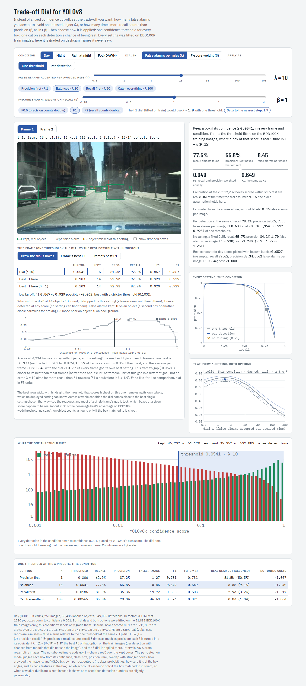
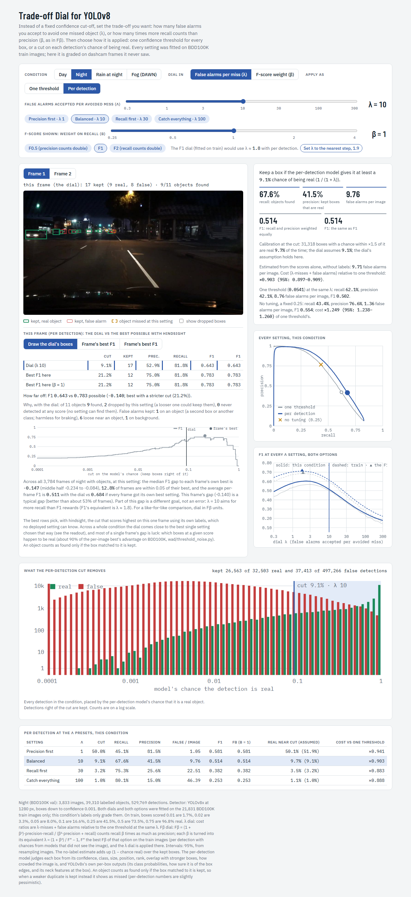
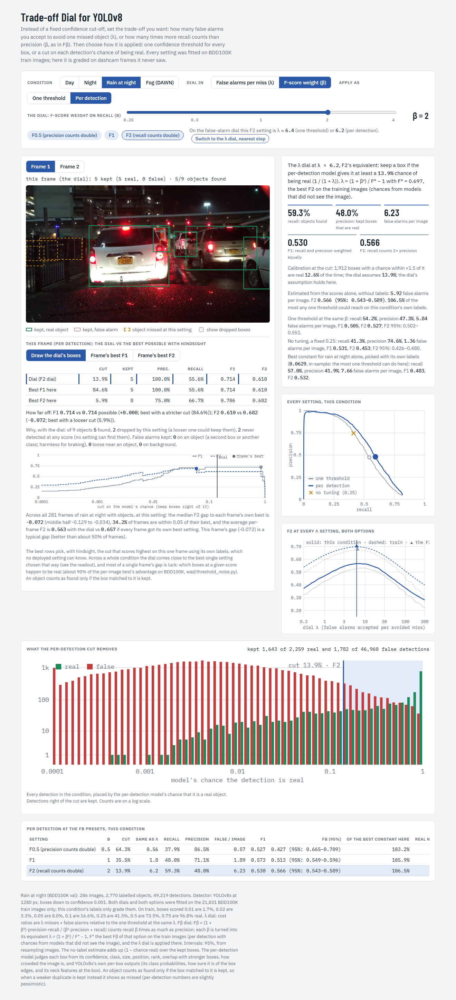
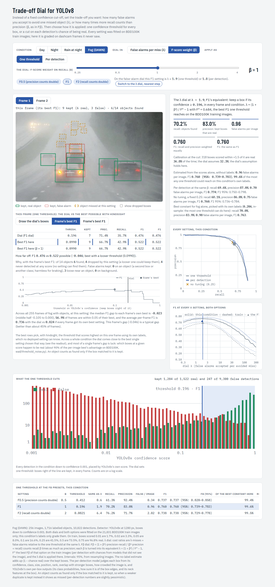

# 09 — The dial demo: what it shows and how to use it

*The page is generated by `python -m wad.dial_demo` (writes `results/threshold/dial_demo/index.html`, ~1.2 MB,
self-contained). The copy in this folder, `dial_demo/dial_demo.html`, is the 2026-10-22 build and opens offline
in any browser. A published copy (artifact v10, private until you share it) is at
https://claude.ai/artifact/GCPc1S9uN8MLuCBcFNdNcf. Every number on the page comes from the same functions that
write `results/threshold/per_detection_yolo_eval.csv` and `fbeta_eval.csv`. All preset rows were checked
against those CSVs, and the frame scorecard against brute force (NOTES "The trade-off dial in action").*

> **In short.** The page makes the method tangible:
> - Pick a condition (BDD100K day, night, rain at night, or DAWN fog).
> - Turn the dial in λ (false alarms per avoided miss) or in Fβ units.
> - Apply it as one threshold or per detection.
> - See what is kept on two real frames and what that setting costs across the whole condition.
> - The frame scorecard compares the dial on the selected frame with the best that frame could have had in
>   hindsight.

---

## 1. Opening it

- Double-click `dial_demo/dial_demo.html`. It needs no server and no internet, and works in any browser.
- To rebuild it from the harness:

  ```
  python -m wad.dial_demo
  ```

  This takes 2–10 minutes and needs the per-detection model, `weights/per_detection_yolo.joblib`, plus the
  caches.
- The standalone file includes a `[hidden]` CSS rule that a host page would normally inject. Without it, the
  β view showed the λ row (fixed 2026-10-22).

## 2. The controls

| control | options | what it does |
|---|---|---|
| condition | Day · Night · Rain at night · Fog (DAWN) | BDD100K val: day 4,257 frames, night 3,833, rain at night 286; DAWN fog: 256 frames (clean labels) |
| dial in | false alarms per miss (λ) · F-score weight (β) | λ slider 0.3–300 on a log scale. Presets: precision first λ 1 · balanced λ 10 · recall first λ 30 · catch everything λ 100. β slider 0.25–4, presets F0.5 · F1 · F2; β is converted to its equivalent λ (doc 08 §7) |
| apply as | one threshold · per detection | option A: s ≥ τ(λ). Option B: p(d) ≥ 1/(1+λ) with model 2 |
| frame | Frame 1 · Frame 2 | two example frames per condition |
| show dropped boxes | checkbox | also draws the boxes the setting drops |
| draw (scorecard) | the dial's boxes · frame's best F1 · frame's best Fβ | redraws the frame with the hindsight-best choice |

## 3. What each panel shows

1. **The frame.**
   - Kept boxes on real objects are green, kept false alarms red.
   - Objects missed at this setting are orange dashed. These include objects no box found at any score.
2. **Readout (right).**
   - The rule in words, e.g. "keep a box if its confidence ≥ 0.0541".
   - Recall, precision and false alarms per image; F1 and Fβ.
   - **Calibration at the cut:** how many boxes near the cut are actually real, against what the dial assumes.
     The page flags a mismatch above 25%; DAWN fog is the known case.
   - The **label-free estimate** of false alarms.
   - The other option at the same λ, with its cost ratio and 95% interval.
   - No tuning (0.25), and the condition's in-sample best constant.
3. **Every setting, this condition.** The precision–recall curves of both options, the no-tuning point, and
   the current setting.
4. **F at every λ.** F1 or Fβ against the dial for both options, on this condition (solid) and on train
   (dashed); the train peak marks the F-dial.
5. **What the one threshold (or the per-detection cut) removes.** A histogram of all detections in the
   condition by score (or chance), real against false, on a log scale, with the cut drawn in.
6. **Preset table.** The four λ presets (or three β presets) with threshold or cut, recall, precision,
   FA/image, F1, Fβ, calibration near the cut, and the cost of no tuning.
7. **Frame scorecard** (added 2026-10-15). For the selected frame:
   - the dial's precision, recall, F1 and Fβ, against the frame's own **hindsight best** (the best
     "keep value ≥ t" rule using the frame's labels);
   - the gap ("how far off") and why: objects dropped by this setting vs never detected at any score; false
     alarms on an object, loose, or on background;
   - the frame's F curve across thresholds;
   - how the gap compares with every frame of the condition (`frame_gaps`).

**Reading the scorecard honestly.** Hindsight-best is not achievable: it uses the frame's labels. Most of a
single frame's gap is luck, meaning which boxes at a given score happen to be real (doc 07 #5). At the F1 dial,
the median per-frame F1 gap, one threshold / per detection, is:

| condition | median gap | frames within 0.05 of their best | mean per-frame F1 (dial vs hindsight) |
|---|---|---|---|
| day | −0.046 / −0.042 | 53% / 57% | 0.736 / 0.763 vs 0.798 / 0.818 |
| night | −0.075 / −0.069 | 35% / 38% | |
| rain at night | −0.073 / −0.083 | 34% / 36% | |
| DAWN fog | −0.023 / −0.025 | 57% / 58% | |

At λ = 10 the F1 gaps look about twice as large, but that is a different goal: λ = 10 aims for more recall than
F1 rewards (F1 ≈ λ 1.9).

## 4. Screenshots (four states)


*λ = 10, one threshold, BDD100K day. Threshold 0.0541: recall 77.5%, precision 55.8%, 8.45 false alarms per
image, with calibration at the cut as assumed (8.8% vs 9.1%). The frame scorecard shows this frame at F1 0.867
against 0.929 possible with hindsight.*


*λ = 10, per detection, BDD100K night. The per-detection cut (9.1% chance) against the one threshold at the
same λ, with its cost ratio and 95% interval.*


*F2 (β = 2) per detection, BDD100K rain at night. β = 2 maps to λ = 6.2 (cut 13.9%): recall 59.3%, precision
48.0%, 6.23 false alarms per image, F2 0.566 (0.543–0.589), 106.5% of the best constant any one threshold could
reach in-sample.*


*F1 dial, one threshold, DAWN fog, with the frame's hindsight-best F1 boxes drawn: what the best possible
single cut for this one frame would keep.*

## 5. Using it in the talk (30-second live demo)

1. Open **Rain at night**, λ = 1 ("precision first"). Point out few false alarms, but many orange dashed
   misses.
2. Drag to λ = 30. Misses drop and red boxes appear: that is the price, now chosen rather than imposed.
3. Switch **apply as → per detection**. At the same λ, more found and fewer false; the cost ratio below 1 is the
   method's gain.
4. Switch **dial in → β**, pick F2. The same dial, in F-score units.

If projecting a browser is awkward, use the four screenshots as backup slide B6.

## 6. Where the numbers come from

| on the page | computed by | file |
|---|---|---|
| presets, cost ratios, intervals | `wad.per_detection.grade` | `results/threshold/per_detection_yolo_eval.csv` |
| one threshold per λ | `wad.one_threshold` exact switch points | `weights/one_threshold_table.csv` (258 rows) |
| Fβ → λ | `wad.fbeta_dial` | `weights/fbeta_table.csv` |
| calibration at the cut | per-condition share real within ×1.5 of the cut | `per_detection_yolo_cuts.csv` (presets) |
| label-free false alarms | Σ(1 − chance) over kept boxes | `label_free_fp.csv` |
| frame scorecard, condition gaps | `frame_gaps` in `wad/dial_demo.py` | embedded in the page |
