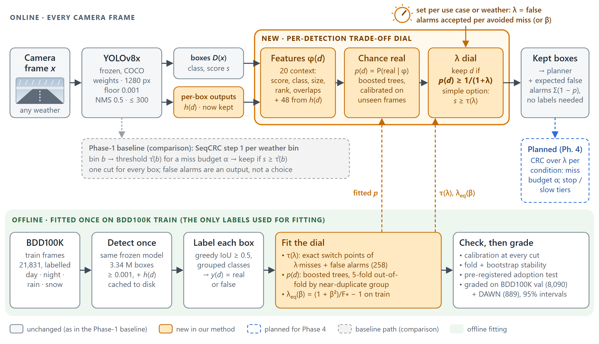
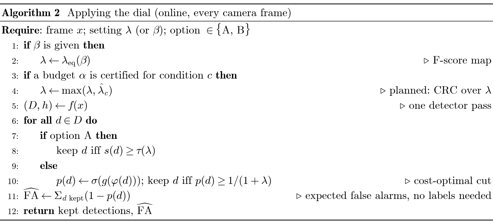
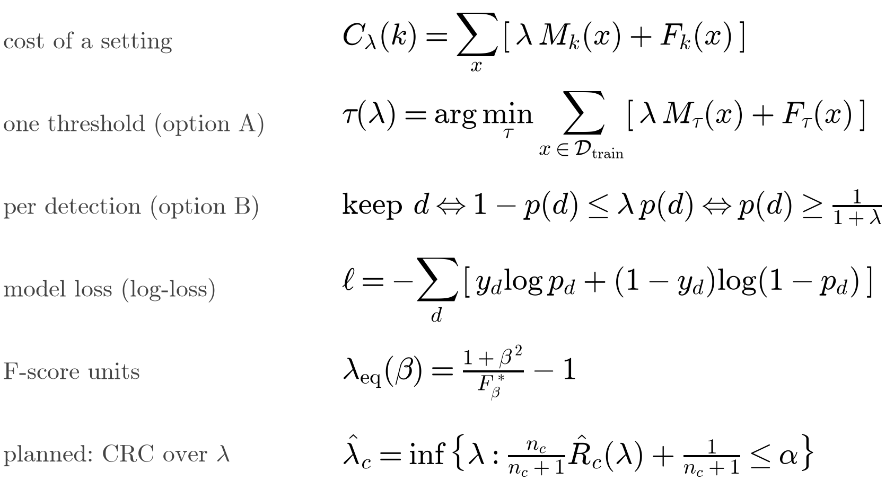

# 10 — Phase 3 kit: the Methodology section and the 5–7 slide talk

*Built 2026-10-22 for the Phase 3 assignment: update the Overleaf Methodology section, and give a 5–7 minute
talk with 5–7 slides plus Q&A. Phase 4 (full experiments) is due Nov 5. Every number here comes from the
result files, through docs 02, 05 and 08. The Overleaf text is in `latex/`, the slide figures in
`figures/phase3/`, and the slide-by-slide script in `slides/outline.md`.*

> **In short.**
> - **Baseline:** SeqCRC step 1, a conformal confidence threshold, calibrated per weather bin. It was
>   reproduced in Phase 1 and holds a 20% miss budget in every bin, but its false alarms are an
>   output rather than a choice: 1.6 per image in DAWN snow, 117 in BDD100K rain at night.
> - **Method:** a calibrated trade-off dial. Each detection gets a calibrated chance p(d) of being real,
>   computed from the frozen YOLOv8x's own outputs. A box is kept iff p(d) ≥ 1/(1+λ), where λ is the
>   number of false alarms accepted per avoided miss. Fβ maps onto λ, and so will a miss budget α
>   (CRC over λ, Phase 4).
> - **Diagram and pseudocode** are the same files in Overleaf and on the slides:
>   - diagram: `figures/phase3/architecture.svg` (slides) and `.pdf` (Overleaf);
>   - pseudocode: Algorithms 1–2 in `latex/methodology.tex`, drawn line for line in
>     `figures/phase3/pseudocode_alg*.svg`.
> - Everything compiles. `latex/methodology_standalone.pdf` is the test build, with no warnings
>   beyond a harmless encoding note in `algorithm.sty`.

---

## 1. What is in the kit

| file | what it is | use it for |
|---|---|---|
| `latex/methodology.tex` | the full Methodology section, about 5 pages: baseline, idea, changes table, architecture figure, equations (1)–(6), Algorithms 1–2, design-choices table, experiment plan | paste into Overleaf, or `\input{methodology}` |
| `latex/preamble_additions.tex` | two lines, `algorithm` and `algpseudocode[noend]` | add to the Overleaf preamble |
| `latex/refs_methodology.bib` | 9 new BibTeX entries plus 2 optional ones: Elkan 2001, Zhao 2013, Lipton 2014, Guo 2017, Friedman 2001, LightGBM, scikit-learn, GFL/DFL, Efron–Tibshirani | append to `refs.bib` |
| `latex/methodology_standalone.tex` / `.pdf` | compile test with the literature review's exact preamble | check before uploading |
| `latex/build_slide_algorithms.py` → `algorithms_for_slides.tex/.pdf` | the algorithm environments copied verbatim from `methodology.tex`, one per small page | pixel-exact pseudocode, if you prefer it over the PNGs |
| `figures/phase3/architecture.svg` (+ `.pdf`, `.png`, `make_architecture.py`) | the pipeline diagram; the generator checks that every text line fits | **slide 4** (SVG) and the Overleaf figure (PDF) |
| `figures/phase3/pseudocode_alg1.svg`, `pseudocode_alg2.svg`, `pseudocode_equations.svg` (each also `.png`; + `make_pseudocode.py`) | Algorithms 1–2 and the key equations, line for line as in `methodology.tex` | **slide 5** |
| `figures/phase3/baseline_price.svg` (also `.png`; + `make_baseline_price.py`) | false alarms per image that per-bin CRC needs to hold α = 0.2, per condition | **slide 2** |
| `slides/outline.md` | slide-by-slide content, visuals, timing, speaker notes, backup slides | building the deck |
| `dial_demo/` | the interactive dial page plus 4 screenshots | backup slide or live demo (doc 09) |

**Overleaf steps**
1. Upload `figures/phase3/architecture.pdf` next to `main.tex`. If it goes into a `figs/` folder, add that
   folder to `\graphicspath`.
2. Add the two lines from `preamble_additions.tex`.
3. Append `refs_methodology.bib` to `refs.bib`. Its citation keys do not clash with the 33 keys already there.
4. Replace the Methodology section with `methodology.tex`.
5. Recompile. The algorithms carry no equation numbers in their comments, so they read the same wherever the
   section lands.
6. If a slide needs a different line in the pseudocode, change `methodology.tex` first. Then change `ALG1`/`ALG2`
   in `figures/phase3/make_pseudocode.py` to match and re-run it, so the two never drift apart.

## 2. The assignment's checklist and where each item lives

| required on the slide | where it is (slide / Overleaf) | key content |
|---|---|---|
| 1. Title: project title and team members | slide 1 | "Weather Adaptive Autonomous Driving: a calibrated trade-off dial for object detection in bad weather". Nicholas Taylor and Zander Picon. CAI 6930, FGCU, Phase 3. |
| 2. Baseline recap: Phase-1 model, reproduced results, key limitation (the gap from the lit review) | slide 2 / §3.1 | SeqCRC step 1 per weather bin. Reproduced: the guarantee held 5/5 on COCO; on DAWN with YOLOv8x, α = 0.2 holds in every bin (0.188–0.194) at 1.6–6.2 FPPI; global fails in fog (0.251). Gap: false alarms unpriced (to 117/image at night); one cut for every box; needs the weather label. |
| 3. Proposed method: core idea (1–2 sentences) and exactly what changes or is added | slide 3 / §3.2 and Table 1 | §3 and §4 below |
| 4. Architecture diagram, input to output, new parts highlighted, **.svg** | slide 4 / Fig. 1 | `architecture.svg`: orange = new, grey = unchanged, grey dashed = baseline lane, blue dashed = planned |
| 5. Algorithm and pseudocode, main steps, key equations or losses | slide 5 / §3.4, Eqs. (2)–(6), Algs. 1–2 | `pseudocode_alg2` (online) plus `pseudocode_equations`; Alg. 1 (offline fitting) as backup or a second column |
| 6. Design choices, why, alternatives considered | slide 6 / §3.5 and Table 2 | §7 below |
| 7. Experiment plan: data and splits, metrics and baselines, ablations, compute (NRP A100) | slide 7 / §3.6 | §8 below |
| Tip: diagrams, not paragraphs | all slides | one figure per slide, at most 3 bullets |
| Tip: diagram and pseudocode identical to Overleaf | slides 4–5 | same SVG/PDF source; pseudocode generated from the same lines |

## 3. The core idea, in 1–2 sentences (pick one)

- **Technical:** *Instead of one confidence threshold per weather bin, each detection receives a calibrated
  probability of being real, computed from the frozen detector's own per-box outputs, and is kept iff that
  probability is at least 1/(1+λ). λ, the false alarms accepted per avoided miss, is a stated, use-case-specific
  trade-off.*
- **Plain:** *We turn the detector's arbitrary confidence cut-off into a dial with real units: how many false
  alarms are you willing to accept to avoid missing one object. Each setting is the best possible rule for
  that trade-off, and its behaviour is measured on data it never saw.*
- **One-liner for the title slide:** *A calibrated trade-off dial for camera object detection in bad weather.*

## 4. What changes vs the baseline (slide 3, Table 1)

| | baseline (SeqCRC step 1 per weather bin) | ours (the dial) |
|---|---|---|
| detector | YOLOv8x, frozen COCO weights, 1280 px, floor 0.001 | **unchanged** |
| decision rule | one score threshold per bin, s ≥ τ̂(b) | **replaced:** per detection, p(d) ≥ 1/(1+λ). Simple option: one threshold s ≥ τ(λ) |
| what you choose | a miss budget α; the false alarms follow | **the trade-off λ** (or β); α becomes a floor via CRC over λ (planned) |
| run-time inputs | score and weather label | score, box context and YOLOv8x's per-box outputs; **no weather label** |
| fitting | calibration half of each bin | once, on 21,831 labelled BDD100K **train** frames (3.34 M detections) |
| **added** | none | per-box feature tap h(d); feature builder φ(d) (20 + 48); calibrated gradient-boosted model; β→λ map; label-free estimate of false alarms Σ(1−p) |

**Headline evidence for slide 3** (graded on BDD100K val and DAWN, never used to fit; doc 08 §5):
- Per detection costs **0.87–0.96×** one threshold on BDD100K and **0.90–0.97×** on DAWN, in every condition and
  preset. On BDD100K every 95% interval lies below 1.
- No tuning (0.25) costs **1.24×** the dial at λ = 10 on BDD100K and 1.31× on DAWN. All BDD100K val at λ = 10:
  recall 74.4% vs 56.7%, at 8.5 vs 1.5 false alarms per image.
- F1 on all of BDD100K val: 0.701 (0.697–0.705) per detection, against 0.672 for one threshold and 0.670 for
  no tuning.

## 5. The architecture diagram (slide 4, Fig. 1)

**How to talk through it, left to right, in about 40 s**
1. A camera frame, any weather, goes through the **unchanged, frozen YOLOv8x**: one pass, floor 0.001.
2. **New:** we keep its per-box outputs h(d). These are the class probabilities, how sure each box edge is (DFL),
   the neck feature and the pyramid level.
3. **New:** the feature builder adds context (score, size, rank, overlaps, crowding). A calibrated
   boosted-tree model turns this into p(d), the chance that the box is real.
4. **New:** the λ dial keeps a box iff p(d) ≥ 1/(1+λ). λ comes from the use case, or from β.
5. Out come the kept boxes, plus an estimate of their false alarms that needs no labels.
6. **Offline (green band):** everything is fitted once on BDD100K train and graded on val and DAWN.
7. **Grey lane:** what the baseline does instead.
8. **Blue box:** what Phase 4 adds, CRC over λ.

**Editing:** change the text in `make_architecture.py` and re-run it. The script refuses lines that would
overflow their box. Then re-render the PDF and PNG with Edge (doc 04 §9) so Overleaf and the slide stay
identical.

## 6. Algorithm, equations and losses (slide 5, §3.4)

| eq. | formula | in words |
|---|---|---|
| (1) baseline | τ̂(b) = max{τ : n/(n+1)·R̂(τ;b) + 1/(n+1) ≤ α} | the strictest threshold whose corrected calibration miss rate stays under α |
| (2) cost | C_λ = Σ_x [λ·M(x) + F(x)] | λ false alarms are worth one miss |
| (3) option A | τ(λ) = argmin_τ Σ_train [λ·M_τ + F_τ] | the best single threshold for that trade-off, solved exactly (258 switch points) |
| (4) option B | keep d ⟺ 1 − p ≤ λp ⟺ p(d) ≥ 1/(1+λ) | keep a box when its expected false alarm costs less than its expected miss (Bayes rule; optimal if p is calibrated) |
| loss | ℓ = −Σ_d [y log p + (1−y) log(1−p)] | log-loss of the boosted trees, so p is a probability |
| (5) Fβ map | λ_eq(β) = (1+β²)/F*_β − 1 | the Fβ-optimal cut F*/(1+β²) written as a dial setting: F1 ≈ λ 1.8, F2 ≈ λ 6.2 |
| (6) planned | λ̂_c = inf{λ : n_c/(n_c+1)·R̂_c(λ) + 1/(n_c+1) ≤ α}; deploy max(λ_user, λ̂_c) | the baseline's guarantee applied to λ: a certified miss budget as a floor on caution |

Algorithm 1 (offline fitting) is `figures/phase3/pseudocode_alg1.png`. Put it in the report and in the backup
slides; slide 5 has room for Algorithm 2 plus the equations.

## 7. Design choices, with the evidence (slide 6, Table 2)

| choice | why | alternatives considered → what happened | doc |
|---|---|---|---|
| **frozen detector, post-hoc decision** | calibration stays valid; one detector run serves every λ; no retraining per condition | DA-Detect domain adaptation → 20.41 vs 21.44 AP@50 on real DAWN fog (difference −1.03, CI −4.46 to +1.68); fine-tuning → would invalidate every fitted threshold and probability | 02 |
| **trade-off as λ** (false alarms per avoided miss) | the use case sets the balance (redundant sensors → low λ; cautious driving → high λ); explicit optimal rule; β and α map onto it | fixed α only → false alarms unpriced (1.6–117 per image); maximise F1 → one fixed balance (≈ λ 1.8); FPPI cap → no handle on misses | 05, 08 |
| **decide per detection, not per image or per weather** | 87–91% of a per-image oracle's edge on BDD100K is luck (which boxes at a given score are real); the learnable signal is per box | per-image threshold from pixels (P1, P2 not met); from the confidence profile (1.005–1.017×); from YOLOv8x image features (E1–E3 not met); softmax / noisy-OR box combinations (1.02–1.32×); summed-confidence maps (worse than thresholding) | 07 |
| **one threshold kept as option A** | exact, auditable, one number per λ | per-weather thresholds → 0.98–1.03× (no gain); each condition's in-sample best is only 0–5% cheaper | 08 §3 |
| **gradient-boosted trees** | tabular features; ~11 min on CPU for 3.34 M boxes; calibrated without post-hoc scaling (ECE 0.11 points on BDD100K val) | settings and context features chosen in exploratory runs, alternatives within ~0.005 | 08 §4, §6 |
| **YOLOv8x's own per-box outputs** (model 2) | pre-registered: 0.972× (0.969–0.975) of model 1's cost on BDD100K, DAWN not worse (0.995); class probabilities carry most of the gain | context only (model 1) → adopted model 2 under 3 pre-registered criteria, all met | 08 §4 |
| **one model for every β** | theory: only the cut moves with β | dedicated β-weighted models → tie (0.997–1.001×) | 08 §7 |
| **fit on train, grade on val + DAWN** | no choice on graded data; DAWN tests transfer to real fog, rain, sand, snow | calibrate on halves of the test pool, as the baseline does → kept for the CRC-over-λ step only | 03 §8 |
| **grouped classes** (vehicle, two-wheeler, person) | car↔truck confusions are not safety misses; lowers the floor | class-aware matching (run 1) → higher floor; α = 0.1 out of reach | 05 §2 |
| **YOLOv8x @1280** | far and small objects (16–27% of BDD100K boxes per bin are under 20 px tall) | YOLOv8s @640 (α = 0.2 infeasible in every BDD100K bin); YOLOv8x @640 (better on DAWN, chosen post hoc) → ablation (d) | 05 §2 |

**Slide version (6 rows):** frozen detector · λ units · per detection · one threshold as fallback · boosted
trees on YOLO's own outputs · fit on train, grade elsewhere. Each row has one "instead of X, because Y" line.

## 8. Experiment plan for Phase 4 (slide 7, §3.6), due Nov 5

**Already done, report as is:**
- options A and B on all conditions, with presets λ = 1 / 3 / 10 / 30 / 100 and β = 0.5 / 1 / 2;
- calibration, 5-fold stability, bootstrap;
- model 1 vs model 2 (pre-registered);
- per-weather thresholds;
- dedicated β models;
- the no-label false-alarm check;
- the frame scorecard.

**Data and splits**

| set | frames | role |
|---|---|---|
| BDD100K train | 21,831 (day, night, rain, snow) | fit τ(λ), p(d), λ_eq(β); 5-fold OOF by near-duplicate group |
| BDD100K val | 8,090 in 7 bins: clear / cloudy / rain / snow by day, clear / rain / snow at night | grading only; per-condition CRC halves (200 splits) for CRC over λ |
| DAWN (clean labels) | 889: fog 256, rain 187, sand 243, snow 203 | grading only (real adverse weather, a different camera); CRC halves |
| optional | Foggy Cityscapes (3 densities), ACDC | needs an account with the data owner (the user's step); adds controlled fog density |

**Metrics**
- cost C_λ relative to one threshold, with 95% image-bootstrap intervals;
- recall, precision and false alarms per image at the presets;
- Fβ against no tuning and the best in-sample constant;
- ECE, and the share of real boxes near each cut;
- per-frame gap to the hindsight best (frame scorecard);
- for CRC over λ: held-out miss against α (share of splits above), its false-alarm price, and the smallest
  certifiable α.

**Baselines**
1. No tuning, τ = 0.25.
2. Global CRC.
3. **Per-weather CRC: the Phase-1 baseline.**
4. Option A, the one-threshold dial.
5. Model 1 (context only).
6. Reference bounds that no deployable rule reaches: the in-sample best constant, and the per-frame hindsight best.

**Ablations (new)**

| # | ablation | question | compute |
|---|---|---|---|
| a | retrain model 2 without each feature group (class probabilities / neck PCA / DFL / level / context) | which outputs carry the gain (complements the shuffle importance) | 5 fits × ~11 min CPU; 5-fold → NRP CPU pods |
| b | per-condition recalibration (isotonic per condition) | fixes DAWN fog's under-stated chances (17% real at the 9.1% cut)? | minutes |
| c | training-set size 25 / 50 / 100% × 3 seeds | how much data the dial needs | 9 fits |
| d | detector: YOLOv8x @640, YOLOv8s @640/@1280 | does the dial transfer across detectors and resolutions | 3 new detector + per-box passes over 30.9k frames: **NRP A100** |
| e | **CRC over λ vs CRC over τ** at α = 0.2 (and the smallest feasible α) | does the dial certify the same miss budget for fewer false alarms | minutes per condition, 200 splits |

**Compute plan**

Measured on the laptop (RTX 3050 Ti 4 GB, Ryzen 7 4800H; doc 04 §6):
- YOLOv8x @1280: 0.15–0.17 s per frame.
- Per-box output pass over 30.9k frames: ~85 min.
- Model 2 fit: ~11 min (CPU).
- Fβ dial: ~30 min.
- CRC splits: minutes.

On the NRP A100: run the detector passes for (d), and the parallel fits for (a) and (c). This is an
**estimate, not measured**: at ≥ 10× the laptop's YOLOv8x throughput, each 30.9k-frame pass takes under about
15 minutes, and the whole plan a few GPU-hours. The laptop can do everything in about a day if NRP access is
late.

**Two-week schedule**

| dates | work |
|---|---|
| Oct 23–26 | CRC over λ (e) and per-condition recalibration (b) on the laptop. Set up the NRP job (container with the pinned requirements, cached data) |
| Oct 27–30 | NRP runs: detector variants (d), learning curves (c), feature ablations (a) |
| Oct 31–Nov 3 | tables and figures through the same harness commands; pre-register (e)'s criteria before running it, as for every earlier test |
| Nov 4–5 | write the results section; final checks (`--from-cache` reproducibility, tests) |

**Risks and fallbacks**
- **NRP access slips.** Every step runs on the laptop; (d) shrinks to YOLOv8x @640 only.
- **CRC over λ is infeasible at small α.** About 11–18% of objects are never detected at any score, so report
  the smallest certifiable α as the baseline runs did.
- **DAWN fog under-calibration.** Ablation (b) addresses it. If it persists, use the conservative rule: in fog,
  use λ's one-threshold cut.

## 9. Likely questions and short answers

1. **Why not just tune the threshold per weather?** We did. One threshold per weather, fitted on that weather's
   train frames, costs 0.98–1.03× the single threshold: no gain. YOLOv8x's score means about the same thing in
   every condition. What differs is how much is recoverable.
2. **Isn't 0.25 already fine?** At λ ≈ 1.4 it is the dial's own choice. For anything more recall-oriented it is
   expensive: at λ = 10 it costs 1.24× on BDD100K and 1.31× on DAWN, and it finds 56.7% of objects where the dial
   finds 74.4%.
3. **Where is the guarantee?**
   - Today the backing is empirical: calibration error 0.11 points; near each cut, the share real matches the
     cut (BDD100K 52.1 / 25.1 / 9.6 / 3.4 / 1.1% at cuts 50 / 25 / 9.1 / 3.2 / 1.0%); fold and bootstrap
     stability; pre-registered adoption.
   - The finite-sample guarantee comes from CRC over λ (Phase 4). It is the baseline's own theorem, applied to λ.
4. **How would a car choose λ?** From its use case: redundancy (lidar or radar can veto, so lower λ), the cost of
   a phantom brake, or how cautiously it should drive in this weather. Two other routes: an F-score preference
   (β → λ_eq), or a certified miss budget per condition (CRC over λ sets a floor).
5. **Does it work in fog?** Yes, with a caveat. DAWN fog at λ = 10 costs 0.956× one threshold (0.921–0.989), with
   precision 71.6% vs 65.3% at the same recall. The model under-states chances in fog (17% real at the 9.1% cut),
   so it leans to precision. Per-condition recalibration is ablation (b).
6. **Why boosted trees and not a network?** The inputs are tabular. It trains in ~11 min on CPU, is calibrated
   without post-processing, and alternatives scored within ~0.005. Cost at run time is negligible next to the
   detector; this will be timed in Phase 4.
7. **Is BDD100K → DAWN transfer valid?** DAWN is graded only, never fitted. The cost ratios hold
   (0.895–0.966×); calibration is looser (ECE about 1 point vs 0.1).
8. **Why not per-image adaptivity?** Pre-registered per-image models failed three times. A null simulation shows
   87–91% of the oracle's per-image edge is luck: which boxes at a given score happen to be real.
9. **Video and dependence?** CRC assumes exchangeable frames within a condition; our frames are single images.
   Video needs a non-exchangeable variant (Farinhas et al., ICLR 2024; in `refs_litreview.bib`).
10. **Why YOLOv8x?** It is SeqCRC's own detector and our baseline's. Option A works for any detector. Option B
    needs per-box outputs, which most one-stage detectors expose. Ablation (d) tests transfer.
11. **What does a frame look like?** Show the dial page (doc 09). On BDD100K day at the F1 dial, the median frame
    is 0.04–0.05 F1 below its own hindsight best. At night the gap is 0.07–0.08, mostly luck.
12. **What did you not solve?**
    - Weather estimators: v1–v3 and O3 did not isolate fog or rain at night (doc 06).
    - DA-Detect showed no gain on real fog.
    - Per-class budgets (O4) are a preview only.
    - The decision layer (stop/slow tiers) is specified, not built.

## 10. Timing for a 6-minute talk

| slide | time | cumulative |
|---|---|---|
| 1 title | 0:15 | 0:15 |
| 2 baseline recap | 1:00 | 1:15 |
| 3 proposed method | 1:00 | 2:15 |
| 4 architecture | 1:00 | 3:15 |
| 5 algorithm | 1:00 | 4:15 |
| 6 design choices | 0:50 | 5:05 |
| 7 experiment plan | 0:55 | 6:00 |
