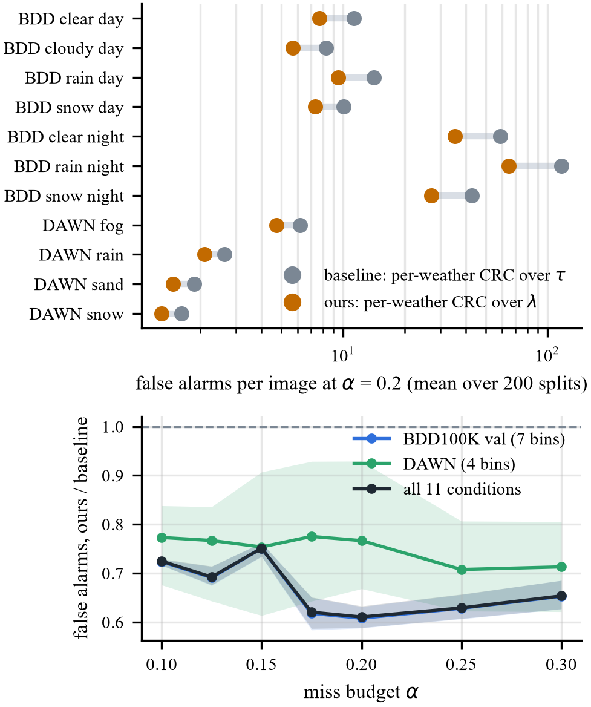
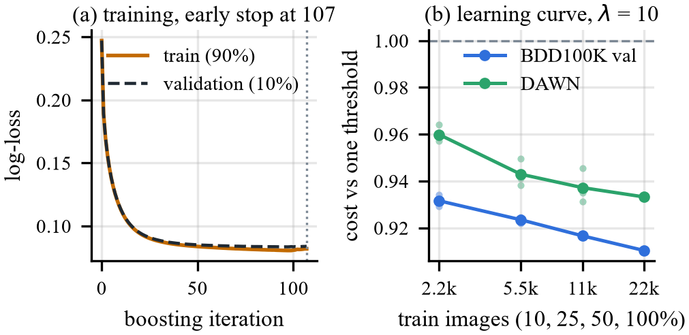
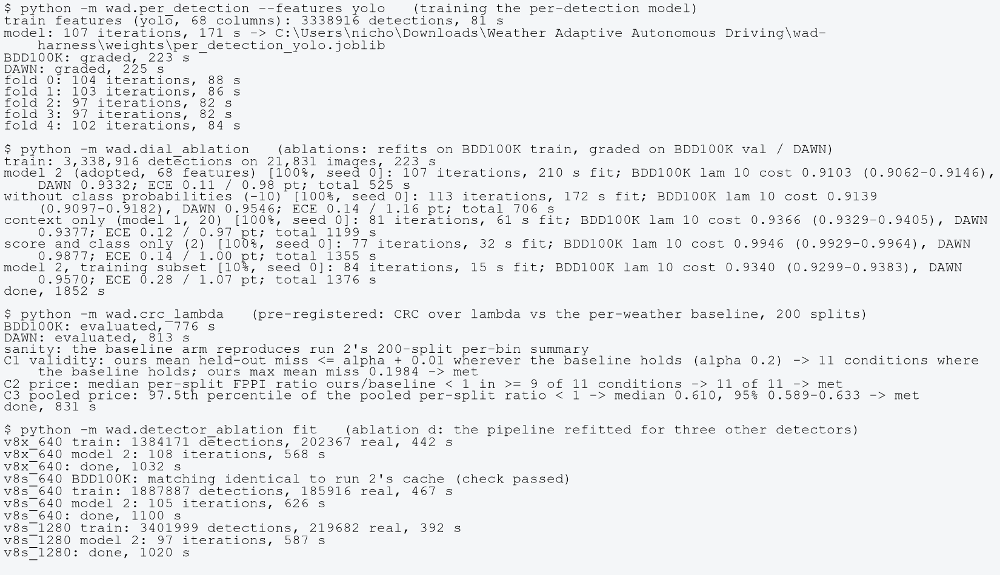
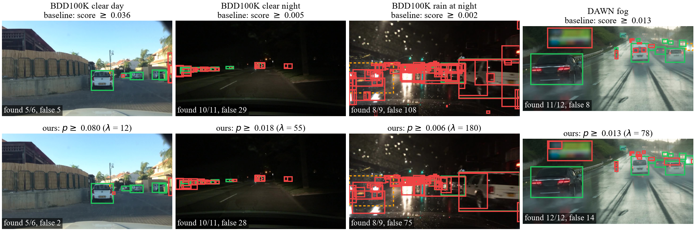

# 14 — Phase 4: experiments, dataset and results

*Phase 4 (due Thu Nov 5, 4:45 PM) asks for Dataset, Experimental Setup and Results sections showing the method
trained and tested against the Phase 1 baseline on the same test data. Everything here was run on 2026-11-03.*

*Sources:*
- *The main comparison was pre-registered in `PREREG_crc_lambda.md` and committed before running; its results are
  in `results/crc_lambda/`.*
- *The ablations are in `results/ablation/`; the dial's graded results in `results/threshold/per_detection_yolo_*.csv`.*
- *The paper's tables and figures are made by `python -m wad.phase4_paper` (`Docs/latex/phase4/`). The updated
  Overleaf project is in `..\overleaf_phase4\`, outside the git repo.*

> **In short.**
> - **What was trained, and where.** The trained component is the dial's per-detection model: gradient-boosted
>   trees on 68 YOLOv8x outputs per box. It was trained on 21,831 BDD100K train frames (3.34 M detections), a
>   weather-stratified 31% of BDD100K train, because of compute limits. It was tested on all 8,090 BDD100K val
>   frames in 7 weather bins and on 889 DAWN images. The detector stays frozen by design.
> - **Main result (pre-registered, all three criteria met).** We compared the method with the baseline at the same
>   20% miss budget, certified per weather bin on the same 200 calibration/test splits:
>   - Ours is CRC over the dial λ; the baseline is per-weather CRC over the score.
>   - Both hold the budget in all 11 conditions.
>   - Ours needs **0.61× the false alarms** (95% 0.59–0.63): pooled, 19.3 instead of 31.7 per image at the
>     same recall.
>   - In rain at night it is 65 instead of 117.
> - **Fixed dial (λ = 10):** per detection costs 0.90–0.96× the one threshold fitted on train (0.91–0.98× even the
>   best threshold picked in hindsight on each test condition), and the default 0.25 costs 1.18–1.31×.
> - **Training evidence:** the log-loss curves of the model (early stop at iteration 107), the learning curve, and
>   the run logs.
> - **Qualitative:** baseline vs ours on held-out frames chosen by a fixed rule.
> - **Ablations:** feature groups and training-set size; per-condition recalibration (helps in DAWN fog and sand
>   only with labelled frames from that camera); other detectors and resolutions (both results transfer) (§6).

---

## 1. What the assignment asks, and where it is answered

| requirement | answer | in the paper (`overleaf_phase4/sections/experiments.tex`) |
|---|---|---|
| train and test on the full dataset, or at least a mini set, with a clear split; say which and why | trained on a 21,831-frame weather-stratified subset (31%) of BDD100K train because of compute and storage limits; tested on the full BDD100K val in 7 weather bins (8,090) and DAWN (889) | §V-A "Training subset, and why" and "Splits" |
| dataset: name, source, size, splits with counts, sensors, preprocessing, how the subset was chosen | Table VI (data) + text | §V-A |
| setup: hardware, training time, framework and versions, hyperparameters, metrics and why | laptop RTX 3050 Ti; 90 s fit; scikit-learn 1.9.1 etc.; GBDT settings; metrics and why | §V-B |
| a table comparing method vs baseline on the same test data | Table VII (CRC over λ vs per-weather CRC, α = 0.2, 11 conditions) and Table IX (dial at λ = 10 vs default and one threshold) | §V-C, §V-D |
| training evidence: a loss curve or log | Fig. `fig_p4_training` (log-loss per iteration, learning curve); Fig. `fig_p4_logs` (log excerpts) | §V-E |
| a qualitative figure | Fig. `fig_p4_qualitative` (4 conditions × baseline / ours) | §V-F |
| discussion: what worked, what didn't, why | | §V-I |
| ablation (optional) | all five planned ablations: Table `tab:ablation` (feature groups, training-set size), Table `tab:recal` (per-condition recalibration), Table `tab:detectors` (YOLOv8x @640, YOLOv8s @640 / @1280), and the CRC comparison itself (e) | §V-G |
| GitHub repo with training and evaluation code; logs and checkpoints | https://github.com/Nicholas55555/wad-harness, with `checkpoints/`, `logs/` and `results/*/*.log` | text box (§8) |

## 2. Data and splits

| set | role | frames | objects | YOLOv8x detections (≥ 0.001) | frames per condition |
|---|---|---|---|---|---|
| BDD100K train (subset) | fit | 21,831 | 261,699 | 3,338,916 | clear 4,500, cloudy 1,500, rain 2,532, snow 2,873, fog 130, dawn/dusk 1,996; night: clear 4,300, rain 2,000, snow 2,000 |
| BDD100K val | test | 8,090 | 97,745 | 1,178,828 | clear 1,764, cloudy 1,676, rain 395, snow 422; night: clear 3,274, rain 286, snow 273 |
| DAWN (clean labels) | test | 889 | 6,952 | 49,814 | fog 256, rain 187, sand 243, snow 203 |

**How the train subset was chosen (`PREREG_threshold.md`):**
- every train frame already used by the O3 and visibility work;
- plus a stratified draw (seed 3) of clear night 4,000, rainy night 1,950, snowy night 1,950 and dawn/dusk 2,000
  frames, all foggy frames, and the rest of the rainy and snowy daytime frames.

The frames were read out of the official 5.7 GB archive with HTTP range requests.

**Why a subset:**
- every frame costs a YOLOv8x @1280 pass plus a per-box output pass, about 0.3 s per frame together on the 4 GB
  GPU;
- the per-box tensors for this subset alone are 2.9 GB.

**Splits:**
- Fitting uses train only. Early stopping uses a random 10% of the train detections. The 5-fold out-of-fold
  checks use folds by near-duplicate group.
- The CRC comparison uses run 2's 200 calibration/test halves of each test bin. They are stratified, keep
  near-duplicate groups together, and have 4,487 calibration frames per split in total.

**Preprocessing (doc 03):**
- six classes, with rider mapped to person; traffic signs and lights, trains and zero-area boxes dropped;
- EXIF orientation applied;
- YOLOv8x letterbox at 1280;
- grouped matching at IoU 0.5.

## 3. Setup

| item | value |
|---|---|
| hardware | laptop: RTX 3050 Ti Laptop GPU 4 GB, Ryzen 7 4800H (8 cores), 31.4 GB RAM; NRP not needed |
| GPU time (frozen detector only) | train detection 55 min (3,322 s), train per-box outputs 54 min (3,265 s), BDD100K val ≈ 20 + 21 min |
| training time | features 81 s; fit 90 s (107 iterations); full run with grading and 5 folds 654 s |
| CRC comparison | 13 min on one CPU core (BDD100K 687 s) |
| software | Python 3.11.15, PyTorch 2.14.1+cu126, Ultralytics 8.4.171, scikit-learn 1.9.1, NumPy 2.4.6, pandas 3.0.6 |
| detector | YOLOv8x COCO, 1280 px, batch 1, floor 0.001, NMS 0.5, ≤ 300 boxes (frozen) |
| model | `HistGradientBoostingClassifier`: log-loss, learning rate 0.1, 63 leaves, ≤ 400 iterations, early stopping on 10% (patience 10), seed 0; full-batch (no batch size); 68 features, neck PCA-32 fitted on 200k train detections |
| CRC | 200-point grid; α ∈ {0.10, 0.125, 0.15, 0.175, 0.20, 0.25, 0.30}; primary 0.2 |
| metrics | held-out image miss vs α (the certified quantity; misses are the safety error); false alarms per image (the price: phantom braking); recall and precision; cost C_λ vs one threshold with 95% image bootstrap; ECE (the 1/(1+λ) rule needs calibration). No mAP: it hides the operating point |

## 4. Main result: CRC over λ vs the per-weather baseline (pre-registered)

**Sanity check first.** The baseline arm reproduced run 2's 200-split per-bin results exactly; the run aborts
otherwise.

**Criteria:**

| criterion | value | verdict |
|---|---|---|
| C1 validity: ours holds α wherever the baseline does | baseline holds in all 11; ours' max mean miss 0.198 | met |
| C2 price: median FA ratio < 1 in ≥ 9 of 11 conditions | 11 of 11 | met |
| C3 pooled: 97.5th percentile of the pooled ratio < 1 | 0.610 (0.589–0.633) | met |

**Results at α = 0.2.** Each cell is held-out miss (share of splits above α) / recall / precision / false alarms per
image.

| condition | baseline: CRC over τ | ours: CRC over λ | λ̂ | FA ratio (95%) |
|---|---|---|---|---|
| BDD clear day | 0.198 (37%) / 78.7% / 48.6% / 11.36 | 0.198 (40%) / 78.8% / 58.3% / 7.66 | 11.0 | 0.68 (0.62–0.72) |
| BDD cloudy day | 0.198 (47%) / 78.0% / 57.4% / 8.29 | 0.198 (37%) / 78.1% / 66.3% / 5.67 | 6.9 | 0.69 (0.64–0.72) |
| BDD rain day | 0.198 (48%) / 79.1% / 41.3% / 14.16 | 0.198 (46%) / 79.3% / 51.2% / 9.48 | 12.6 | 0.67 (0.60–0.76) |
| BDD snow day | 0.196 (45%) / 79.1% / 51.0% / 10.08 | 0.197 (40%) / 79.5% / 59.0% / 7.34 | 9.2 | 0.73 (0.64–0.84) |
| BDD clear night | 0.198 (42%) / 78.6% / 12.1% / 58.89 | 0.198 (44%) / 78.6% / 18.7% / 35.33 | 62.8 | 0.60 (0.58–0.63) |
| BDD rain night | 0.195 (38%) / 78.9% / 6.3% / 117.14 | 0.196 (40%) / 78.6% / 10.7% / 64.87 | 139.8 | 0.55 (0.48–0.67) |
| BDD snow night | 0.192 (34%) / 79.5% / 15.7% / 42.70 | 0.192 (36%) / 79.3% / 22.5% / 27.15 | 42.8 | 0.64 (0.54–0.77) |
| DAWN fog | 0.191 (42%) / 82.3% / 50.7% / 6.16 | 0.191 (40%) / 82.2% / 57.6% / 4.72 | 21.5 | 0.73 (0.57–1.01) |
| DAWN rain | 0.188 (36%) / 79.1% / 71.4% / 2.63 | 0.188 (36%) / 79.4% / 75.6% / 2.10 | 2.6 | 0.82 (0.62–0.99) |
| DAWN sand | 0.194 (40%) / 79.4% / 75.4% / 1.88 | 0.194 (42%) / 79.9% / 79.5% / 1.48 | 3.4 | 0.81 (0.60–0.98) |
| DAWN snow | 0.192 (40%) / 70.8% / 81.6% / 1.63 | 0.194 (40%) / 71.5% / 85.0% / 1.30 | 1.2 | 0.79 (0.63–1.01) |
| **pooled, all 11** | | | | **0.61 (0.59–0.63)** |

**Also found:**
- **Every budget:** the gain holds at every α from 0.10 to 0.30 (pooled 0.61–0.75).
- **The global variant** (one fit pooled over bins) fails at night and in fog for both rules, as in run 2. Ours
  again needs 0.60× the false alarms.
- **The smallest certifiable α is unchanged** (0.075–0.174 for both). The floor is set by objects the detector
  never proposes. α = 0.15 cannot be certified at clear or rain night by either rule.

## 5. The dial at a fixed setting (λ = 10), training evidence, qualitative

**Dial at λ = 10.** Each cell is recall % / precision % / false alarms per image.

| condition | no tuning 0.25 | cost | one threshold | per detection | cost (95%) |
|---|---|---|---|---|---|
| BDD100K val, all | 56.7 / 81.7 / 1.54 | 1.24 | 71.3 / 50.1 / 8.59 | 74.4 / 51.4 / 8.49 | 0.910 (0.906–0.915) |
| day | 65.7 / 84.1 / 1.70 | 1.24 | 77.5 / 55.7 / 8.45 | 79.1 / 59.6 / 7.35 | 0.918 (0.912–0.923) |
| night | 43.4 / 76.6 / 1.36 | 1.25 | 62.1 / 42.1 / 8.76 | 67.6 / 41.5 / 9.76 | 0.903 (0.897–0.909) |
| rain at night | 41.3 / 74.6 / 1.36 | 1.18 | 58.4 / 38.7 / 8.96 | 63.4 / 38.6 / 9.78 | 0.918 (0.897–0.941) |
| DAWN, all | 72.1 / 82.9 / 1.16 | 1.31 | 82.3 / 62.9 / 3.80 | 83.1 / 66.6 / 3.27 | 0.933 (0.912–0.954) |
| DAWN fog | 68.1 / 85.9 / 0.75 | 1.29 | 78.6 / 65.3 / 2.80 | 78.6 / 71.6 / 2.09 | 0.956 (0.921–0.989) |

**Reference bounds.** These are the plan's baselines 6, and no deployable rule reaches them. All numbers are at
λ = 10, relative to one threshold.
- **Best single threshold chosen in hindsight on each test condition** (in-sample): 0.97–1.00×. Per detection
  costs 0.91–0.98× even this bound: 0.912 on BDD100K val, 0.983 in DAWN fog.
- **A threshold chosen for each frame in hindsight:** 0.83× on BDD100K val and 0.71× on DAWN. Most of that is luck.
  - Under a null that redraws which boxes are real from score and class alone, the same oracle reaches 0.85× and
    0.78×.
  - So a per-frame threshold could learn at most 0.019 (BDD100K) and 0.073 (DAWN) of one threshold's cost.
  - Per detection gains 0.090 and 0.067.
  - Sources: `results/threshold/one_threshold_eval.csv` and `noise_floor.csv`.

**Training evidence.** Train and validation log-loss reach their minimum at iteration 97 (0.081 / 0.083), and
early stopping ends training at 107. The learning curve and log excerpts are in the figures below.

**Qualitative examples.** Held-out frames at α = 0.2, chosen by a fixed rule: the first frame by image id with 6–15
objects in each condition's test half of split 0.
- At night and in rain at night, both rules find the same objects; ours keeps fewer false alarms (108 → 75 on the
  rain-night frame).
- On the clear-day frame, ours drops 3 of the baseline's 5 false alarms.
- The DAWN fog frame shows the trade the other way: ours finds 12/12 objects against 11/12, with 14 false alarms
  against 8.

## 6. Ablations (exploratory)

The model was refitted with each part of its input removed, and on smaller training subsets. The run is
`python -m wad.dial_ablation`, 31 min; results are in `results/ablation/dial_ablation.md`. The full refit reproduces
the adopted model exactly (identical probabilities). Each cell is the cost at λ = 10 relative to one threshold
(95%).

| variant | features | BDD100K val | BDD100K night | DAWN | ECE BDD / DAWN (pt) |
|---|---|---|---|---|---|
| model 2, all 68 (adopted) | 68 | 0.910 (0.906–0.915) | 0.903 (0.897–0.909) | 0.933 (0.912–0.954) | 0.11 / 0.98 |
| without class probabilities | 58 | 0.914 (0.910–0.918) | 0.907 (0.901–0.913) | 0.955 (0.939–0.971) | 0.14 / 1.16 |
| without box-edge DFL entropies | 63 | 0.911 (0.907–0.915) | 0.904 (0.898–0.910) | 0.933 (0.913–0.953) | 0.13 / 0.99 |
| without neck components | 36 | 0.920 (0.916–0.924) | 0.918 (0.912–0.923) | 0.916 (0.891–0.940) | 0.11 / 0.83 |
| without pyramid level | 67 | 0.910 (0.906–0.915) | 0.905 (0.899–0.911) | 0.932 (0.911–0.954) | 0.12 / 1.01 |
| context only (model 1) | 20 | 0.937 (0.933–0.940) | 0.938 (0.933–0.944) | 0.938 (0.918–0.958) | 0.12 / 0.97 |
| per-box outputs only | 48 | 0.934 (0.930–0.938) | 0.929 (0.923–0.934) | 0.984 (0.969–1.000) | 0.11 / 1.15 |
| score and class only | 2 | 0.995 (0.993–0.996) | 0.995 (0.992–0.997) | 0.988 (0.981–0.994) | 0.14 / 1.00 |
| 10% of train images (3 seeds) | 68 | 0.932 ± 0.002 | 0.929 ± 0.001 | 0.960 ± 0.004 | 0.25 / 1.00 |
| 25% (3 seeds) | 68 | 0.923 ± 0.001 | 0.918 ± 0.002 | 0.943 ± 0.006 | 0.13 / 0.96 |
| 50% (3 seeds) | 68 | 0.917 ± 0.000 | 0.910 ± 0.001 | 0.937 ± 0.007 | 0.12 / 0.99 |

**Reading:**
- **Context and per-box outputs together carry the gain.** Score and class alone are no better than one threshold;
  either half alone reaches about 0.935.
- **The class-probability vector is what transfers to DAWN.**
- **DFL entropies and the pyramid level add nothing measurable.**
- **The neck components help on BDD100K but hurt on DAWN** (they encode BDD100K's cameras). A model for new cameras
  may be better off without them.
- **More data still helps,** and the curve has not flattened. Training on all 70,000 BDD100K train frames is the
  obvious next step.

### Ablation (b): per-condition recalibration

The question from the plan: the model under-states its chances in DAWN fog (17% of the boxes near the λ = 10 cut of
9.1% are real). Does an isotonic map p → share real, fitted per condition, fix that? The run is
`python -m wad.dial_recalibration`, 13 min on the CPU, on run 2's 200 calibration/test splits. Results are in
`results/ablation/dial_recalibration.md`.

There are three maps, each applied before the rule p ≥ 1/(1+λ) on the test half:
- **condition:** fitted on that condition's calibration half;
- **pooled:** fitted on the whole dataset's calibration half;
- **train:** fitted per weather on BDD100K train's out-of-fold chances, so it uses no test-data labels.

Each cost cell is the recalibrated cost at λ = 10 divided by the raw cost: the median over 200 splits, with the 95%
interval. The last column shows the boxes near the cut, as mean chance / share real, raw → condition map.

| condition | raw / one thr. | condition map | pooled map | train map | near the cut (%) |
|---|---|---|---|---|---|
| BDD100K val, all | 0.911 | 1.002 (1.000–1.005) | 1.000 (1.000–1.004) | 1.001 (1.000–1.002) | 8.4–10.1 real in every bin |
| DAWN, all | 0.934 | 0.987 (0.968–1.022) | 0.990 (0.980–1.009) | 1.002 (0.994–1.009) | |
| DAWN fog | 0.956 | **0.964 (0.930–1.047)** | 0.970 (0.937–0.999) | 0.984 (0.967–0.999) | 9.0 / 17.0 → 9.1 / 9.1 |
| DAWN rain | 0.927 | 1.005 (0.996–1.064) | 1.023 (0.989–1.075) | 1.010 (0.992–1.023) | 9.0 / 8.0 → 9.6 / 9.7 |
| DAWN sand | 0.937 | 0.961 (0.922–1.003) | 0.969 (0.936–0.999) | 1.001 (0.995–1.003) | 8.9 / 16.1 → 9.7 / 11.0 |
| DAWN snow | 0.912 | 1.006 (0.993–1.101) | 1.008 (0.986–1.044) | 1.017 (0.998–1.035) | 9.0 / 10.7 → 8.9 / 9.4 |

**Reading:**
- **Fog is fixed.** The condition map brings the share real near the cut from 17% to 9.1%. It lowers the cost at
  λ = 10 by 3.6%, and is lower in 92% of the splits. The interval still includes 1, because a fog calibration half
  has only about 128 frames.
  - Recall goes from 78.9% to 81.3%, for 1.1 more false alarms per image.
  - Sand behaves the same way (0.961).
- **BDD100K is unchanged.** There p is already calibrated, and the maps give 0.99–1.01 in every bin and setting.
- **Maps fitted on BDD100K train do not fix fog** (0.984, still 15.7% real near the cut). The shift comes from
  DAWN's camera, not from the weather label.
- **So recalibration needs labelled frames from the new condition.** CRC over λ uses the same frames and does not
  need recalibration: its cut depends on p only through the order of the chances within a condition, and a monotone
  map keeps that order. An isotonic map can only tie neighbouring boxes.

### Ablation (d): other detectors and resolutions

The whole pipeline is rerun for YOLOv8x @640, YOLOv8s @640 and YOLOv8s @1280; only the detector changes. Each
detector gets:
- detection on the same frames;
- grouped matching;
- its per-box outputs;
- its own one threshold, model 1 and model 2, fitted on BDD100K train with the adopted settings;
- grading on BDD100K val and DAWN;
- CRC over λ vs the per-weather baseline on run 2's 200 splits.

The run is `bash scripts/run_detector_ablation.sh`:
- **GPU:** 3.7 h for the detection and per-box passes, 57–92 min per detector.
- **CPU:** 17–18 min per detector for matching, fitting, grading and CRC.

Results are in `results/ablation/detector_ablation.md`.

**Checks:**
- Every per-box pass matched every cached detection (0 rows unmatched).
- The new BDD100K matching for YOLOv8s @640 is identical to run 2's.

The table columns:
- **Objects:** the share of BDD100K val objects the detector ever proposes (score ≥ 0.001).
- **One thr. vs adopted:** that detector's one-threshold cost relative to YOLOv8x @1280's, at λ = 10.
- **Model 2 and model 1:** cost at λ = 10 relative to the detector's own one threshold.
- **CRC:** the pooled false-alarm ratio, ours / baseline, at the smallest α every condition can certify.

| detector | objects | one thr. vs adopted | model 2: BDD100K val | night | DAWN | model 1: BDD100K | CRC α | FA ratio (95%) | smallest α, BDD100K bins |
|---|---|---|---|---|---|---|---|---|---|
| YOLOv8x @1280 (adopted) | 85.6% | 1.000 | 0.910 (0.906–0.915) | 0.903 | 0.933 (0.912–0.954) | 0.937 | 0.20 | 0.61 (0.59–0.63) | 0.103–0.173 |
| YOLOv8x @640 | 76.6% | 1.062 | 0.948 (0.945–0.951) | 0.947 | 0.913 (0.892–0.933) | 0.960 | 0.25 | 0.75 (0.73–0.78) | 0.164–0.245 |
| YOLOv8s @640 | 70.0% | 1.317 | 0.956 (0.954–0.958) | 0.947 | 0.945 (0.932–0.959) | 0.963 | 0.35 | 0.70 (0.67–0.72) | 0.222–0.311 |
| YOLOv8s @1280 | 83.3% | 1.130 | 0.927 (0.924–0.931) | 0.915 | 0.951 (0.938–0.965) | 0.945 | 0.25 | 0.61 (0.59–0.64) | 0.128–0.215 |

**Reading:**
- **The per-detection gain transfers.** For every detector, per detection beats its own one threshold at every graded
  λ (1, 3, 10, 30): 0.90–0.96×, every interval below 1.
  - Model 2 is at least as good as model 1 everywhere.
  - Calibration holds: ECE 0.11–0.28 points on BDD100K val, 0.56–1.32 on DAWN.
  - The gain on BDD100K is largest at 1280 px, where there are far more weak boxes to sort: 3.3–3.4 M train
    detections against 1.4–1.9 M at 640 px.
- **CRC over λ transfers.** For every detector it keeps the miss budget wherever the baseline does, and certifies it
  with 0.61–0.75× the baseline's false alarms. The median ratio is below 1 in all 11 conditions.
- **The detector sets the floor.** Smaller or lower-resolution detectors never propose 17–30% of the BDD100K
  objects, against 14% for the adopted one.
  - So α = 0.2 can no longer be certified everywhere, whatever the keep rule.
  - The dial does not turn YOLOv8s into YOLOv8x: YOLOv8s @1280 with per detection still costs 1.05× YOLOv8x's
    one threshold.
- **Match the resolution to the objects.** DAWN's objects are twice as tall as BDD100K's: median 73 vs 37 px, and
  3% vs 24% under 20 px.
  - So on DAWN, YOLOv8x @640 is the better detector: its one threshold costs 0.91× and its per-detection rule 0.83×
    YOLOv8x @1280's one threshold.
  - The dial's gain comes on top of the right resolution.

## 7. Runtime

The per-detection rule was timed per frame with `python -m wad.dial_runtime`: CPU, one process, 300 random BDD100K
val frames.
- **Per detection:** 67 ms per frame (median; p95 86 ms) for a median of 142 boxes.
  - 57 ms context features (unoptimized pandas);
  - 6 ms per-box columns;
  - 11 ms trees.
- **One threshold:** 0.3 ms.
- **Detector:** YOLOv8x takes 152 ms per frame on the GPU, and the per-box outputs come from the same pass.

The implementation adds about 45% to the detector's time; the trees alone add about 7%. The context features are
the part to vectorize.

## 8. Submitting

**Option 2 (recommended): update Overleaf.** Upload or replace these files from `..\overleaf_phase4\`:
- `main.tex` (new abstract; Experiments section included);
- `sections/experiments.tex` (new);
- `sections/tables/*.tex` (new);
- `sections/methodology.tex` and `sections/introduction.tex` (small edits);
- `figures/fig_p4_*.pdf` (new).

**Option 1:** compile on Overleaf and upload the PDF. The local preview `overleaf_phase4/main.pdf` is built with
XeTeX, so its fonts differ from Overleaf's pdfLaTeX.

**Text box:**
- Overleaf link (editor access for the instructor).
- GitHub: https://github.com/Nicholas55555/wad-harness, with training and evaluation code (`wad/per_detection.py`,
  `wad/crc_lambda.py`, `wad/dial_ablation.py`), `checkpoints/` (trained models) and logs (`results/*/*.log`,
  `logs/`).
- Phase 1 baseline reproduction: https://github.com/Nicholas55555/seqcrc-baseline.
